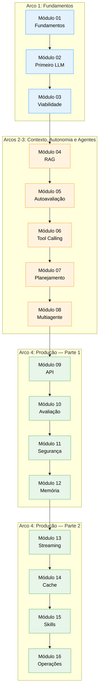

# 🎓 Projeto Final Integrador — Agente IA Completo

> **Objetivo:** Construir um sistema completo de agente IA que usa TODOS os 16 módulos.

## Visão Geral

Você vai construir **"AgentForge"** — uma plataforma completa para criar, deployar e operar agentes IA em produção.



## Arquitetura do Sistema

### Camadas

| Camada | Módulos | Responsabilidade |
| -------- | --------- | ----------------- |
| **Foundation** | 01–03 | Entender IA, avaliar viabilidade |
| **Core Agents** | 04–08 | RAG, self-eval, tool calling, planning, multi-agent |
| **Production** | 09–16 | API, evaluation, safety, memory, streaming, caching, skills, ops |

### Correspondência Módulo ↔ Componente

O projeto final integra os **16 módulos do curso**. Cada componente abaixo corresponde a um módulo específico (é o mesmo código que você já escreveu em cada `run.py`/`miniproject.md`, agora conectado):

| Módulo | Componente | Arco |
| --------- | ------------ | ------ |
| 01 — Fundamentos | `PromptAnalyzer` | Fundamentos |
| 02 — Primeiro Fluxo com LLM | `LLMClient` | Fundamentos |
| 03 — Análise de Viabilidade | `FeasibilityAnalyzer` | Fundamentos |
| 04 — Pipeline RAG | `MiniRAG` | Contexto |
| 05 — Autoavaliação | `SelfEvalGenerator` | Qualidade |
| 06 — Tool Calling | `ToolCallingSystem` | Autonomia |
| 07 — Planejamento | `Planner` | Resiliência |
| 08 — Sistema Multiagente | `MultiAgentSystem` | Autonomia |
| 09 — Produção (API) | `AgentAPI` | Produção |
| 10 — Avaliação e Testes | `EvalFramework` | Produção |
| 11 — Segurança | `SafetySystem` | Produção |
| 12 — Memória | `MemorySystem` | Produção |
| 13 — Streaming | `StreamingSystem` | Operações |
| 14 — Cache | `CacheSystem` | Operações |
| 15 — Skills | `SkillSystem` | Operações |
| 16 — Operações | `OpsSystem` | Operações |

### Componentes Principais

```python
class AgentForge:
    """Plataforma completa de agente IA."""
    
    # Fundamentos (Módulos 01–03)
    def __init__(self, config: dict):
        self.analyzer = PromptAnalyzer()           # Módulo 01
        self.feasibility = FeasibilityAnalyzer()   # Módulo 03
    
    # Núcleo (Módulos 04–08)
    def rag_engine(self):                       # Módulo 04
        return MiniRAG()
    
    def self_eval(self):                        # Módulo 05
        return SelfEvalGenerator()
    
    def tool_caller(self):                      # Módulo 06
        return ToolCallingSystem()
    
    def planner(self):                          # Módulo 07
        return Planner()
    
    def multi_agent(self):                      # Módulo 08
        return MultiAgentSystem()
    
    # Produção (Módulos 09–16)
    def api(self):                              # Módulo 09
        return AgentAPI()
    
    def evaluator(self):                        # Módulo 10
        return EvalFramework()
    
    def safety(self):                           # Módulo 11
        return SafetySystem()
    
    def memory(self):                           # Módulo 12
        return MemorySystem()
    
    def streamer(self):                         # Módulo 13
        return StreamingSystem()
    
    def cache(self):                            # Módulo 14
        return CacheSystem()
    
    def skills(self):                           # Módulo 15
        return SkillSystem()
    
    def ops(self):                              # Módulo 16
        return OpsSystem()
```

## Requisitos Obrigatórios

### 1. API REST (Módulo 09)

- Endpoint `/chat` para interagir com o agente
- Validação de input com Pydantic
- Middleware de timing
- Docker + docker-compose

### 2. RAG Pipeline (Módulo 04)

- Indexação de documentos
- Recuperação por similaridade
- Geração de resposta com contexto

### 3. Autoavaliação (Módulo 05)

- Loop generate→evaluate→refine
- Threshold configurável
- Custo acumulado das iterações

### 4. Tool Calling (Módulo 06)

- Registro dinâmico de ferramentas
- Classificação de risco
- HITL para operações críticas

### 5. Sistema Multiagente (Módulo 08)

- Supervisor roteia requests
- Especialistas fallback
- Contexto compartilhado

### 6. Segurança (Módulo 11)

- Sanitização de input/output
- Guardrails configuráveis
- Jailbreak detection

### 7. Memória (Módulo 12)

- Short-term (context window)
- Long-term (persistente por sessão)
- Decay automático

### 8. Streaming (Módulo 13)

- SSE para respostas em tempo real
- TTFT < 500ms
- Error recovery

### 9. Cache (Módulo 14)

- LRU cache com TTL
- Hit rate > 30%
- Economia de custo mensurável

### 10. Skills (Módulo 15)

- Registry de skills
- Pipeline composition
- Discovery por keyword

### 11. Operações de Produção (Módulo 16)

- Health checks
- Métricas (p50/p95/p99 latency)
- Rollback decision
- A/B testing

## Estrutura de Arquivos Esperada

```
agentforge/
├── agentforge/
│   ├── __init__.py
│   ├── analyzer.py          # Módulo 01
│   ├── feasibility.py       # Módulo 03
│   ├── rag.py               # Módulo 04
│   ├── self_eval.py         # Módulo 05
│   ├── tool_caller.py       # Módulo 06
│   ├── planner.py           # Módulo 07
│   ├── multi_agent.py       # Módulo 08
│   ├── api.py               # Módulo 09
│   ├── evaluator.py         # Módulo 10
│   ├── safety.py            # Módulo 11
│   ├── memory.py            # Módulo 12
│   ├── streaming.py         # Módulo 13
│   ├── cache.py             # Módulo 14
│   ├── skills.py            # Módulo 15
│   └── ops.py               # Módulo 16
├── tests/
│   ├── test_analyzer.py
│   ├── test_rag.py
│   └── ... (testes para cada módulo)
├── docs/
│   ├── architecture.md
│   └── api_reference.md
├── docker-compose.yml
├── Dockerfile
├── requirements.txt
└── README.md
```

## Critérios de Avaliação

| Critério | Peso | Descrição |
| ---------- | ------ | ----------- |
| **Integração dos módulos** | 30% | Todos os 16 módulos funcionando juntos |
| **Qualidade do código** | 20% | Clean code, testes, documentação |
| **API REST** | 15% | endpoints funcionais, validação, docs |
| **Safety & Evaluation** | 15% | guardrails, métricas, A/B testing |
| **Production Readiness** | 10% | Docker, health checks, monitoring |
| **Documentação** | 10% | README, architecture, API reference |

## Entrega

### Mínimo Viável (Aprovado)

- [ ] API funcional com pelo menos 3 endpoints
- [ ] RAG indexando pelo menos 1 documento
- [ ] Self-evaluation com loop mínimo
- [ ] Safety básico (sanitização de input)
- [ ] Docker compose funcionando

### Avançado (Excelência)

- [ ] Todos os 16 módulos implementados
- [ ] Testes unitários cobrindo > 80% do código
- [ ] Streaming SSE funcionando
- [ ] Caching com hit rate mensurável
- [ ] A/B testing entre modelos
- [ ] Dashboard de métricas

### Extra (Destaque)

- [ ] Deploy em cloud (AWS/GCP/Azure)
- [ ] CI/CD pipeline automatizado
- [ ] Grafana dashboard
- [ ] Auto-scaling
- [ ] Multi-language support

## Como Começar

1. **Semana 1:** Setup + Fundamentos (Módulos 01–03)
   - Criar estrutura do projeto
   - Implementar PromptAnalyzer + FeasibilityAnalyzer

2. **Semana 2-3:** Núcleo e Agentes (Módulos 04–08)
   - RAG pipeline
   - Self-evaluation loop
   - Tool calling + planning
   - Multi-agent coordination

3. **Semana 4-5:** Produção (Módulos 09–16)
   - API REST
   - Evaluation framework
   - Safety guardrails
   - Memory system
   - Streaming + caching
   - Skills registry
   - Production ops

4. **Semana 6:** Testing + Deployment
   - Testes unitários
   - Docker + deploy
   - Documentação
   - Apresentação

## Dicas

- **Comece pequeno:** Implemente um módulo por vez
- **Teste frequentemente:** Use os `exercises.py` de cada módulo (IMPLEMENTE os TODOs!)
- **Documente decisões:** Mantenha um log de arquitetura
- **Use os miniprojects:** Cada `miniproject.md` é um bloco reutilizável
- **Colabore:** Discuta design decisions com colegas

## Recursos

- [Python FastAPI Docs](https://fastapi.tiangolo.com/)
- [Docker Documentation](https://docs.docker.com/)
- [OpenAI API Reference](https://platform.openai.com/docs/api-reference)
- [LangChain Framework](https://python.langchain.com/) (opcional)
