# 🎓 Projeto Final Integrador — Agente IA Completo

> **Objetivo:** Construir um sistema completo de agente IA que usa TODOS os 16 módulos.

## Visão Geral

Você vai construir **"AgentForge"** — uma plataforma completa para criar, deployar e operar agentes IA em produção.

```mermaid
graph TD
    classDef foundation fill:#e3f2fd,stroke:#90caf9,color:#000,stroke-width:2px
    classDef core fill:#fff3e0,stroke:#ffcc80,color:#000,stroke-width:2px
    classDef production fill:#e8f5e9,stroke:#a5d6a7,color:#000,stroke-width:2px

    subgraph G1 [Fase 1: Foundation]
        direction LR
        P0["P0<br/>Fundamentos"] --> P1["P1<br/>Viabilidade"]
    end

    subgraph G2 [Fase 2: Core e Agents]
        direction LR
        P2["P2<br/>RAG"] --> P3a1["P3a1<br/>Self-Eval"]
        P3a1 --> P3a2["P3a2<br/>Tool Calling"]
        P3a2 --> P3a3["P3a3<br/>Planning"]
        P3a3 --> P3b["P3b<br/>Multi-Agent"]
    end

    subgraph G3 [Fase 3: Production - Parte 1]
        direction LR
        P4["P4<br/>API"] --> P5["P5<br/>Evaluation"]
        P5 --> P6["P6<br/>Safety"]
        P6 --> P7["P7<br/>Memory"]
    end

    subgraph G4 [Fase 3: Production - Parte 2]
        direction LR
        P8["P8<br/>Streaming"] --> P9["P9<br/>Caching"]
        P9 --> P10["P10<br/>Skills"]
        P10 --> P11["P11<br/>ProdOps"]
    end

    P1 --> P2
    P3b --> P4
    P7 --> P8

    class P0,P1 foundation
    class P2,P3a1,P3a2,P3a3,P3b core
    class P4,P5,P6,P7,P8,P9,P10,P11 production
```



## Arquitetura do Sistema

### Camadas

| Camada | Módulos | Responsabilidade |
| -------- | --------- | ----------------- |
| **Foundation** | P0, P1 | Entender IA, avaliar viabilidade |
| **Core Agents** | P2-P3b | RAG, self-eval, tool calling, planning, multi-agent |
| **Production** | P4-P11 | API, evaluation, safety, memory, streaming, caching, skills, ops |

### Componentes Principais

```python
class AgentForge:
    """Plataforma completa de agente IA."""
    
    # Foundation (P0, P1)
    def __init__(self, config: dict):
        self.analyzer = PromptAnalyzer()           # P0
        self.feasibility = FeasibilityAnalyzer()   # P1
    
    # Core (P2-P3b)
    def rag_engine(self):                       # P2
        return MiniRAG()
    
    def self_eval(self):                        # P3a1
        return SelfEvalGenerator()
    
    def tool_caller(self):                      # P3a2
        return ToolCallingSystem()
    
    def planner(self):                          # P3a3
        return Planner()
    
    def multi_agent(self):                      # P3b
        return MultiAgentSystem()
    
    # Production (P4-P11)
    def api(self):                              # P4
        return AgentAPI()
    
    def evaluator(self):                        # P5
        return EvalFramework()
    
    def safety(self):                           # P6
        return SafetySystem()
    
    def memory(self):                           # P7
        return MemorySystem()
    
    def streamer(self):                         # P8
        return StreamingSystem()
    
    def cache(self):                            # P9
        return CacheSystem()
    
    def skills(self):                           # P10
        return SkillSystem()
    
    def ops(self):                              # P11
        return OpsSystem()
```

## Requisitos Obrigatórios

### 1. API REST (P4)

- Endpoint `/chat` para interagir com o agente
- Validação de input com Pydantic
- Middleware de timing
- Docker + docker-compose

### 2. RAG Pipeline (P2)

- Indexação de documentos
- Recuperação por similaridade
- Geração de resposta com contexto

### 3. Self-Evaluation (P3a1)

- Loop generate→evaluate→refine
- Threshold configurável
- Custo acumulado das iterações

### 4. Tool Calling (P3a2)

- Registro dinâmico de ferramentas
- Classificação de risco
- HITL para operações críticas

### 5. Multi-Agent (P3b)

- Supervisor roteia requests
- Especialistas fallback
- Contexto compartilhado

### 6. Safety (P6)

- Sanitização de input/output
- Guardrails configuráveis
- Jailbreak detection

### 7. Memory (P7)

- Short-term (context window)
- Long-term (persistente por sessão)
- Decay automático

### 8. Streaming (P8)

- SSE para respostas em tempo real
- TTFT < 500ms
- Error recovery

### 9. Caching (P9)

- LRU cache com TTL
- Hit rate > 30%
- Economia de custo mensurável

### 10. Skills (P10)

- Registry de skills
- Pipeline composition
- Discovery por keyword

### 11. Production Ops (P11)

- Health checks
- Métricas (p50/p95/p99 latency)
- Rollback decision
- A/B testing

## Estrutura de Arquivos Esperada

```
agentforge/
├── agentforge/
│   ├── __init__.py
│   ├── analyzer.py          # P0
│   ├── feasibility.py       # P1
│   ├── rag.py               # P2
│   ├── self_eval.py         # P3a1
│   ├── tool_caller.py       # P3a2
│   ├── planner.py           # P3a3
│   ├── multi_agent.py       # P3b
│   ├── api.py               # P4
│   ├── evaluator.py         # P5
│   ├── safety.py            # P6
│   ├── memory.py            # P7
│   ├── streaming.py         # P8
│   ├── cache.py             # P9
│   ├── skills.py            # P10
│   └── ops.py               # P11
├── tests/
│   ├── test_analyzer.py
│   ├── test_rag.py
│   └── ... (testes para cada módulo)
├── docs/
│   ├── architecture.md
│   └── api_reference.md
├── docker-compose.yml
├── Dockerfile
├── requirements.txt
└── README.md
```

## Critérios de Avaliação

| Critério | Peso | Descrição |
| ---------- | ------ | ----------- |
| **Integração dos módulos** | 30% | Todos os 16 módulos funcionando juntos |
| **Qualidade do código** | 20% | Clean code, testes, documentação |
| **API REST** | 15% | endpoints funcionais, validação, docs |
| **Safety & Evaluation** | 15% | guardrails, métricas, A/B testing |
| **Production Readiness** | 10% | Docker, health checks, monitoring |
| **Documentação** | 10% | README, architecture, API reference |

## Entrega

### Mínimo Viável (Aprovado)

- [ ] API funcional com pelo menos 3 endpoints
- [ ] RAG indexando pelo menos 1 documento
- [ ] Self-evaluation com loop mínimo
- [ ] Safety básico (sanitização de input)
- [ ] Docker compose funcionando

### Avançado (Excelência)

- [ ] Todos os 16 módulos implementados
- [ ] Testes unitários cobrindo > 80% do código
- [ ] Streaming SSE funcionando
- [ ] Caching com hit rate mensurável
- [ ] A/B testing entre modelos
- [ ] Dashboard de métricas

### Extra (Destaque)

- [ ] Deploy em cloud (AWS/GCP/Azure)
- [ ] CI/CD pipeline automatizado
- [ ] Grafana dashboard
- [ ] Auto-scaling
- [ ] Multi-language support

## Como Começar

1. **Semana 1:** Setup + Foundation (P0, P1)
   - Criar estrutura do projeto
   - Implementar PromptAnalyzer + FeasibilityAnalyzer

2. **Semana 2-3:** Core Agents (P2-P3b)
   - RAG pipeline
   - Self-evaluation loop
   - Tool calling + planning
   - Multi-agent coordination

3. **Semana 4-5:** Production (P4-P11)
   - API REST
   - Evaluation framework
   - Safety guardrails
   - Memory system
   - Streaming + caching
   - Skills registry
   - Production ops

4. **Semana 6:** Testing + Deployment
   - Testes unitários
   - Docker + deploy
   - Documentação
   - Apresentação

## Dicas

- **Comece pequeno:** Implemente um módulo por vez
- **Teste frequentemente:** Use os `test_exercise.py` de cada módulo
- **Documente decisões:** Mantenha um log de arquitetura
- **Use os miniprojects:** Cada `miniproject.md` é um bloco reutilizável
- **Colabore:** Discuta design decisions com colegas

## Recursos

- [Python FastAPI Docs](https://fastapi.tiangolo.com/)
- [Docker Documentation](https://docs.docker.com/)
- [OpenAI API Reference](https://platform.openai.com/docs/api-reference)
- [LangChain Framework](https://python.langchain.com/) (opcional)
