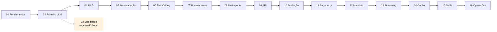

# 📖 AI Agents Course — Formação Prática em Agentes de IA com Python

Um curso técnico construído sobre **Aprendizagem Baseada em Problemas (PBL)**: cada módulo começa com um problema real e apresenta a teoria apenas quando ela é necessária para destravar o código. Siga a ordem dos módulos (01 → 16) ou salte direto ao tema que você precisa.

---

## Introdução

**Para quem é.** Programadores iniciantes que querem entender — e construir — agentes de IA com Python, sem precisar de um doutorado em machine learning. Se você sabe usar um computador e escrever algumas linhas de código, este curso foi feito para você.

**Como está organizado.** Os 16 módulos seguem uma progressão deliberada em quatro arcos:

- **Fundamentos (Módulos 01–03):** o que é IA/LLM, tokens, custo e como decidir se um problema merece IA.
- **Contexto e Qualidade (Módulos 04–05):** dar conhecimento ao modelo (RAG) e fazê-lo avaliar o próprio trabalho.
- **Autonomia e Resiliência (Módulos 06–08):** agentes que usam ferramentas, planejam tarefas multi-etapas e sobrevivem a falhas — inclusive trabalhando em equipe.
- **Produção e Operações (Módulos 09–16):** tirar do script local e levar para o mundo real: API, avaliação, segurança, memória, streaming, cache, skills reutilizáveis e operações contínuas.

**Ordem e pré-requisitos.** Cada módulo abre com uma seção *⚠️ Pré-requisito* dizendo
exatamente o que você precisa dominar antes. A cadeia abaixo é a espinha dorsal do curso —
siga-a linearmente na primeira passada:



| Módulo | Pré-requisito direto | Observação |
|--------|---------------------|------------|
| 01 Fundamentos | — | porta de entrada; requer [Ponte Python](PYTHON_BRIDGE.md) se faltar fluência |
| 02 Primeiro LLM | 01 | primeira chamada real a um modelo |
| 03 Viabilidade | 01 | **opcional**: pode estudar depois do 02 ou até do 08 |
| 04 RAG | 02 | dá conhecimento ao modelo |
| 05 Autoavaliação | 04 | loop gerar→avaliar→refinar |
| 06 Tool Calling | 05 | agente usa funções reais + HITL |
| 07 Planejamento | 06 | circuit breaker, checkpoints, retry |
| 08 Multiagente | 07 | supervisor + especialistas |
| 09 Produção (API) | 08 | primeiro ponto que exige Docker |
| 10 Avaliação | 09 | golden dataset + A/B testing |
| 11 Segurança | 10 | guardrails, prompt injection |
| 12 Memória | 11 | short/long-term memory |
| 13 Streaming | 12 | SSE token-by-token |
| 14 Cache | 13 | response cache + economia |
| 15 Skills | 14 | registry + composição |
| 16 Operações | 15 | CI/CD, monitoramento, rollback |

**Como usar cada módulo.** Em cada módulo você tem três artefatos que conversam entre si:

1. `MATERIAL.md` — o material didático (conceito + teoria sob demanda);
2. `run.py` — o código executável que demonstra o conceito;
3. `miniproject.md` — o mini-projeto integrador, onde você aplica o que aprendeu.

Siga a ordem dos módulos usando a navegação **← Anterior · Índice · Próximo →** no fim de cada material.

**Pré-requisitos.** Python 3.11+, uma conta na OpenAI (ou compatível) e Docker (necessário só a partir do Módulo 09).

---

## Sumário

### Fase 1 — Fundamentos

1. [Módulo 01 — Fundamentos: O que é IA e LLM?](modules/01-fundamentos/MATERIAL.md) — IA, LLMs, tokenização e prompt engineering.
   ↳ [`run.py`](modules/01-fundamentos/run.py)
2. [Módulo 02 — Primeiro Fluxo com LLM](modules/02-primeiro-llm/MATERIAL.md) — sua primeira chamada HTTP a um modelo.
   ↳ [`run.py`](modules/02-primeiro-llm/run.py) · [Miniprojeto](modules/02-primeiro-llm/miniproject.md)
3. [Módulo 03 — Análise de Viabilidade](modules/03-viabilidade/MATERIAL.md) — benchmark IA vs. regras; quando IA vale a pena.
   ↳ [`run.py`](modules/03-viabilidade/run.py) · [Miniprojeto](modules/03-viabilidade/miniproject.md)

### Fase 2 — Contexto e Qualidade

1. [Módulo 04 — Pipeline RAG](modules/04-rag/MATERIAL.md) — recuperação de contexto para dar conhecimento interno ao LLM.
   ↳ [`run.py`](modules/04-rag/run.py) · [Miniprojeto](modules/04-rag/miniproject.md)
2. [Módulo 05 — Autoavaliação e Reflexão](modules/05-autoavaliacao/MATERIAL.md) — loop de crítica estruturada.
   ↳ [`run.py`](modules/05-autoavaliacao/run.py) · [Miniprojeto](modules/05-autoavaliacao/miniproject.md)

### Fase 3 — Autonomia e Resiliência

1. [Módulo 06 — Tool Calling](modules/06-tool-calling/MATERIAL.md) — agente com funções reais + human-in-the-loop.
   ↳ [`run.py`](modules/06-tool-calling/run.py) · [Miniprojeto](modules/06-tool-calling/miniproject.md)
2. [Módulo 07 — Planejamento e Retomada](modules/07-planejamento/MATERIAL.md) — circuit breaker, checkpoints e retry.
   ↳ [`run.py`](modules/07-planejamento/run.py) · [Miniprojeto](modules/07-planejamento/miniproject.md)
3. [Módulo 08 — Sistema Multiagente](modules/08-multiagente/MATERIAL.md) — supervisor + especialistas cooperando.
   ↳ [`run.py`](modules/08-multiagente/run.py) · [Miniprojeto](modules/08-multiagente/miniproject.md)

### Fase 4 — Produção e Operações

1. [Módulo 09 — Produção (API REST com FastAPI)](modules/09-producao-api/MATERIAL.md) — do script local ao serviço com Docker.
   ↳ [`run.py`](modules/09-producao-api/run.py) · [Miniprojeto](modules/09-producao-api/miniproject.md)
2. [Módulo 10 — Avaliação e Testes](modules/10-avaliacao/MATERIAL.md) — golden dataset + A/B testing.
    ↳ [`run.py`](modules/10-avaliacao/run.py) · [Miniprojeto](modules/10-avaliacao/miniproject.md)
3. [Módulo 11 — Segurança e Guardrails](modules/11-seguranca/MATERIAL.md) — prompt injection e defesas.
    ↳ [`run.py`](modules/11-seguranca/run.py) · [Miniprojeto](modules/11-seguranca/miniproject.md)
4. [Módulo 12 — Memória e Contexto](modules/12-memoria/MATERIAL.md) — short/long-term memory.
    ↳ [`run.py`](modules/12-memoria/run.py) · [Miniprojeto](modules/12-memoria/miniproject.md)
5. [Módulo 13 — Streaming e Tempo Real](modules/13-streaming/MATERIAL.md) — SSE token-by-token.
    ↳ [`run.py`](modules/13-streaming/run.py) · [Miniprojeto](modules/13-streaming/miniproject.md)
6. [Módulo 14 — Cache e Otimização de Custo](modules/14-cache/MATERIAL.md) — response cache + model routing.
    ↳ [`run.py`](modules/14-cache/run.py) · [Miniprojeto](modules/14-cache/miniproject.md)
7. [Módulo 15 — Design e Composição de Skills](modules/15-skills/MATERIAL.md) — skill registry + pipelines.
    ↳ [`run.py`](modules/15-skills/run.py) · [Miniprojeto](modules/15-skills/miniproject.md)
8. [Módulo 16 — Operations de Produção](modules/16-operacoes/MATERIAL.md) — CI/CD, monitoramento e rollback.
    ↳ [`run.py`](modules/16-operacoes/run.py) · [Miniprojeto](modules/16-operacoes/miniproject.md)

### 🎓 Projeto Final Integrador

*Depois dos 16 módulos:* construa **AgentForge**, um sistema que integra todos os
módulos num agente IA completo, com rubrica de aprovação e cronograma de 6 semanas.

→ **[FINAL_PROJECT.md — Projeto Final Integrador](FINAL_PROJECT.md)**

---

## Princípios

- **Problema antes de ferramenta** — a tecnologia entra só quando se justifica.
- **Evidência antes de opinião** — escolhas arquiteturais exigem testes e medições reais.
- **Simplicidade antes de complexidade** — se um `if/else` resolve melhor que LLM, vence.
- **Tópicos transversais obrigatórios**: Custo · Observabilidade · Segurança · Governança.

---

## Apêndice — Setup

### Pré-requisitos

- Python 3.11+
- Conta na OpenAI (ou compatível)
- Docker (Módulo 09)

> 🐵 **Falta fluência em Python?** Se você sabe o básico (`for`, `if`, funções) mas trava ao ler
> `@dataclass`, `[x for x in ...]` ou `Optional[...]`, comece pelo
> **[Ponte Python — do imperativo ao idiomático](PYTHON_BRIDGE.md)**. É um apêndice de tradução,
> não um curso de Python: cada padrão usado aqui tem exemplo ❌→✅ e indica onde aparece no curso.
>
> 📚 **Não lembra o que significa uma sigla (RAG, SSE, HITL, TTFT)?** Consulte o
> **[Glossário Unificado](GLOSSARIO.md)** — todas as siglas e os 100+ termos dos
> 16 módulos num só lugar, com link para o módulo onde cada um é aprofundado.

### Instalação

```bash
python -m venv .venv
source .venv/bin/activate  # Linux/Mac
pip install -e ".[dev]"
cp .env.example .env       # Configure suas chaves
```

> 🔌 **Preso à OpenAI? Não está.** Todo `run.py` lê o provedor do `.env`, nunca do código.
> Trocar de fornecedor é editar duas linhas — sem tocar em nenhum módulo:
>
> ```bash
> LLM_PROVIDER=qwen          # ou: openai (outros compatíveis via OPENAI_BASE_URL)
> MODEL=qwen3.8-flash        # nome do modelo no seu plano
> ```
>
> O curso ensina os **conceitos** (tokens, RAG, tool calling, cache…) que são os mesmos
> em qualquer API *OpenAI-compatible* — Anthropic, Gemini, Qwen/DashScope ou um modelo
> local via [Ollama](https://ollama.com) apontando `OPENAI_BASE_URL` para `http://localhost:11434/v1`.
> Se um modelo mudar de nome ou preço, você ajusta o `.env` e segue o jogo: nada no
> material depende de uma versão específica. Ver `shared/security.py` (registry de providers).

### Executar módulos

```bash
# Cada módulo tem seu script principal
python modules/02-primeiro-llm/run.py
python modules/03-viabilidade/run.py
python modules/04-rag/run.py
# ... etc
```

### Estrutura do Projeto

```
ai-agents-course/
├── shared/                 # Utilitários compartilhados
│   ├── cost.py             # Estimativa de custos (tiktoken)
│   ├── logging_config.py   # Logs estruturados
│   ├── security.py         # Gestão de secrets (.env)
│   └── governance.py       # Human-in-the-loop
├── modules/                # Módulos do curso
│   ├── 01-fundamentos/    # Fundamentos (IA, LLM, tokens)
│   ├── 02-primeiro-llm/       # Primeiro fluxo com LLM
│   ├── 03-viabilidade/     # Análise de viabilidade
│   ├── 04-rag/             # Pipeline RAG
│   ├── 05-autoavaliacao/     # Autoavaliação
│   ├── 06-tool-calling/  # Tool Calling
│   ├── 07-planejamento/      # Planejamento e retomada
│   ├── 08-multiagente/    # Multiagente
│   ├── 09-producao-api/      # Deploy em produção
│   ├── 10-avaliacao/      # Avaliação e testes
│   ├── 11-seguranca/          # Segurança e guardrails
│   ├── 12-memoria/          # Memória e contexto
│   ├── 13-streaming/       # Streaming e tempo real
│   ├── 14-cache/         # Cache e otimização de custo
│   ├── 15-skills/         # Design de skills
│   └── 16-operacoes/ # Ops de produção (CI/CD + monitoring)
├── tests/                  # Testes por módulo
├── data/                   # Dados de exemplo
├── docs/                   # Documentação
├── PYTHON_BRIDGE.md        # 🐵 Apêndice: ponte Python (padrões idiomáticos)
├── GLOSSARIO.md            # 📚 Apêndice: glossário unificado (siglas + termos)
└── docker-compose.yml      # Infraestrutura P4
```

### Avaliação

Cada módulo deve ser entregue como repositório GitHub com:

- Código funcional e testado
- Relatório de custos (tokens/gasto)
- Logs estruturados demonstrando observabilidade
- Comentários sobre trade-offs arquiteturais
