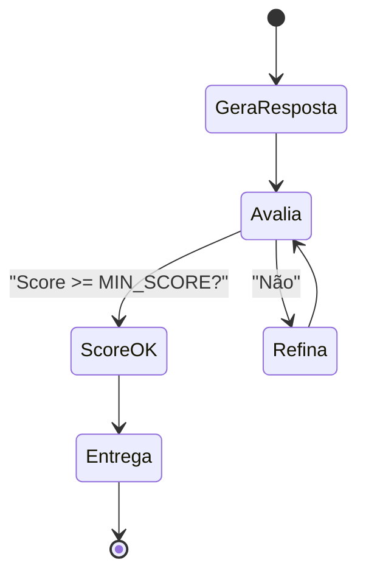

# Módulo 05 — Autoavaliação e Reflexão

## ⚠️ Pré-requisito

Você precisa ter concluído o módulo [Módulo 04 — Pipeline RAG](../04-rag/MATERIAL.md). Especificamente, precisa saber:

- Como um agente gera respostas usando LLMs e por que a autoavaliação é necessária antes de entregar

---

## 📋 Sumário

### Core (obrigatório)

1. [Infraestrutura do Curso](#infraestrutura-do-curso)
2. [O Problema da Confiança](#o-problema-da-confiança)
3. [Pydantic — O Validador de Formulários](#pydantic--o-validador-de-formulários)
4. [Structured Outputs](#structured-outputs)
5. [O Loop de Refinamento](#o-loop-de-refinamento)
6. [Por que Limitar Iterações?](#por-que-limitar-iterações)

### 🔬 Avançado (opcional na primeira leitura)

7. [beta.chat.completions.parse()](#betachatcompletionsparse)
8. [O que você vai ver](#o-que-você-vai-ver)

### Prático

9. [Exercício Prático](#exercício-prático)
10. [Troubleshooting](#troubleshooting)
11. [Glossário](#glossário)

---

## 🎯 Objetivos de Aprendizagem

Ao final deste módulo, você será capaz de:

- [ ] **Explicar** por que autoavaliação é necessária antes de entregar respostas ao usuário
- [ ] **Implementar** um loop de refinamento (gera → avalia → refina → reavalia)
- [ ] **Usar** Pydantic structured outputs para garantir JSON consistente e validado
- [ ] **Configurar** limites seguros de iteração (max_iterations) para evitar gasto infinito
- [ ] **Entender** quando a autoavaliação pode ser "o lobo guardando o próprio aprisco"

> 💡 **Dica:** Este módulo introduz o conceito mais importante de qualidade em agentes: nunca confie na primeira resposta sem verificar. Todo agente de produção precisa desse loop.

---

## Infraestrutura do Curso

Como este módulo usa os mesmos arquivos `shared/` dos outros módulos, aqui está um resumo rápido:

```
applied-ai-agents/
├── modules/05-autoavaliacao/
│   ├── MATERIAL.md    ← Este arquivo
│   ├── run.py         ← Código executável
│   └── ...
├── shared/
│   ├── cost.py          ← count_tokens, estimate_cost, format_cost
│   ├── security.py      ← get_required_secret (API keys)
│   └── logging_config.py ← setup_logging, measure_latency
```

### Dependências Necessárias

> 📖 Fonte: **[EN]** First dependency "dependable" · `fastapi-docs-en/docs/tutorial/dependencies/sub-dependencies.md` —
> "This is quite simple (not very useful), but will help us focus on how the sub-dependencies work."

```bash
pip install pydantic openai rich python-dotenv
```

| Pacote | Função |
| -------- | -------- |
| `pydantic` | Validação estruturada (garante JSON consistente) |
| `openai` | SDK OpenAI para chamar LLMs |
| `rich` | Output bonito no terminal |
| `python-dotenv` | Lê variáveis de ambiente do `.env` |

### Por que `sys.path.insert(0, ...)` no código?

> A explicação completa está no **Módulo 01** — seção [Por que `sys.path.insert(0, ...)` no código?](../01-fundamentos/MATERIAL.md#por-que-syspathinsert0--no-código).
> Em resumo: cada `run.py` roda a partir da própria pasta, mas o `shared/` fica na raiz; a linha adiciona a raiz ao caminho de busca do Python. Sem isso, os imports de `shared/` falham com `ModuleNotFoundError`.

### O que cada módulo `shared/` faz?

| Módulo | Função | Quando usar |
| -------- | -------- | ------------- |
| `shared/cost.py` | Contar tokens, estimar custo, formatar preço | Sempre que chamar LLM |
| `shared/security.py` | Ler API keys do `.env` com validação | Sempre que precisar autenticação |
| `shared/logging_config.py` | Configurar logs + medir latência | Para debug e monitoramento |

> ⚠️ **Importante:** Você **não precisa entender** a implementação interna do `shared/`. Só precisa saber que essas funções existem e usá-las.

---

## Conceitos Fundamentais

### O Problema da Confiança

> 📖 Fonte: **[EN]** Building LLMs for Production · Peters, Louie & Bouchard, Louis-François · 2024 · OEBPS/c13B —
> "LLMs aren’t designed to express uncertainty or admit a lack of information."

LLMs são poderosos mas não são perfeitos. Eles podem:

- Inventar fatos (alucinação)
- Ser incompletos ou vagos
- Perder nuances importantes
- Gerar respostas plausíveis mas erradas

Como saber se a resposta está boa **antes** de entregá-la ao usuário?

### Por que isso existe?

Nos primeiros módulos, o agente gerava uma resposta e pronto. Mas em produção, você **não pode entregar respostas sem verificar**. Veja o custo de pular a verificação:

| O agente entrega sem checar | Consequência no mundo real | Como o loop pega |
| --------------------------- | -------------------------- | ---------------- |
| Classifica um ticket como "BAIXA" quando era "URGENTE" | Cliente frustrado, SLA estourado | `accuracy` baixo → refina |
| Extrai dados errados de um formulário | Processo administrativo travado | `completeness`/`issues` apontam o gap |
| Gera código com bug silencioso | Vulnerabilidade de segurança | Feedback específico → reescrita |

A autoavaliação resolve isso criando um **loop de qualidade** antes da entrega.

### Erros Comuns de Iniciantes

| Erro | Consequência | Correção |
| ------ | -------------- | ---------- |
| Usar `temperature > 0` na avaliação | Score muda a cada chamada → impossível comparar | Sempre `temperature=0` para avaliação |
| Não limitar iterações | Loop infinito gastando tokens | `max_iterations=3` como padrão |
| Avaliar com texto livre | JSON inválido, parsing falha | SEMPRE usar Pydantic structured output |
| Feedback genérico no refinamento | Modelo não sabe o que corrigir | Feedback específico: "Falta X", "Y está errado" |

---

## 🔑 Pydantic — O Validador de Formulários

### Analogia: Formulário de Cadastro

Imagine um formulário de cadastro online:

```
Nome: [___________]  ← Obrigatório, texto
Idade: [__]          ← Obrigatório, número entre 0-150
Email: [___________] ← Obrigatório, formato válido
Newsletter: [✓]      ← Obrigatório, booleano
```

Se você tenta enviar com idade "vinte" (texto) ou email "invalido" (sem @), o formulário **rejeita** a submissão.

**Pydantic faz exatamente isso, mas para dados Python:**

```python
from pydantic import BaseModel, Field

class SelfEvaluation(BaseModel):
    accuracy: int = Field(ge=1, le=10)  # Número entre 1 e 10
    completeness: int = Field(ge=1, le=10)
    clarity: int = Field(ge=1, le=10)
    issues: list[str]  # Lista de strings obrigatória
    needs_improvement: bool  # True ou False
```

Se o LLM retorna `{"accuracy": "alta", "completeness": 15}` → **Pydantic rejeita**:

- `"alta"` não é `int` → ValidationError
- `15` > `le=10` → ValidationError

#### Escada: do caso simples ao realista

| Nível | Entrada do LLM | O que o Pydantic faz | Por que importa |
| ------- | ---------------- | ---------------------- | ------------------ |
| **Simples** | `{"accuracy": 9, ...}` todos os campos no formato | ✅ Aceita e tipa | Caminho feliz: decisão programática direta |
| **Tipo errado** | `"accuracy": "alta"` | ❌ ValidationError (não é `int`) | Texto livre vira erro na fronteira, não bug silencioso depois |
| **Fora de faixa** | `"completeness": 15` | ❌ ValidationError (`15 > le=10`) | Captura score impossível mesmo com tipo certo |
| **Campo faltando** | omissão de `issues` | ❌ ValidationError (obrigatório) | Garante que o agente nunca "esqueça" de listar problemas |

> 💡 A linha **"Simples"** é o único caso que você *quer* que aconteça; as três abaixo são exatamente os erros que a tabela "Erros Comuns" lista — agora nomeados um a um.

### Por que usar Pydantic em vez de texto livre?

| Sem Pydantic (texto livre) | Com Pydantic (structured output) |
| --------------------------- | ---------------------------------- |
| `{"accuracy": "quase perfeito"}` ❌ | `{"accuracy": 9}` ✅ |
| Parsing manual propenso a erros | Validação automática |
| Formato inconsistente entre chamadas | Schema fixo e previsível |
| Impossível tomar decisões programáticas | Scores numéricos → decisões automáticas |

---

## Structured Outputs

Pydantic permite definir um **schema estruturado** que o LLM deve seguir. Ao invés de texto livre, o modelo retorna JSON validado:

```python
class SelfEvaluation(BaseModel):
    accuracy: int = Field(ge=1, le=10)  # Sempre 1-10
    completeness: int = Field(ge=1, le=10)
    clarity: int = Field(ge=1, le=10)
    issues: list[str]
    needs_improvement: bool
```

Isso garante que a avaliação seja **consistente** e **programática** — podemos tomar decisões baseadas nos scores.

---

## O Loop de Refinamento



Este loop é inspirado em como humanos revisam textos: escrevemos, lemos, identificamos problemas, reescrevemos.

### Por que Limitar Iterações?

Sem limite, o agente poderia entrar em loop infinito refinando infinitamente. O `max_iterations` define um teto seguro:

| Iterações | Vantagem | Desvantagem |
| ----------- | ---------- | ------------- |
| 1 | Rápido, barato | Qualidade incerta |
| 3 | Equilíbrio | Custo moderado |
| 5+ | Alta qualidade | Custo elevado, diminishing returns |

---

## 🔬 beta.chat.completions.parse()

> ⚠️ **AVANÇADO — OPCIONAL** na primeira leitura. Pode pular esta seção e voltar depois.

A API da OpenAI com `beta.chat.completions.parse()` faz mágica:

1. Envia prompt ao LLM
2. Parseia a resposta JSON automaticamente
3. Valida contra o schema Pydantic
4. Lança `ValidationError` se falhar

Isso elimina parsing manual e garante tipagem forte.

### O prefixo `beta.` na API

Quando vê `client.beta.chat.completions.parse()`:

- `beta.` = funcionalidade **experimental** da OpenAI
- Funciona, mas pode mudar sem aviso prévio
- Em produção real, espere pela versão estável (`client.chat.completions.parse()`)
- Para este curso, `beta.` é perfeitamente seguro de usar

### Fallback se beta.parse falhar

Se a API não suportar `beta.parse()` ainda:

```python
try:
    response = client.beta.chat.completions.parse(...)
    evaluation = response.choices[0].message.parsed
except Exception:
    # Fallback: parse manual do JSON
    import json
    raw_json = response.choices[0].message.content
    data = json.loads(raw_json)
    evaluation = SelfEvaluation(**data)
```

---

## O que você vai ver

Antes de rodar o código, aqui está uma prévia do que o programa vai fazer:

```
$ python modules/05-autoavaliacao/run.py

🤖 Gerando resposta inicial...
   Iteração 1: "Resposta parcial..."

🔍 Avaliando qualidade...
   Feedback: "Faltam detalhes sobre segurança"

🔄 Refinando resposta...
   Iteração 2: "Resposta completa com segurança..."

✅ Aprovado! (custo total: $0.008)
```

---

> ⏸️ **Rode agora — autoavaliação e reflexão**
>
> Antes de estudar Structured Outputs em detalhe, execute o loop de crítica:
>
> ```bash
> python modules/05-autoavaliacao/run.py
> ```
>
> Você deve ver o agente gerar uma resposta, criticar a própria saída, corrigir iterativamente e parar ao atingir o critério ou o limite de iterações.
>
> Se a saída divergir disso, revise os pré-requisitos antes de continuar.

## Exercício Prático

Execute `python modules/05-autoavaliacao/run.py` e observe:

1. Como a primeira resposta pode ser aprovada na primeira iteração
2. Quando o feedback melhora a resposta nas iterações seguintes
3. O que acontece quando `max_iterations` é atingido
4. Como os custos acumulam com múltiplas iterações

---

## Perguntas para Reflexão

1. Se a autoavaliação também fosse feita por um LLM, ela não seria "o lobo guardando o próprio aprisco"? Como mitigar?
2. Que critérios adicionais você adicionaria além de accuracy/completeness/clarity?
3. Como você saberia quantas iterações são suficientes para um caso de uso real?

---

## Troubleshooting

| Erro | Causa provável | Solução |
| ------ | ---------------- | --------- |
| `ModuleNotFoundError: No module named 'pydantic'` | Dependência não instalada | `pip install pydantic` |
| `ValidationError: validation failed` | LLM retornou JSON fora do schema | Verifique se o prompt pede formato JSON estrito |
| `beta.chat.completions.parse()` não encontrado | SDK antigo | `pip install --upgrade openai` |
| `OPENAI_API_KEY not set` | Variável de ambiente ausente | Adicione ao `.env` ou export: `export OPENAI_API_KEY=sk-...` |
| Loop infinito (raro) | `max_iterations` não configurado | Sempre defina `max_iterations=3` como padrão |
| Score sempre baixo | Prompt de avaliação muito rigoroso | Ajuste `MIN_SCORE` para 5-6 em vez de 7 |

---

## 📖 Glossário

> 📚 Este é o glossário local do módulo. Todos os termos e siglas dos 16 módulos estão consolidados no **[Glossário Unificado](../../GLOSSARIO.md)**.

| Termo | Definição | Analogia |
| ------- | ----------- | ---------- |
| **Pydantic** | Biblioteca para validação estruturada de dados | Formulário com campos obrigatórios |
| **Structured Output** | JSON com formato previsível e validado | Receita de bolo passo a passo |
| **Loop de Refinamento** | Gera → Avalia → Refina → Reavalia | Revisar um texto várias vezes |
| **max_iterations** | Limite máximo de tentativas | Tempo limite de prova |
| **ValidationError** | Exceção lançada quando JSON não valida | Formulário rejeitado pelo sistema |
| **beta.** | Prefixo experimental da API OpenAI | Versão teste de app novo |
| **temperature=0** | Modo determinístico (mesmo input = mesmo output) | Robô seguindo receita vs artista improvisando |

---

## 📌 Resumo do Módulo

Autoavaliação é o conceito mais importante de qualidade em agentes:

1. **Nunca confie na primeira resposta** — LLMs podem alucinar, ser incompletos ou plausíveis mas errados. Sempre verifique antes de entregar.

2. **Structured outputs (Pydantic) são obrigatórios** — JSON validado garante consistência e permite tomar decisões programáticas baseadas em scores. Nunca use texto livre para avaliação.

3. **Loop de refinamento = gera → avalia → refina → reavalia** — inspirado em como humanos revisam textos. Score >= MIN_SCORE? Entrega. Não? Feedback específico → reescreve.

4. **Limite iterações (max=3)** — sem limite, loop infinito gastando tokens. 3 iterações é equilíbrio entre custo e qualidade. Diminishing returns após isso.

5. **Temperature=0 SEMPRE para avaliação** — se score muda a cada chamada, impossível comparar. Avaliação precisa ser determinística.

> ✅ **Você está pronto para:** Agora que seu agente se autoavalia, vamos dar a ele poder de **agir** — tool calling.

## ✅ Checklist: Como Saber Se Você Atingiu o Objetivo

Marque cada item **só se conseguir fazer sem olhar o material**:

- [ ] Explico por que avaliar a resposta antes de entregá-la ao usuário
- [ ] Mostro como max_iterations previne loops infinitos
- [ ] Explico a diferença entre feedback construtivo e validação simples
- [ ] Rodo `run.py` e explico como custos acumulam com iterações
- [ ] Digo 3 sinais de que uma resposta precisa ser refinada

> ⚠️ Se marcou menos de 3 itens, releia as seções correspondentes antes de prosseguir.

---

## 🔗 Próximos Passos

Com autoavaliação, seu agente verifica a qualidade antes de entregar. Mas ainda só gera texto — não executa ações no mundo real.

→ Leia o módulo [Módulo 06 — Tool Calling (Uso Autônomo de Ferramentas)](../06-tool-calling/MATERIAL.md) para aprender como agentes usam ferramentas externas.

---

## ✅ Como verificar seus exercícios

Você tem três formas de checar se entendeu e implementou corretamente:

**1. Rodar os exercícios direto no terminal (feedback imediato):**
```bash
python modules/05-autoavaliacao/exercises.py
```
Cada função `test_*` imprime ✓ ou ✗ e mostra quantos passaram. Preencha os `TODO` até ver **"Todos os exercícios passaram!"**.

**2. Validar automaticamente com pytest (modo aluno):**
```bash
CHECK_MY_EXERCISES=1 pytest -k "05-autoavaliacao"
```
Isso roda os `asserts` dos seus exercícios como testes reais — ideal para CI ou para ter certeza antes de entregar.

**3. Comparar com o gabarito:**
Abra [`exercises_solution.py`](exercises_solution.py) depois de tentar sozinho. Ele é a referência oficial e passa em todos os próprios testes.

> 💡 **Dica:** tente primeiro sem olhar a solução. Se travar, releve a seção de conceito; só consulte o gabarito como último recurso — o aprendizado vem do esforço de implementar.

---

## 🧭 Navegação

| ← Anterior | Índice | Próximo → |
| --- | --- | --- |
| [← Módulo 04 — Pipeline RAG](../04-rag/MATERIAL.md) | [📖 Sumário do curso](../../README.md) | [Módulo 06 — Tool Calling (Uso Autônomo de Ferramentas) →](../06-tool-calling/MATERIAL.md) |
