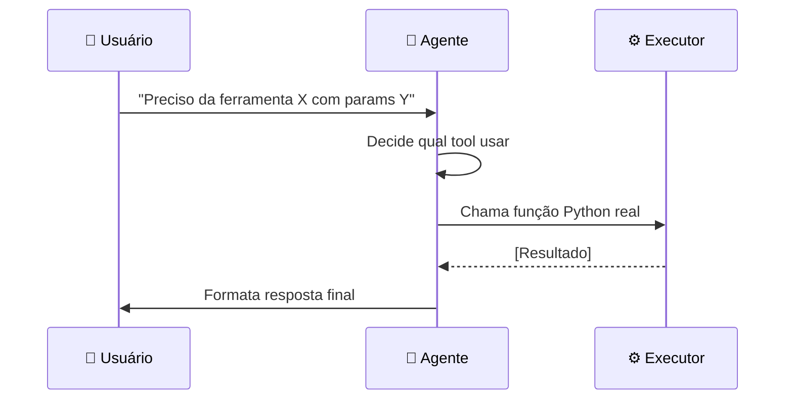
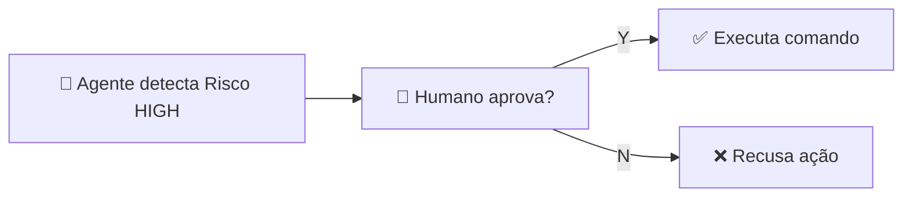

# Módulo 06 — Tool Calling (Uso Autônomo de Ferramentas)

## ⚠️ Pré-requisito

Você precisa ter concluído o módulo [Módulo 05 — Autoavaliação e Reflexão](../05-autoavaliacao/MATERIAL.md). Especificamente, precisa saber:

- Por que avaliar a resposta antes de entregá-la ao usuário
- Como configurar limites seguros de iteração (max_iterations)
- O que é Pydantic e structured outputs

---

## 📋 Sumário

### Core (obrigatório)

1. [Infraestrutura do Curso](#infraestrutura-do-curso)
2. [Do Texto à Ação](#do-texto-à-ação)
3. [O Pattern de Tool Calling](#o-pattern-de-tool-calling)
4. [JSON Schema como Contrato](#json-schema-como-contrato)
5. [Segurança: Princípio do Menor Privilégio](#segurança-princípio-do-menor-privilégio)
6. [Human-in-the-Loop (HITL)](#human-in-the-loop-hitl)

### 🔬 Avançado (opcional na primeira leitura)

7. [Como o Modelo Decide Chamar uma Tool](#como-o-modelo-decide-chamar-uma-tool)
8. [Arquitetura do Loop Tool-Calling](#arquitetura-do-loop-tool-calling)

### Prático

9. [O que você vai ver](#o-que-você-vai-ver)
10. [Exercício Prático](#exercício-prático)
11. [Troubleshooting](#troubleshooting)
12. [Glossário](#glossário)

---

## 🎯 Objetivos de Aprendizagem

Ao final deste módulo, você será capaz de:

- [ ] **Explicar** a diferença entre um chatbot passivo e um agente ativo com ferramentas
- [ ] **Definir** schemas JSON para ferramentas com descrições claras que o modelo entenda
- [ ] **Implementar** o pattern de tool calling (decide → executa → retorna resultado)
- [ ] **Aplicar** camadas de segurança (whitelist, risk levels, HITL) para agentes com acesso a ferramentas
- [ ] **Entender** como o modelo decide qual ferramenta usar (attention entre prompt + schemas)

> 💡 **Dica:** Tool calling é o que transforma um LLM de "dicionário" em "assistente que age". Este é o conceito mais próximo de "agência real" no curso.

---

## Infraestrutura do Curso

Este módulo usa os mesmos arquivos `shared/` dos outros módulos:

```
applied-ai-agents/
├── modules/06-tool-calling/
│   ├── MATERIAL.md    ← Este arquivo
│   ├── run.py         ← Código executável
│   ├── architecture.md ← Diagramas arquiteturais
│   └── ...
├── shared/
│   ├── cost.py          ← count_tokens, estimate_cost, format_cost
│   ├── security.py      ← get_required_secret (API keys)
│   ├── governance.py    ← ActionRequest, RiskLevel, require_approval, safe_execute
│   └── logging_config.py ← setup_logging, measure_latency
```

### Dependências Necessárias

> 📖 Fonte: **[EN]** First dependency "dependable" · `fastapi-docs-en/docs/tutorial/dependencies/sub-dependencies.md` —
> "This is quite simple (not very useful), but will help us focus on how the sub-dependencies work."

```bash
pip install pydantic openai rich python-dotenv
```

| Pacote | Função |
| -------- | -------- |
| `pydantic` | Validação estruturada (garante JSON consistente) |
| `openai` | SDK OpenAI para chamar LLMs |
| `rich` | Output bonito no terminal |
| `python-dotenv` | Lê variáveis de ambiente do `.env` |

### Por que `sys.path.insert(0, ...)` no código?

> A explicação completa está no **Módulo 01** — seção [Por que `sys.path.insert(0, ...)` no código?](../01-fundamentos/MATERIAL.md#por-que-syspathinsert0--no-código).
> Em resumo: cada `run.py` roda a partir da própria pasta, mas o `shared/` fica na raiz; a linha adiciona a raiz ao caminho de busca do Python. Sem isso, os imports de `shared/` falham com `ModuleNotFoundError`.

### O que cada módulo `shared/` faz?

| Módulo | Função | Quando usar |
| -------- | -------- | ------------- |
| `shared/cost.py` | Contar tokens, estimar custo, formatar preço | Sempre que chamar LLM |
| `shared/security.py` | Ler API keys do `.env` com validação | Sempre que precisar autenticação |
| `shared/governance.py` | Classificar risco, pedir aprovação humana, executar seguro | SEMPRE que agente usa ferramentas |
| `shared/logging_config.py` | Configurar logs + medir latência | Para debug e monitoramento |

> ⚠️ **Importante:** Você **não precisa entender** a implementação interna do `shared/`. Só precisa saber que essas funções existem e usá-las.

---

## Conceitos Fundamentais

### Do Texto à Ação

> 📖 Fonte: **[EN]** AI Engineering · Chip Huyen · 2024 · OEBPS/ch06 —
> "An AI agent is meant to accomplish tasks typically provided by the users in the inputs."

Até agora, nossos agentes só **geravam texto**. Mas no mundo real, agentes precisam:

- Ler arquivos do sistema de arquivos
- Consultar APIs externas
- Executar comandos
- Modificar estados

Tool calling transforma um LLM passivo em um agente ativo.

### Por que isso existe?

Sem tool calling, o agente é apenas um chatbot — ele pode responder perguntas mas não pode **fazer nada**. Imagine um assistente que sabe a resposta mas não consegue:

- Abrir um arquivo para ler dados reais
- Enviar um email quando solicitado
- Consultar uma API de clima para dar informação atualizada

Com tool calling, o LLM deixa de ser um dicionário e vira um **assistente que age**.

### Erros Comuns de Iniciantes

| Erro | Consequência | Correção |
| ------ | -------------- | ---------- |
| Schema de tool sem `description` | Modelo não sabe quando chamar a tool | Sempre descrever claramente o que cada tool faz |
| Permitir ferramentas perigosas sem restrição | Agente pode apagar arquivos, executar comandos maliciosos | Whitelist + risk levels + HITL |
| Não validar JSON da resposta | Crash se modelo retorna JSON inválido | SEMPRE usar Pydantic validation |
| Tool muito genérica | Modelo confunde quando usar qual tool | Uma tool = uma função específica bem definida |

---

## O Pattern de Tool Calling



O LLM não executa a ferramenta diretamente — ele **decide** qual ferramenta usar e **descreve** os parâmetros. Um executor seguro roda a função real.

### Fluxo simplificado

1. Usuário envia pergunta → LLM recebe prompt + schemas das tools
2. LLM responde com JSON: `{"tool": "read_file", "params": {"path": "/etc/hosts"}}`
3. Sistema valida JSON → Verifica whitelist → Classifica risco
4. Se risco HIGH → HITL pede aprovação humana
5. Executor roda `read_file("/etc/hosts")` → resultado volta ao LLM
6. LLM formata resposta final para usuário

---

## JSON Schema como Contrato

Cada ferramenta tem um schema que define seus parâmetros:

```json
{
  "type": "function",
  "function": {
    "name": "read_file",
    "description": "Lê conteúdo de um arquivo",
    "parameters": {
      "type": "object",
      "properties": {
        "file_path": {"type": "string", "description": "Caminho do arquivo"},
        "max_lines": {"type": "integer", "default": 100}
      },
      "required": ["file_path"]
    }
  }
}
```

Este schema é enviado ao LLM junto com o prompt. O modelo responde com JSON estruturado que pode ser validado e executado programaticamente.

**Contraste: o mesmo contrato, vago vs. claro.** A `description` é o único indício que o
modelo tem para decidir *quando* chamar a tool — veja o efeito de escrevê-la mal:

| ❌ Vaga (modelo erra o gatilho) | ✅ Clara (modelo acerta) |
| -------------------------------- | ----------------------- |
| `"description": "faz coisas com arquivo"` | `"description": "Lê o conteúdo de um arquivo de texto a partir de um caminho"` |

Diante de "Leia /etc/hosts", a versão vaga não ancora a intenção em nenhuma ação concreta,
e o modelo pode nem chamar a tool (ou chamar a errada). A clara casa "ler" + "caminho" com
`file_path`, e o gatilho dispara. É por isso que a tabela de erros lá em cima trata
"schema sem `description`" como falha, não como detalhe estético.

> 💡 **Regra de ouro:** Quanto melhor a `description` da tool, melhor o modelo decide quando usá-la. Nunca deixe descriptions vazias ou vagas.

---

## Segurança: Princípio do Menor Privilégio

Agentes com acesso a ferramentas são perigosos se não forem restritos:

| Camada de Segurança | O que faz |
| --------------------- | ----------- |
| **Whitelist** | Só permite comandos/funções pré-aprovados |
| **Risk Levels** | Classifica cada tool (LOW/MEDIUM/HIGH/CRITICAL) |
| **Human-in-the-Loop** | Pede aprovação humana para ações críticas |
| **Timeouts** | Limita tempo de execução |
| **Output Limits** | Trunca respostas muito longas |

### Níveis de Risco

| Nível | Exemplo | Precisa HITL? |
| ------- | --------- | --------------- |
| LOW | `read_file`, `search_files` | Não |
| MEDIUM | `write_file`, `calculate` | Não |
| HIGH | `execute_command`, `delete_file` | Sim |
| CRITICAL | `format_disk`, `delete_user_data` | Sim + log de auditoria |

---

## Human-in-the-Loop (HITL)

Para ações de risco HIGH ou CRITICAL, o agente pausa e pergunta ao humano:



⚠️ **AÇÃO REQUER APROVAÇÃO HUMANA**

- Tool: `execute_command`
- Comando: `rm -rf /tmp/cache`
- Risco: HIGH

Isso garante que humanos mantenham controle sobre decisões importantes.

---

## 🔬 Como o Modelo Decide Chamar uma Tool

> ⚠️ **AVANÇADO — OPCIONAL** na primeira leitura. Pode pular esta seção e voltar depois.

O modelo **não tem um switch ligado/desligado** para ferramentas. Ele foi **fine-tuned** durante o treinamento para reconhecer padrões nos prompts que indicam necessidade de ação.

```
Prompt recebido:
  system: "Você é um assistente com 3 ferramentas..."
  tools: [read_file, list_dir, execute_command]
  user: "Leia /etc/hosts"
         ↓
[Modelo processa com attention entre user + tools schemas]
         ↓
O modelo reconhece:
  - A palavra "Leia" → mapeia para função read_file
  - "/etc/hosts" → extrai como argumento file_path
         ↓
Resposta do modelo (JSON):
{
  "tool_calls": [
    {
      "id": "call_abc123",
      "type": "function",
      "function": {
        "name": "read_file",
        "arguments": '{"file_path": "/etc/hosts"}'
      }
    }
  ]
}
```

### Por que às vezes o modelo ignora ferramentas?

1. **Schema mal descrito**: Se `description` é vago, o modelo não associa a ferramenta à intenção do usuário
2. **Prompt ambíguo**: "Me dá uma info sobre isso" — qual tool? Nenhuma descrição combina bem
3. **Overfitting**: Modelos treinados em dados específicos tendem a usar tools só quando o padrão é familiar

### Por que às vezes inventa argumentos?

O modelo tenta ser útil. Se você pediu algo que nenhuma tool cobre, ele pode "alucinar" parâmetros imaginários tentando forçar uma chamada. Por isso a validação rigorosa é obrigatória.

---

## 🔬 Arquitetura do Loop Tool-Calling

> Referência completa: [architecture.md](architecture.md)

O sistema tool-calling é um loop fechado com 5 componentes:

```
[Usuário] → [LLM] → [JSON Parser] → [Whitelist Checker] → [Executor]
    ↑                                                        ↓
    ←─────── [Resultado formatado] ←─────── [Tool real Python]
```

| Componente | Responsabilidade | O que valida |
| ------------ | ------------------ | -------------- |
| **LLM** | Decide qual tool usar + parâmetros | Nenhum (confia no schema) |
| **JSON Parser** | Converte resposta LLM → dict Python | JSON válido? Chaves corretas? |
| **Whitelist Checker** | Verifica se tool está permitida | Nome da tool na lista? |
| **Risk Level** | Classifica perigo da operação | LOW/MEDIUM/HIGH/CRITICAL |
| **Executor** | Roda função Python real | HITL aprovado? |

---

### Demo: O Núcleo do Loop, Sem Chamar a API

Antes de ligar um modelo de verdade, vale isolar a mecânica que o `run.py` usa: o LLM devolve **uma lista de `tool_calls`** (nome + argumentos em JSON), e o seu código faz *dispatch* — executa a função certa e devolve o resultado. Abaixo está esse núcleo rodando com as ferramentas reais do módulo (`calculate_tool`, `list_directory_tool`) e um `tool_calls` **simulado**, exatamente no formato que o modelo retornaria. Copie, cole num arquivo e rode — não precisa de chave de API.

```python
import json
from pathlib import Path

# As ferramentas REAIS do modulo (mesmas funcoes de run.py)
def calculate_tool(expression: str) -> str:
    import re
    if re.search(r"[a-z_]|__|import|eval|exec|open|lambda", expression, re.IGNORECASE):
        return "ERRO: Expressao contem caracteres nao permitidos."
    allowed = set("0123456789+-*/().% ")
    if not all(c in allowed for c in expression):
        return "ERRO: Caracteres nao permitidos na expressao."
    try:
        return f"Resultado: {eval(expression, {'__builtins__': {}}, {})}"
    except Exception as e:
        return f"ERRO no calculo: {e}"

def list_directory_tool(path: str = ".") -> str:
    dir_path = Path(path)
    if not dir_path.is_dir():
        return f"ERRO: Diretorio nao encontrado: {path}"
    items = [f"{'DIR' if i.is_dir() else 'FILE'} {i.name}" for i in sorted(dir_path.iterdir())]
    return "\n".join(items) if items else "(vazio)"

# O "registry": nome da ferramenta -> funcao executavel
REGISTRY = {"calculate": calculate_tool, "list_directory": list_directory_tool}

def dispatch(tool_calls):
    """Nucleo do loop: recebe os tool_calls do modelo e devolve os resultados."""
    results = []
    for call in tool_calls:
        name = call["function"]["name"]
        args = json.loads(call["function"]["arguments"])  # o modelo manda JSON como string
        print(f"[usando ferramenta] {name}({args})")
        out = REGISTRY[name](**args)                       # executa a funcao real
        print(f"[resultado] {out}")
        results.append({"tool_call_id": call["id"], "name": name, "content": out})
    return results

# Isto e EXATAMENTE o que um LLM devolveria em assistant_message.tool_calls
# para a pergunta "quanto e 27 * 143? liste os arquivos de ./shared"
fake_tool_calls = [
    {"id": "call_1", "function": {"name": "calculate", "arguments": '{"expression": "27 * 143"}'}},
    {"id": "call_2", "function": {"name": "list_directory", "arguments": '{"path": "./shared"}'}},
]

out = dispatch(fake_tool_calls)
print(json.dumps(out, ensure_ascii=False, indent=2))
```

Saída real ao rodar (reproduzível, sem custo de API):

```text
[usando ferramenta] calculate({'expression': '27 * 143'})
[resultado] Resultado: 3861
[usando ferramenta] list_directory({'path': './shared'})
[resultado] FILE __init__.py
DIR __pycache__
FILE cost.py
FILE governance.py
FILE hints.py
FILE logging_config.py
FILE security.py
[
  {
    "tool_call_id": "call_1",
    "name": "calculate",
    "content": "Resultado: 3861"
  },
  {
    "tool_call_id": "call_2",
    "name": "list_directory",
    "content": "FILE __init__.py\nDIR __pycache__\nFILE cost.py\nFILE governance.py\nFILE hints.py\nFILE logging_config.py\nFILE security.py"
  }
]
```

> Repare nos três pontos que o `run.py` repete em escala real: **(1)** os argumentos chegam como **string JSON** e precisam de `json.loads`; **(2)** o `name` vira uma **busca no registry** — se a tool não estiver lá, é recusado (whitelist); **(3)** cada resultado volta rotulado com o `tool_call_id`, que é como o modelo depois amarra a resposta à chamada. Quando você rodar `python run.py`, é este mesmo esqueleto — só que quem produz os `tool_calls` passa a ser o modelo de verdade.

---

## O que você vai ver

Antes de rodar o código, aqui está uma prévia do que o programa vai fazer:

```
$ python modules/06-tool-calling/run.py

🤖 Usuário pergunta: "Qual o tamanho da pasta /tmp?"

🔧 Agente decide: usar tool 'list_directory'
   Input: {path: "/tmp"}

📋 Tool retorna: "512MB"

💬 Resposta: "A pasta /tmp tem 512MB."

⚠️ Usuário pergunta: "Apague todos os arquivos temporários"
   Risco detectado: HIGH → HITL acionado
   Agente aguarda aprovação humana...

💰 Custo por ferramenta: list_directory=$0.002
```

---

> ⏸️ **Rode agora — ferramentas + HITL**
>
> Antes de ler as seções avançadas (🔬), execute o loop tool-calling completo:
>
> ```bash
> python modules/06-tool-calling/run.py
> ```
>
> Você deve ver o banner `MÓDULO 06 — Tool Calling`, as tools registradas com seus níveis de risco (`read_file (risk=medium)`, `calculate (risk=low)`), e uma aprovação human-in-the-loop pedida antes de executar qualquer ação de risco.
>
> Se a saída divergir disso, revise os pré-requisitos antes de continuar.

## Exercício Prático

Execute `python modules/06-tool-calling/run.py` e observe:

1. Como o agente decide qual ferramenta usar baseado na pergunta
2. As ferramentas sendo executadas (ler arquivo, listar diretório, buscar)
3. Quando o HITL é acionado para ações de alto risco
4. O relatório de custos por ferramenta usada

---

## Perguntas para Reflexão

1. Que riscos existem em permitir que um LLM execute comandos shell? Como você mitigaria?
2. Se uma tool falhasse com erro, o agente deveria tentar outra tool ou pedir ajuda humana?
3. Como você implementaria rate limiting para evitar abuso de ferramentas?

---

## Troubleshooting

| Erro | Causa provável | Solução |
| ------ | ---------------- | --------- |
| `ModuleNotFoundError: No module named 'pydantic'` | Dependência não instalada | `pip install pydantic` |
| `OPENAI_API_KEY not set` | Variável de ambiente ausente | Adicione ao `.env` ou export: `export OPENAI_API_KEY=sk-...` |
| Tool chamada mas não executada | Schema sem `description` clara | Adicionar descrição detalhada à tool |
| JSON inválido retornado pelo LLM | Falta validação | Usar Pydantic para validar antes de executar |
| Agente ignora ferramentas disponíveis | Prompt não menciona tools explicitamente | Incluir schemas no system prompt |
| Comando shell executado sem aprovação | Risk level mal configurado | Verificar `RiskLevel.HIGH` no governance |

---

## 📖 Glossário

> 📚 Este é o glossário local do módulo. Todos os termos e siglas dos 16 módulos estão consolidados no **[Glossário Unificado](../../GLOSSARIO.md)**.

| Termo | Definição | Analogia |
| ------- | ----------- | ---------- |
| **Tool Calling** | Padrão onde LLM decide qual função externa chamar | Motorista escolhendo rota no GPS |
| **JSON Schema** | Formato estruturado que descreve parâmetros da tool | Receita de bolo com ingredientes exatos |
| **HITL** | Human-in-the-Loop — aprovação humana antes de ação crítica | Freio de mão em encruzilhada perigosa |
| **Whitelist** | Lista de ferramentas/comandos permitidos | Porteiro que só deixa entrar convidados |
| **Risk Level** | Classificação de perigo (LOW→CRITICAL) | Semáforo: verde/amarelo/vermelho |
| **Fine-tuned** | Treinamento específico para reconhecer padrões | Piloto experiente reconhecendo situações |
| **Attention** | Mecanismo que conecta palavras do prompt às tools | Concentração ao ler instruções |

---

## 📌 Resumo do Módulo

Tool calling é o que transforma um chatbot em agente:

1. **Chatbot vs Agente** — chatbot responde perguntas, agente executa ações (chamar API, salvar no banco, enviar email). A diferença está nas ferramentas.

2. **Schema = contrato** — descreva claramente o que cada ferramenta faz, quais parâmetros são obrigatórios e qual o formato de retorno. O modelo segue o schema como se fosse código.

3. **HITL (Human-in-the-Loop) é essencial** — para operações críticas (deletar dados, enviar emails), sempre peça confirmação humana antes de executar. Nunca confie cegamente no modelo.

4. **Validação é sua responsabilidade** — o modelo pode passar parâmetros errados. Sempre valide antes de chamar a função real. Use Pydantic models para garantir tipos corretos.

5. **Ferramentas são extensões seguras** — cada tool define os limites do que o agente pode fazer. Ferramentas mal definidas = comportamento imprevisível. Defina permissões com cuidado.

> ✅ **Você está pronto para:** Agora que seu agente pode agir, vamos aprender a lidar quando as coisas dão errado — resilience patterns.

## ✅ Checklist: Como Saber Se Você Atingiu o Objetivo

Marque cada item **só se conseguir fazer sem olhar o material**:

- [ ] Explico a diferença entre chatbot passivo e agente com ferramentas
- [ ] Descrevo o pattern tool calling (decide → executa → retorna resultado)
- [ ] Explico por que HITL é necessário para ações de alto risco
- [ ] Rodo `run.py` e explico como o agente escolhe qual ferramenta usar
- [ ] Digo 3 riscos de permitir que LLM execute comandos shell

> ⚠️ Se marcou menos de 3 itens, releia as seções correspondentes antes de prosseguir.

---

## 🔗 Próximos Passos

Com tool calling, seu agente pode executar ações. Mas o mundo real é caótico — APIs falham, timeouts acontecem, serviços ficam indisponíveis.

→ Leia o módulo [Módulo 07 — Planejamento e Retomada](../07-planejamento/MATERIAL.md) para aprender circuit breakers, checkpoints e retry strategies.

---

## ✅ Como verificar seus exercícios

Você tem três formas de checar se entendeu e implementou corretamente:

**1. Rodar os exercícios direto no terminal (feedback imediato):**
```bash
python modules/06-tool-calling/exercises.py
```
Cada função `test_*` imprime ✓ ou ✗ e mostra quantos passaram. Preencha os `TODO` até ver **"Todos os exercícios passaram!"**.

**2. Validar automaticamente com pytest (modo aluno):**
```bash
CHECK_MY_EXERCISES=1 pytest -k "06-tool-calling"
```
Isso roda os `asserts` dos seus exercícios como testes reais — ideal para CI ou para ter certeza antes de entregar.

**3. Comparar com o gabarito:**
Abra [`exercises_solution.py`](exercises_solution.py) depois de tentar sozinho. Ele é a referência oficial e passa em todos os próprios testes.

> 💡 **Dica:** tente primeiro sem olhar a solução. Se travar, releve a seção de conceito; só consulte o gabarito como último recurso — o aprendizado vem do esforço de implementar.

---

## 🧭 Navegação

| ← Anterior | Índice | Próximo → |
| --- | --- | --- |
| [← Módulo 05 — Autoavaliação e Reflexão](../05-autoavaliacao/MATERIAL.md) | [📖 Sumário do curso](../../README.md) | [Módulo 07 — Planejamento e Retomada →](../07-planejamento/MATERIAL.md) |
