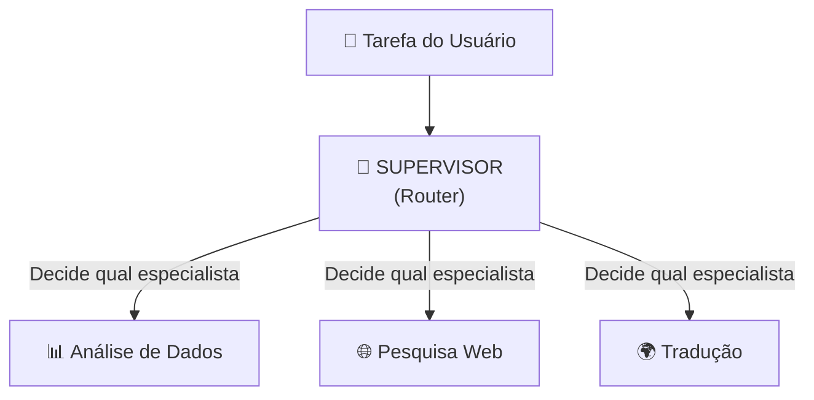
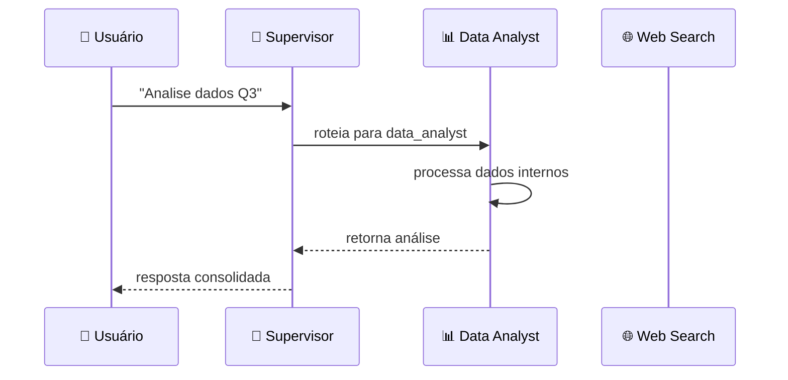
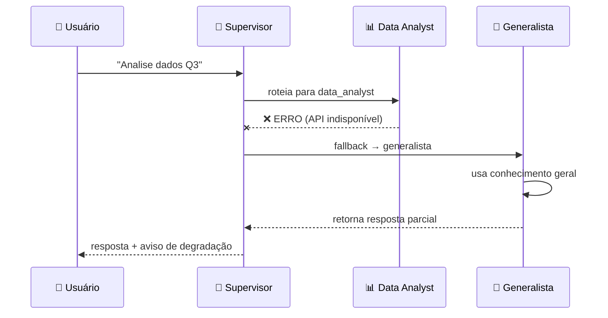

# Capítulo 08 — Sistema Multiagente

## ⚠️ Pré-requisito

Você precisa ter concluído o módulo [Capítulo 07 — Planejamento: Planejamento](../07-planejamento/MATERIAL.md). Especificamente, precisa saber:

- Como planejar sequências de ações para agentes autônomos
- Quando um agente deve agir sozinho vs. coordenar com outros

---

## 📋 Sumário

### Core (obrigatório)

1. [Por que Múltiplos Agentes?](#por-que-múltiplos-agentes)
2. [Arquitetura Supervisor-Especialista](#arquitetura-supervisor-especialista)
3. [Roteamento: LLM vs Heurísticas](#roteamento-llm-vs-heurísticas)
4. [Degradation Elegante](#degradation-elegante)
5. [Custos em Multiagente](#custos-em-multiagente)

### 🔬 Avançado (opcional na primeira leitura)

1. [Arquitetura Multiagente](#️-arquitetura-multiagente)
2. [Pipeline na Prática — Passo a Passo](#pipeline-na-prática--passo-a-passo)

### Prático

1. [O que você vai ver](#-o-que-você-vai-ver)
2. [Exercício Prático](#exercício-prático)
3. [Perguntas para Reflexão](#perguntas-para-reflexão)
4. [Resumo do Módulo](#resumo-do-módulo)
5. [Troubleshooting](#troubleshooting)
6. [📦 Infraestrutura do Curso](#infraestrutura-do-curso-importante)

---

## 📦 Infraestrutura do Curso (IMPORTANTE!)

Antes de começar, entenda como o código está organizado:

```
applied-ai-agents/
├── modules/          ← Cada módulo do curso (você está aqui)
│   └── 08-multiagente/
│       ├── MATERIAL.md    ← Este arquivo
│       ├── run.py         ← Código executável (supervisor + especialistas)
│       ├── architecture.md ← Diagramas detalhados da arquitetura
│       └── exercises.py    ← Exercícios práticos (IMPLEMENTE os TODOs!)
├── shared/             ← MÓDULOS COMPARTILHADOS (usados em TODOS os módulos)
│   ├── cost.py          ← Funções de custo (count_tokens, estimate_cost)
│   ├── security.py      ← Gerenciamento de API keys
│   ├── governance.py    ← ActionRequest, RiskLevel, require_approval()
│   └── logging_config.py ← Configuração de logging + measure_latency()
└── data/               ← Dados de exemplo
```

### Por que `sys.path.insert(0, ...)` no código?

Quando você roda `python modules/08-multiagente/run.py`, o Python procura imports **só na pasta atual** (`modules/08-multiagente/`). Mas o `shared/` fica na raiz (`applied-ai-agents/shared/`).

A linha:

```python
sys.path.insert(0, str(Path(__file__).parent.parent))
```

Diz ao Python: "Além da pasta atual, também procure na pasta **dois níveis acima**" — que é onde o `shared/` está.

> 💡 **Analogia:** É como dizer ao Python para procurar livros não só na estante atual, mas também na prateleira de cima. Sem isso, `from shared.cost import count_tokens` falha com `ModuleNotFoundError`.

### O que cada módulo `shared/` faz?

| Módulo | Função | Quando usar |
| -------- | -------- | ------------- |
| `shared/cost.py` | Contar tokens, estimar custo, formatar preço | Sempre que chamar LLM ou medir consumo |
| `shared/security.py` | Ler API keys do `.env` com validação | Sempre que precisar de autenticação |
| `shared/governance.py` | ActionRequest, RiskLevel, require_approval(), safe_execute() | Ferramentas que modificam dados |
| `shared/logging_config.py` | Configurar logs estruturados + medir latência | Para debug e monitoramento |

> ⚠️ **Importante:** Você **não precisa entender** a implementação interna do `shared/`. Só precisa saber que essas funções existem e usá-las. A implementação será explicada nos módulos seguintes.

---

## 🎯 Objetivos de Aprendizagem

Ao final deste módulo, você será capaz de:

- [ ] **Explicar** por que múltiplos agentes especializados superam um agente genérico único
- [ ] **Projetar** uma arquitetura supervisor-especialista com roteamento adequado
- [ ] **Comparar** roteamento baseado em LLM vs heurísticas (custo vs flexibilidade)
- [ ] **Implementar** graceful degradation quando um especialista falha
- [ ] **Calcular** custos adicionais do multiagente (supervisor + especialistas)

> 💡 **Dica:** Multiagente é mais caro que agente único, mas entrega qualidade muito superior. O segredo é usar modelos pequenos no supervisor e só escalar para modelos grandes nos especialistas quando necessário.

---

## Conceitos Fundamentais

### Por que Múltiplos Agentes?

Um único agente tentando fazer tudo é como um generalista tentando ser expert em todas as áreas. Sistemas multiagente oferecem:

| Agente Único | Múltiplos Agentes |
| -------------- | ------------------- |
| Prompt genérico | Prompts especializados por domínio |
| Falha única = sistema todo falha | Especialista falha = fallback para outro |
| Custo alto (contexto grande) | Custo otimizado (cada agente tem contexto mínimo) |
| Dificil de debugar | Isolamento de problemas por especialista |

### Por que isso existe?

Agentes únicos têm um problema fundamental: **quanto mais fazem, pior ficam**.

Quando você dá a um único modelo 5 tarefas diferentes (analisar dados, pesquisar na web, traduzir, classificar texto, gerar código), o prompt precisa cobrir todos os casos. Isso significa:

- Prompt enorme e confuso
- Modelo se confunde entre contextos diferentes
- Se uma tarefa falha, todas as outras também

Com múltiplos agentes especializados:

- Cada um tem um prompt focado na sua área
- Falha isolada não derruba o sistema
- Fácil de adicionar novos especialistas sem tocar nos existentes

### Erros Comuns de Iniciantes

| Erro | Consequência | Correção |
| ------ | -------------- | ---------- |
| Supervisor muito inteligente | Custa mais (LLM grande no roteamento) | Usar modelo pequeno (gpt-4o-mini) para rotear |
| Especialistas com prompts sobrepostos | Supervisor não sabe qual chamar | Delimitar claramente o escopo de cada especialista |
| Sem fallback | Um especialista falha = sistema para | Graceful degradation: tenta outro ou retorna parcial |
| Contexto compartilhado demais | Custo explode (cada agente vê tudo) | Cada agente recebe APENAS o necessário |

### 🏗️ Arquitetura Multiagente

> 📖 Fonte: **[EN]** Systems Thinking for Agentic AI · Ediz Najim · 2026 · OEBPS/c4FV —
> "A multi-agent system divides responsibility across specialized components."

> Referência completa: [architecture.md](architecture.md)

A topologia supervisor-especialista é composta por 4 camadas:

```
[Usuário] → [Gateway] → [Supervisor] → [Especialistas]
              ↑              ↓              ↓
         [Cache]     [Monitor/Custo]  [Fallback Router]
```

| Camada | Responsabilidade | Modelo recomendado |
| -------- | ------------------ | -------------------- |
| **Gateway** | Recebe task, valida input | Nenhum (HTTP) |
| **Supervisor** | Classifica intenção + roteia | gpt-4o-mini (barato) |
| **Especialistas** | Executam tarefas específicas | gpt-4o-mini ou gpt-4o |
| **Fallback Router** | Redireciona se especialista falha | Mesma classe ou genérico |

**Fluxo completo:**

1. Usuário envia task → Gateway valida
2. Supervisor recebe task → analisa intenção com modelo barato
3. Supervisor roteia para especialista mais adequado
4. Especialista executa tarefa com prompt focado no domínio
5. Se especialista falha → Fallback Router tenta outro ou retorna parcial
6. Supervisor consolida resposta final
7. Monitor conta tokens/custo por caminho

**Trade-off chave:** supervisor inteligente (gpt-4o) = melhor roteamento mas mais caro; supervisor simples (gpt-4o-mini) = barato mas pode rotear errado.

### Arquitetura Supervisor-Especialista



O supervisor:

1. **Entende** a intenção da tarefa
2. **Roteia** para o especialista mais adequado
3. **Coordena** retries e fallbacks
4. **Consolida** a resposta final

### Roteamento: LLM vs Heurísticas

> 📖 Fonte: **[EN]** Systems Design for the LLM Era · Sampriti Mitra · OEBPS/Text/Chapter_4 —
> "It also decides which LLMs it should serve, based on the availability of the LLMs and the response times and the use case, whether accuracy is required or low latency is more preferred."

Dois approaches para decidir qual especialista chamar:

**LLM-based routing** (produção):

```python
response = client.chat.completions.create(
    model="gpt-4o-mini",
    messages=[{"role": "user", "content": 
        f"Qual especialista deve lidar com: '{task}'?\n"
        f"Especialistas disponíveis: {specialists}"}]
)
```

**Heuristic routing** (demonstração):

```python
if "dados" in task.lower():
    return data_analyst_agent
elif "traduz" in task.lower():
    return translation_agent
```

Heurísticas são mais rápidas e baratas, mas menos flexíveis. LLM routing adapta-se a novas tarefas sem código novo.

### Degradation Elegante

> 📖 Fonte: **[EN]** Systems Thinking for Agentic AI · Ediz Najim · 2026 · OEBPS/c2N0 —
> "Graceful degradation allows the system to continue in a reduced but controlled mode instead of failing completely."

Quando um especialista falha, o sistema não para — ele tenta alternativas:

```
Especialista A falha → Tenta Especialista B → Se B também falhar → Resposta parcial + aviso
```

Isso é chamado de **graceful degradation** (degradação elegante/falha graciosa): o sistema continua funcionando (mesmo que parcialmente) ao invés de crashar completamente.

### Pipeline na Prática — Passo a Passo

Antes de calcular custos, veja como uma tarefa real flui pelo sistema. Quando um usuário envia:

> *"Analise os dados do relatório Q3 e gere um resumo"*

O sistema executa este ciclo:

```
1️⃣  USUÁRIO envia → "Analise os dados do relatório Q3..."
         ↓
2️⃣  SUPERVISOR recebe → analisa intenção: "análise de dados"
         ↓
3️⃣  ROTEIA para → data_analyst_agent (especialista em dados)
         ↓
4️⃣  ESPECIALISTA processa → lê dados, gera análise
         ↓
5️⃣  ESPECIALISTA retorna → resultado da análise
         ↓
6️⃣  SUPERVISOR consolida → formata resposta final
         ↓
7️⃣  USUÁRIO recebe → resposta completa
```

**Diagrama de sequência** (visão temporal):



**E se o especialista falhar?** O pipeline continua com fallback:



**Código mínimo funcional** — o que acontece em cada etapa:

```python
# Etapa 1-2: Receber e analisar intenção
task = "Analise os dados do relatório Q3"
intention = classify_intention(task)  # → "data_analysis"

# Etapa 3: Roteamento
specialist = ROUTER[intention]  # → data_analyst_agent

# Etapa 4-5: Execução com fallback
try:
    result = specialist.execute(task)
except SpecialistError:
    console.print("[yellow]⚠️ Especialista indisponível, usando fallback[/]")
    result = generalist_agent.execute(task)

# Etapa 6-7: Consolidação e resposta
response = format_response(result, intention)
print(response)
```

> 💡 **Checkpoint:** Se você entendeu o fluxo acima, está pronto para entender por que multiagente custa mais que agente único. Cada seta no diagrama = uma chamada ao LLM = tokens = dinheiro.

### Custos em Multiagente

> 📖 Fonte: **[EN]** Systems Thinking for Agentic AI · Ediz Najim · 2026 · OEBPS/c4FV —
> "A multi-agent system divides responsibility across specialized components."

Cada chamada ao LLM custa tokens. Em multiagente, temos custos adicionais porque o supervisor faz uma chamada extra para rotear antes dos especialistas:

```
Custo_Total = Custo_Supervisor + Σ Custo_Especialistas
```

Exemplo prático com 3 especialistas:

| Etapa | Chamadas | Modelo | Custo Estimado |
| ------- | -------- | ------ | -------------- |
| Roteamento | 1 | gpt-4o-mini | $0.0003 |
| Especialista A (chamado) | 1 | gpt-4o-mini | $0.0015 |
| Especialista B (não chamado) | 0 | — | $0.0000 |
| Especialista C (fallback) | 1 | gpt-4o-mini | $0.0015 |
| **Total** | **3** | — | **$0.0033** |

Compare com agente único na mesma tarefa: ~$0.0020.

O supervisor faz pelo menos 1 chamada (roteamento), e cada especialista pode fazer múltiplas chamadas (com retry). Isso significa que multiagente é tipicamente **mais caro** que agente único — mas entrega **melhor qualidade**. O trade-off vale a pena quando:

- Qualidade > custo (produção real)
- Especialistas especializados reduzem erros (menos retrabalho)
- Fallbacks previnem falhas totais (disponibilidade maior)

## 🎬 O que você vai ver

Antes de rodar o código, aqui está uma prévia do que o programa vai fazer:

```
$ python modules/08-multiagente/run.py

👤 Supervisor recebe: "Classificar ticket urgente"

🔄 Roteamento:
   Tipo: classificação → Especialista A

🤖 Especialista A processa...
   Output: "URGENTE - Prioridade máxima"

⚡ Especialista B falhou (simulado)
   Fallback: redistribuindo para Especialista A

📊 Log de roteamento gerado
💰 Custo total: $0.015
```

## Exercício Prático

Execute `python modules/08-multiagente/run.py` e observe:

1. Como o supervisor roteia diferentes tipos de tarefas
2. O que acontece quando um especialista falha (simulado)
3. Como o fallback redistribui para outro especialista
4. O log completo de roteamento gerado

## Perguntas para Reflexão

1. Se você tivesse 20 especialistas, o roteamento ficaria caro demais? Que alternativa existiria?
2. Como coordenar dois especialistas que precisam trabalhar juntos na mesma tarefa?
3. Quando faria sentido ter agentes hierárquicos (supervisor → sub-supervisores → especialistas)?

---

## ❓ Troubleshooting

Erros comuns que iniciantes encontram neste módulo:

| Erro | Causa | Solução |
| ------ | ------- | --------- |
| `ModuleNotFoundError: No module named 'shared'` | Esqueceu `sys.path.insert(0, ...)` ou roda do diretório errado | Certifique-se de rodar `python modules/08-multiagente/run.py` a partir da raiz do projeto |
| Supervisor roteia tudo para o mesmo especialista | Keywords muito genéricas ou sobrepostas | Refinar keywords por especialista, usar palavras mais específicas |
| Custo explode com muitos especialistas | Cada especialista faz chamadas LLM extras | Usar gpt-4o-mini no supervisor, limitar especialistas chamados |
| Fallback em loop infinito | Lista de especialistas sem verificação | Contador máximo de tentativas + lista de já-tentados |
| Contexto compartilhado cresce demais | Agentes copiam contexto completo | Compartilhar apenas chaves necessárias (subset do dict) |
| Hierarquia profunda = latência alta | Cada nível adiciona ~20% overhead | Limitar a 2 níveis máximos; usar cache para respostas frequentes |

---

## 📌 Resumo do Módulo

Multi-agent supervisor é a arquitetura mais usada para tarefas complexas:

1. **Especialização > Generalização** — um supervisor roteia perguntas para especialistas. Cada especialista domina uma área, não precisa entender tudo.

2. **Roteamento LLM vs Heurística** — heurística (keyword matching) é barata e rápida mas inflexível. LLM routing entende intenção mas custa tokens. Use heurística para categorias claras, LLM para ambíguas.

3. **Graceful degradation = plano B** — se o especialista de finanças falha, fallback para generalista é melhor que erro 500. Sempre tenha fallbacks.

4. **Custos multiplicados** — cada especialista adiciona chamadas. Supervisor → Especialista = 2 chamadas por pergunta. Para 10 especialistas, custo pode subir 10x.

5. **Hierarquia escala** — supervisor → sub-supervisores → especialistas funciona para dezenas de agentes. Mas cada nível adicionia latência.

> ✅ **Você está pronto para:** Agora que seu agente é multi-especializado, vamos colocá-lo em produção com API REST.

## ✅ Checklist: Como Saber Se Você Atingiu o Objetivo

Marque cada item **só se conseguir fazer sem olhar o material**:

- [ ] Explico por que dividir trabalho entre especialistas reduz erros
- [ ] Descrevo o papel do supervisor no roteamento de tarefas
- [ ] Explico como fallback funciona quando um especialista falha
- [ ] Rodo `run.py` e explico o log de roteamento gerado
- [ ] Digo 2 situações onde multi-agentes vale a pena vs agente único

> ⚠️ Se marcou menos de 3 itens, releia as seções correspondentes antes de prosseguir.

---

## 🔗 Próximos Passos

Com multi-agentes, você tem um sistema inteligente mas ainda local. Para usar em produção, precisa de uma interface acessível — uma API REST.

→ Leia o módulo [Capítulo 09 — Producao: Deploy em Produção](../09-producao-api/MATERIAL.md) para aprender FastAPI e Docker.

---

## Material Complementar

(empty)

---

## 🧭 Navegação

| ← Anterior | Índice | Próximo → |
| --- | --- | --- |
| [← P3a-3: Planejamento e Retomada](../07-planejamento/MATERIAL.md) | [📖 Sumário do curso](../../README.md) | [Capítulo 09 — Producao: Produção (FastAPI) →](../09-producao-api/MATERIAL.md) |
