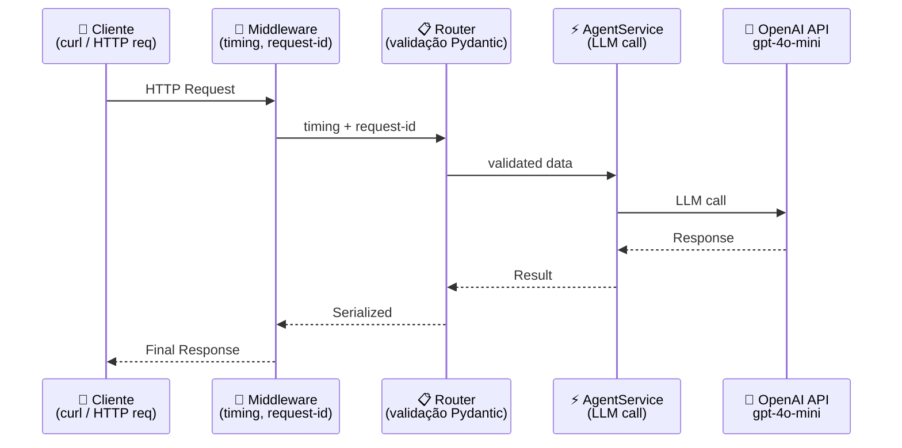
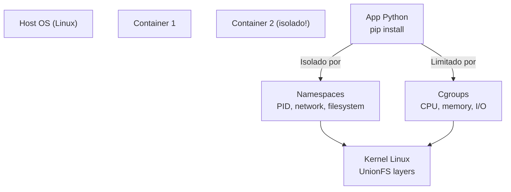

# Módulo 09 — Produção (API REST com FastAPI)

## ⚠️ Pré-requisito

**Conceitual:** você precisa ter concluído o módulo [Módulo 08 — Sistema Multiagente](../08-multiagente/MATERIAL.md). Especificamente, precisa saber:

- Como construir sistemas multiagente coordenados
- Quando usar arquitetura single-agent vs. multi-agent

**Operacional (novo neste arco):** a partir daqui o curso usa **git, Docker e um servidor web**. Se
você nunca mexeu com isso, pare e faça primeiro o **[Setup de Produção](../../SETUP-PRODUCAO.md)**
(guia de transição dos Módulos 01–08 para o Arco 4). Ele garante que você tenha as ferramentas
instaladas e verificadas antes do primeiro código deste módulo.

> ⚙️ **Checklist rápido antes de começar:** `docker run hello-world` funciona? `git --version`
> responde? Você sabe que `uvicorn` sobe um servidor que fica rodando? Se qualquer resposta for "não",
> abra o [SETUP-PRODUCAO.md](../../SETUP-PRODUCAO.md) agora.

---

## 📋 Sumário

### 🔵 Core Obrigatório

1. Objetivos de Aprendizagem
2. De Script a Produto
3. Erros Comuns de Iniciantes
4. FastAPI — Framework Moderno
5. Fluxo de uma Requisição na API
6. O que você vai ver
7. Exercício Prático
8. Perguntas para Reflexão
9. Resumo do Módulo

### 🔬 Avançado — OPCIONAL

 1. Arquitetura de Produção (ver `architecture.md`)
 2. Modelos Pydantic como Contrato
 3. Middleware de Monitoramento
 4. Docker — Empacotamento Consistente
 5. Como o Docker Realmente Funciona (internals)
 6. docker-compose — Infraestrutura Completa

### 🛠️ Prático

 1. 📦 Infraestrutura do Curso
 2. ❓ Troubleshooting

---

## 🎯 Objetivos de Aprendizagem

Ao final deste módulo, você será capaz de:

- [ ] **Construir** uma API REST com FastAPI para expor seu agente como serviço
- [ ] **Validar** inputs do usuário com Pydantic models (contrato cliente-servidor)
- [ ] **Implementar** middleware de monitoramento (timing, request-id, logging estruturado)
- [ ] **Dockerizar** sua aplicação para deploy consistente em qualquer ambiente
- [ ] **Entender** como o Docker funciona internamente (namespaces, cgroups, layers)

> 💡 **Dica:** Este é o módulo que transforma seu script local em um produto real. Sem uma API, seu agente é um brinquedo pessoal. Com uma API, vira algo que 100 pessoas podem usar simultaneamente.

---

## Conceitos Fundamentais

### De Script a Produto

> 📖 Fonte: **[EN]** Context Engineering for Multi-Agent Systems · Denis Rothman · 2025 · EPUB/Chapter_10 —
> "While the core logic remains unchanged, the surrounding infrastructure must evolve to meet the demands of a production environment."

Até agora, executamos scripts Python isolados. Em produção, precisamos de:

| Script Local | API de Produção |
| ------------- | ----------------- |
| Executa e para | Fica rodando 24/7 |
| Um usuário por vez | Múltiplos usuários simultâneos |
| Sem autenticação | Com validação e segurança |
| Logs no terminal | Logs estruturados em arquivo |
| Sem versionamento | Com versionamento e docs |

### Por que isso existe?

Um script local funciona perfeitamente quando você está desenvolvendo. Mas imagine seu agente sendo usado por 100 pessoas ao mesmo tempo:

```
Script local:    Usuário A → [processa] → Resposta → Usuário B espera...
                ↑ TRAVA aqui!

API produção:   Usuário A → [processa] ↘
                Usuário B → [processa] →→ Respostas simultâneas
                Usuário C → [processa] ↗
```

Sem uma API, seu agente é um produto de uso individual. Com uma API, vira um **produto escalável**.

### Erros Comuns de Iniciantes

| Erro | Consequência | Correção |
| ------ | -------------- | ---------- |
| Não validar input do usuário | Modelo recebe texto malicioso ou corrompido | SEMPRE usar Pydantic models para validar |
| Expor chaves de API no código | Qualquer pessoa pode roubar e gastar sua chave | Variáveis de ambiente (.env), nunca hardcode |
| Ignorar timeouts | Requisição fica presa indefinidamente | Timeout de 30s como padrão |
| Logar dados sensíveis | Vaza tokens, emails, CPF nos logs | Sanitizar logs, nunca logar conteúdo completo |
| Não testar localmente antes de deploy | Bug só aparece em produção | Testar com `--serve` antes de dockerizar |

### FastAPI — Framework Moderno

FastAPI é um framework web para Python que oferece:

1. **Autodocumentação**: Swagger UI automática em `/docs`
2. **Validação automática**: Pydantic valida requests automaticamente
3. **Type hints**: Tipagem forte com inferência de schemas
4. **Async/await**: Suporte nativo a operações assíncronas
5. **Performance**: Uma das frameworks Python mais rápidas (comparável a Go/Node.js)

### Fluxo de uma Requisição na API



Cada requisição passa por 4 camadas antes de chegar ao LLM.

### 🏗️ Arquitetura de Produção

> 📖 Fonte: **[EN]** Systems Thinking for Agentic AI · Ediz Najim · 2026 · OEBPS/c2JR —
> "Architecture is the discipline that keeps these parts from collapsing into one opaque workflow."

> 🔬 **AVANÇADO — OPCIONAL**: Esta seção detalha a arquitetura interna. Para o módulo, foque nos conceitos de Gateway → Middleware → Router → AgentService.

Referência completa: [architecture.md](architecture.md)

A aplicação de produção é composta por 5 camadas independentes:

```
[Cliente] → [Gateway HTTP] → [Router] → [AgentService] → [LLM API]
              ↑                  ↓            ↓              ↓
         [Docker]        [Middleware] [Pydantic] [Retry/Timeout]
```

| Camada | Responsabilidade | Framework |
| -------- | ------------------ | ----------- |
| **Gateway** | Expõe endpoints HTTP | FastAPI |
| **Middleware** | Timing, request-id, logging | fastapi.middleware |
| **Router** | Roteia para service correto | fastapi.APIRouter |
| **AgentService** | Lógica de negócio + LLM call | openai.OpenAI |
| **Pydantic** | Validação de input/output | pydantic.BaseModel |

**Fluxo completo:**

1. Cliente envia HTTP request → Gateway recebe
2. Middleware adiciona timing + request-id
3. Router valida input com Pydantic (rejeita inválidos)
4. AgentService processa (chama LLM, usa tools se necessário)
5. Response volta pelo mesmo caminho invertido

**Deploy:** Docker containeriza todas as camadas num ambiente consistente.

### Modelos Pydantic como Contrato

> 🔬 **AVANÇADO — OPCIONAL**: Pydantic é usado para validação automática de inputs. Entenda como "formulário de cadastro" que o servidor usa para verificar se os dados estão corretos antes de processar.

Os modelos definem o contrato entre cliente e servidor:

```python
class AgentRequest(BaseModel):
    message: str                    # Obrigatório
    model: str = "gpt-4o-mini"      # Opcional com default
    use_tools: bool = False         # Booleano
    max_iterations: int = Field(ge=1, le=10, default=3)  # Validado

class AgentResponse(BaseModel):
    answer: str
    tokens_input: int
    tokens_output: int
    cost_usd: float
    conversation_id: str
```

Isso garante que:

- Requests inválidos são rejeitados antes de chegar à lógica
- Clients sabem exatamente o formato esperado
- Docs Swagger são gerados automaticamente

### Middleware de Monitoramento

> 📖 Fonte: **[EN]** Systems Design for the LLM Era · Sampriti Mitra · OEBPS/Text/Chapter_6 —
> "We define a tiered approach using observability platforms (e.g."

> 🔬 **AVANÇADO — OPCIONAL**: Middleware intercepta todas as requisições para adicionar observabilidade (timing, request-id, logging).

Middleware intercepta todas as requisições para adicionar observabilidade:

```python
class MonitoringMiddleware:
    async def __call__(self, request, call_next):
        start = time.time()
        request_id = str(uuid.uuid4())[:8]
        
        # Adiciona headers de tracking
        response = await call_next(request)
        
        elapsed = time.time() - start
        response.headers["X-Request-ID"] = request_id
        response.headers["X-Response-Time"] = f"{elapsed*1000:.0f}ms"
        
        return response
```

Headers customizados permitem:

- Rastrear cada request individualmente nos logs
- Medir latência por endpoint
- Debugar problemas em produção

> ⏸️ **Rode agora — suba a API local**
> Antes de ler sobre Docker, coloque a API de pé:
> ```bash
> python modules/09-producao-api/run.py --serve
> ```
> Abra `http://localhost:8000/docs` no navegador e teste o endpoint `/classify` pelo
> Swagger. Ver a API respondendo torna concreto tudo que veio antes; pare o servidor com
> Ctrl+C quando terminar.

### Docker — Empacotamento Consistente

> 🔬 **AVANÇADO — OPCIONAL**: Docker garante que o código roda igual em qualquer ambiente. Não precisa entender internals agora — foque no conceito de "container = caixa preta isolada".

Docker garante que o código roda igual em qualquer ambiente:

```dockerfile
FROM python:3.11-slim
WORKDIR /app
COPY . .
RUN pip install -e ".[dev]"
EXPOSE 8000
CMD ["uvicorn", "app.main:app", "--host", "0.0.0.0", "--port", "8000"]
```

Vantagens:

- Mesma imagem local e produção
- Dependências congeladas
- Isolamento de ambientes

### Como o Docker Realmente Funciona (OPCIONAL — avançado)

> 🔬 **PARA PRODUÇÃO AVANÇADA**: Esta seção explica como o Docker funciona internamente (namespaces, cgroups, layers). **NÃO é necessário entender isso agora** — foque apenas no conceito de containerização.

Docker **não é uma VM**. Ele não virtualiza hardware — usa recursos do kernel Linux:



**Namespaces**: cada container acha que tem seu próprio sistema de arquivos, rede e processos. É ilusão — o kernel separa tudo.

**Cgroups**: controlam quanto CPU/memória um container pode usar. Sem eles, um container poderia consumir todo o host.

**Layers**: cada `RUN`/`COPY` no Dockerfile cria uma layer read-only. Se você muda só o código (`COPY . .`), as camadas de dependência (`pip install`) são reutilizadas → build mais rápido.

Por isso `docker build` é lento na primeira vez (baixa todas as layers) mas rápido depois (cache de layers).

### docker-compose — Infraestrutura Completa

> 🔬 **AVANÇADO — OPCIONAL**: docker-compose orquestra múltiplos containers (API + banco de dados + cache).

```yaml
services:
  api:
    build: .
    ports: ["8000:8000"]
    depends_on: [chromadb]
  
  chromadb:
    image: chromadb/chroma:latest
    volumes: [chroma_data:/chroma/chroma]
```

Orquestra múltiplos serviços com dependências e volumes persistentes.

> ⏸️ **Rode de novo — via Docker**
> Com a API funcionando localmente, suba o container:
> ```bash
> docker-compose up --build
> ```
> Confirme que `http://localhost:8000/docs` responde igual. Comparar os dois jeitos
> (script vs container) é o ponto desta seção.

## 🎬 O que você vai ver

Antes de rodar o código, aqui está uma prévia do que o programa vai fazer:

```
$ python modules/09-producao-api/run.py --serve

🚀 Iniciando API FastAPI...
   Servindo em http://0.0.0.0:8000
   Docs Swagger: http://localhost:8000/docs

✅ ChromaDB conectado (volumes persistentes)
✅ Modelos carregados

📥 POST /classify {"text": "Ticket urgente"}
   Resposta: {"priority": "URGENTE", "confidence": 0.95}

📊 GET /metrics
   requests_total=15 | avg_latency=1.2s | errors=0
```

## Exercício Prático

Execute `python modules/09-producao-api/run.py --serve` e observe:

1. A API iniciando no port 8000
2. Docs Swagger em <http://localhost:8000/docs>
3. Teste endpoints via curl ou interface interativa do Swagger
4. Métricas acumuladas em `/metrics`

Ou use Docker:

```bash
docker-compose up --build
```

## Perguntas para Reflexão

1. Por que usar async/await na API? Quando isso faz diferença vs quando não faz?
2. Se você tivesse 1000 requisições por segundo, que mudanças seriam necessárias?
3. Como você implementaria autenticação (API keys, JWT) nesta API?

---

## 📖 Glossário

| Termo | Definição | Analogia |
| ------- | ----------- | ---------- |
| **API REST** | Interface que expõe funcionalidade via HTTP e JSON, separando cliente de servidor | Cardápio fixo de um restaurante |
| **FastAPI** | Framework web Python moderno para criar APIs com validação automática | Cozinha pronta com fichas de pedido |
| **Pydantic Model** | Classe que define o contrato (campos/tipos) de entrada e saída da API | Formulário com campos obrigatórios |
| **Endpoint / Rota** | Endereço (ex.: POST /chat) que recebe e devolve JSON | Balcão específico para cada tipo de pedido |
| **Middleware** | Camada que processa toda requisição antes/depois da rota (log, auth) | Segurança que carimba cada crachá na entrada |
| **Observabilidade** (*observability*) | Capacidade de entender o estado interno do sistema a partir das suas saídas (logs, métricas, traces) | Painel do carro: temperatura e RPM revelam o que acontece sob o capô |
| **Docker / Container** | Empacota app + dependências numa imagem reproduzível; container é a instância rodando | Casa pré-fabricada: mesma planta em qualquer terreno |
| **docker-compose** | Arquivo YAML que sobe vários containers juntos em ordem | Capataz erguendo várias casas em sequência |
| **uvicorn** | Servidor ASGI que executa a aplicação FastAPI e fica escutando | Caixa que abre e atende até fechar a loja |

---

## 📌 Resumo do Módulo

Deploy em produção é onde protótipos viram produtos:

1. **FastAPI = padrão para APIs de IA** — validação automática com Pydantic, async nativo, documentação Swagger/OpenAPI gerada automaticamente.

2. **Pydantic models = contrato** — cada endpoint tem input/output definido. Se o cliente enviar formato errado, FastAPI rejeita antes de chamar seu código.

3. **Middleware = observabilidade** — logging estruturado (JSON) permite monitorar latência, tokens usados e erros em tempo real. Sem logging, você está cego.

4. **Docker = portabilidade** — containeriza sua API para rodar em qualquer lugar (local, cloud, edge). Docker Compose orquestra múltiplos containers.

5. **Internals do Docker** — imagens são imutáveis, containers são efêmeros. Volume mount para dados, network para comunicação entre containers.

> ✅ **Você está pronto para:** Agora que sua API está em produção, precisa saber como avaliar a qualidade das respostas.

---

## 📦 Infraestrutura do Curso

Este módulo usa as mesmas estruturas compartilhadas:

**Árvore de diretórios relevante:**

```
applied-ai-agents/
├── modules/
│   └── 09-producao-api/
│       ├── MATERIAL.md          ← Você está aqui
│       ├── run.py               ← API FastAPI funcional
│       ├── exercises.py       ← Exercícios práticos (IMPLEMENTE os TODOs!)
│       ├── architecture.md      ← Diagramas arquiteturais
│       └── app/                 ← Aplicação FastAPI completa
├── shared/
│   ├── logging_config.py        ← setup_logging()
│   └── security.py              ← get_required_secret()
```

**Dependências Necessárias:**

```bash
pip install fastapi uvicorn pydantic openai
# Para Docker: instale Docker Desktop ou Docker Engine
```

**Módulos `shared/` usados neste módulo:**

| Módulo | Função | Analogia |
|--------|--------|----------|
| `shared/logging_config.py` | Configura logs estruturados em JSON | "Câmera de segurança" que grava tudo que acontece |
| `shared/security.py` | Valida variáveis de ambiente (.env) | "Porteiro" que verifica identidade antes de deixar entrar |

**sys.path explicado:**
O comando `sys.path.insert(0, str(Path(__file__).parent.parent))` diz ao Python para procurar módulos dois níveis acima. Imagine que `run.py` é um livro na estante `modules/09-producao-api/` e `shared/` é outro livro na mesma estante principal — o `sys.path` é como abrir a porta entre as estantes.

---

## ❓ Troubleshooting

Erros comuns que iniciantes encontram neste módulo:

| Erro | Causa | Solução |
| ------ | ------- | --------- |
| `ModuleNotFoundError: No module named 'shared'` | Esqueceu `sys.path.insert(0, ...)` ou roda do diretório errado | Certifique-se de rodar `python modules/09-producao-api/run.py` a partir da raiz do projeto |
| `ImportError: cannot import name 'FastAPI'` | FastAPI não instalado | Execute `pip install fastapi uvicorn pydantic` |
| Port 8000 já em uso | Outra API rodando na mesma porta | Matar processo ou mudar porta no `uvicorn` command |
| `docker: command not found` | Docker não instalado | Instalar Docker Desktop (macOS/Windows) ou Docker Engine (Linux) |
| Container não sobe (`docker-compose up`) | Dockerfile incorreto ou dependências faltando | Verificar `docker-compose up --build 2>&1 &#124; tail -50` para erros |
| Swagger UI mostra 404 | API não iniciou corretamente | Verificar logs do terminal — erro geralmente é chave API ausente |

---

## ✅ Checklist: Como Saber Se Você Atingiu o Objetivo

Marque cada item **só se conseguir fazer sem olhar o material**:

- [ ] Explico por que FastAPI é usado em produção (async, auto-docs)
- [ ] Descrevo o que um Dockerfile faz (imagem → container)
- [ ] Explico a diferença entre imagem e container
- [ ] Rodo `run.py --serve` e acesso o Swagger docs
- [ ] Digo 2 vantagens de usar Docker Compose vs docker run

> ⚠️ Se marcou menos de 3 itens, releia as seções correspondentes antes de prosseguir.

---

## 🔗 Próximos Passos

Com sua API em produção, seus agentes estão respondendo perguntas. Mas como saber se as respostas estão boas? Precisamos de avaliação sistemática.

→ Leia o módulo [Módulo 10 — Avaliação e Testes](../10-avaliacao/MATERIAL.md) para aprender golden datasets e testes A/B.

---

## Material Complementar

(empty)

---

## 🧭 Navegação

| ← Anterior | Índice | Próximo → |
| --- | --- | --- |
| [← Módulo 08 — Sistema Multiagente](../08-multiagente/MATERIAL.md) | [📖 Sumário do curso](../../README.md) | [Módulo 10 — Avaliação e Testes →](../10-avaliacao/MATERIAL.md) |
