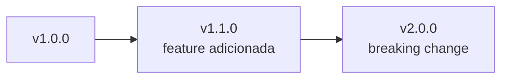
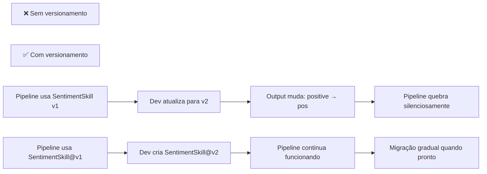
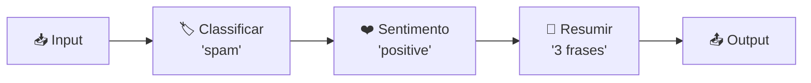

# Módulo 15 — Design e Composição de Skills

## ⚠️ Pré-requisito

Você precisa ter concluído o módulo [Módulo 14 — Cache e Otimização de Custo](../14-cache/MATERIAL.md). Especificamente, precisa saber:

- Como implementar cache para reduzir custo e latência
- Estratégias de invalidation e TTL para caches de LLM

---

## 📋 Sumário

### 🔵 Core Obrigatório

1. Objetivos de Aprendizagem
2. Por que Skills?
3. Erros Comuns de Iniciantes
4. Interface Padrão de uma Skill
5. O que você vai ver
6. Exercício Prático
7. Perguntas para Reflexão
8. Resumo do Módulo

### 🔬 Avançado — OPCIONAL

1. Versionamento Semântico
2. Pipeline Composition
3. Arquitetura do Sistema de Skills
4. Filtros no Pipeline
5. Error Handling em Pipelines

### 🛠️ Prático

 1. 📦 Infraestrutura do Curso
 2. ❓ Troubleshooting

---

## 🎯 Objetivos de Aprendizagem

Ao final deste módulo, você será capaz de:

- [ ] **Definir** uma skill com interface clara (input/output schemas + descrição)
- [ ] **Implementar** versionamento SemVer para evoluir skills sem quebrar consumidores
- [ ] **Compor** pipelines encadeando múltiplas skills como LEGO blocks
- [ ] **Aplicar** filtros no pipeline (confiança mínima, rate limiting, conteúdo proibido)
- [ ] **Gerenciar** error handling em pipelines (fail-fast, fallback, partial success)

> 💡 **Dica:** Skills são o conceito que transforma código bagunçado em sistema modular. Cada skill faz UMA coisa bem — e isso parece simples até você ter 50 skills trabalhando juntas. Este módulo ensina a escalar.

---

## Conceitos Fundamentais

### O que é uma Skill?

Uma skill é uma função especializada com interface bem definida:

```python
class SentimentSkill(BaseSkill):
    def execute(self, input_data: dict) -> dict:
        # Input: {"text": "Produto excelente!"}
        # Output: {"sentiment": "positive", "confidence": 0.85}
```

Skills são como APIs internas — cada uma faz UMA coisa bem.

### Por que isso existe?

Em projetos pequenos, você pode colocar tudo em um arquivo. Mas conforme o sistema cresce:

```
prompts espalhados por 10 arquivos → difícil manter consistência
funções com nomes genéricos (process(), analyze()) → ninguém sabe o que fazem
sem versionamento → atualizar uma skill quebra outro módulo
```

Skills resolvem isso criando **módulos independentes** com contrato claro:

- Cada skill faz UMA coisa bem definida
- Input/output são schemas JSON explícitos
- Versionamento permite evoluir sem quebrar consumidores
- Pipeline composition encadeia skills como LEGO blocks

### Erros Comuns de Iniciantes

| Erro | Consequência | Correção |
| ------ | -------------- | ---------- |
| Skill com muitas responsabilidades | Difícil de testar, debugar, reusar | Uma skill = uma função específica |
| Schema de input/output vago | Pipeline quebra silenciosamente entre skills | JSON Schema rigoroso + validação |
| Não versionar | Atualização quebra pipelines existentes | SemVer: v1.x.x (feature), v2.0.0 (breaking) |
| Hardcode dependências entre skills | Pipeline não funciona se ordem mudar | Registry centralizado com lookup por nome |
| Ignorar erro na skill | Pipeline continua com dado corrompido | Lançar Exception clara + fallback no pipeline |

### Interface Padrão de uma Skill

> 📖 Fonte: **[ZH]** Agent Skills橙皮书 · 2026 · EPUB/Text/page_1_split_80 —
> "市场」的演进。两年前大家分享Prompt，但Prompt太碎片化了，没有结构，没有版本管理，换个模型可能就不好使了。Skill解决了这些问题，它有标准格式、有元数据、有触发条件、可以渐进式加载。Skill就是Prompt的升级版，有了固定格式、有了版本管理、有了标准。"

Toda skill segue o mesmo contrato:

```python
class BaseSkill:
    name: str                    # Identificador único
    version: str                 # SemVer (1.0.0)
    description: str             # O que esta skill faz
    input_schema: dict           # JSON Schema do input esperado
    output_schema: dict          # JSON Schema do output garantido
    
    def execute(self, input_data: dict) -> dict:
        """Executa a skill. Lança Exception em caso de erro."""
        ...
    
    def validate_input(self, data: dict) -> bool:
        """Valida input antes da execução."""
        ...
```

**Por que schemas?** Porque skills trocam dados entre si. Se a skill A produz `{"sentiment": "positive"}` e a skill B espera `{"label": "pos"}`, o pipeline quebra. Schemas garantem compatibilidade.

### Versionamento Semântico

> 📖 Fonte: **[EN]** About FastAPI versions · `fastapi-docs-en/docs/deployment/versions.md` —
> "That's why the current versions are still `0.x.x`, this reflects that each version could potentially have breaking changes."

> 🔬 **AVANÇADO — OPCIONAL**: Versionamento SemVer (Major.Minor.Patch) permite evoluir skills sem quebrar consumidores. Pense como atualizações de app mobile: patch = correção bug, minor = nova feature, major = mudança que quebra compatibilidade.

Cada skill pode ter múltiplas versões:



O registry gerencia qual versão está ativa.

#### Por que versionar skills?



### Pipeline Composition

> 📖 Fonte: **[ZH]** Agent Skills橙皮书 · 2026 · EPUB/Text/page_1_split_58 —
> "后来拆成了5个独立Skill，反而灵活得多。需要哪个用哪个，也可以串联起来用。就像Unix的管道哲学：每个工具做好一件事，通过组合实现复杂功能。"

> 🔬 **AVANÇADO — OPCIONAL**: Encadear skills como corrente de montagem — cada step recebe o output do anterior.

Encadeia skills como corrente de montagem:



Cada step recebe o output do anterior.

### 🏗️ Arquitetura do Sistema de Skills

> 📖 Fonte: **[ZH]** Agent Skills橙皮书 · 2026 · EPUB/Text/page_1_split_80 —
> "市场」的演进。两年前大家分享Prompt，但Prompt太碎片化了，没有结构，没有版本管理，换个模型可能就不好使了。Skill解决了这些问题，它有标准格式、有元数据、有触发条件、可以渐进式加载。Skill就是Prompt的升级版，有了固定格式、有了版本管理、有了标准。"

> 🔬 **AVANÇADO — OPCIONAL**: Esta seção detalha a arquitetura interna (Skill Registry, Version Manager, Pipeline Engine, Filter Chain).

Referência completa: [architecture.md](architecture.md)

O sistema de skills é composto por 4 componentes principais:

```
[Input] → [Skill Registry] → [Pipeline Engine] → [Output]
              ↑                    ↓                  ↓
         [Version Manager]   [Filter Chain]    [Error Handler]
```

| Componente | Responsabilidade | O que gerencia |
| ------------ | ------------------ | ---------------- |
| **Skill Registry** | Armazena todas as skills disponíveis | name → version → implementation |
| **Version Manager** | Controla versões SemVer | v1.x vs v2.x (breaking) |
| **Pipeline Engine** | Encadeia skills na ordem correta | input/output schemas |
| **Filter Chain** | Aplica filtros entre skills | confiança, rate limit, conteúdo |
| **Error Handler** | Gerencia falhas em pipelines | fail-fast, fallback, partial success |

**Fluxo completo:**

1. Request chega → Skill Registry lookup por nome da skill
2. Version Manager seleciona versão ativa (ou específica @v1)
3. Pipeline Engine encadeia: skill A output → skill B input
4. Filter Chain valida entre cada skill (confiança > threshold?)
5. Se skill falha → Error Handler decide: fail-fast / fallback / partial
6. Output final validado contra schema esperado

**Trade-off chave:** pipeline com muitas skills = mais modular mas mais latência; pipeline curto = rápido mas menos flexível.

#### Implementação do Pipeline Engine

```python
class SkillPipeline:
    def __init__(self):
        self.steps = []
        self.filters = []
    
    def add_step(self, skill: BaseSkill):
        """Adiciona skill ao pipeline."""
        self.steps.append(skill)
    
    def add_filter(self, name: str, condition: callable):
        """Adiciona filtro que pode abortar o pipeline."""
        self.filters.append((name, condition))
    
    async def run(self, input_data: dict) -> dict:
        current = input_data
        
        # Aplica filtros antes de cada step
        for step in self.steps:
            for filter_name, condition in self.filters:
                if not condition(current):
                    return {
                        "error": f"Filtro '{filter_name}' falhou",
                        "input": current
                    }
            
            # Executa skill
            try:
                current = await step.execute(current)
            except Exception as e:
                return {
                    "error": f"Skill {step.name} falhou: {e}",
                    "input": current
                }
        
        return current
```

> ⏸️ **Rode agora — registre e execute skills**
> Execute:
> ```bash
> python modules/15-skills/run.py
> ```
> Você verá `1️⃣ Registrando Skills`, `2️⃣ Executando Skills Individuais` (saída JSON de
> sentimento/sumarização/entidades) e `3️⃣ Pipeline Composto`. É a materialização da
> interface padrão e da composição descritas acima.

### Filtros no Pipeline

> 🔬 **AVANÇADO — OPCIONAL**: Filtros aplicam regras entre steps (confiança mínima, rate limiting, conteúdo proibido). Se condição falha, pipeline aborta.

Filtros podem abortar o pipeline se condições não forem satisfeitas:

```python
pipeline.add_filter("qualidade", lambda data: data["confidence"] > 0.7)
```

Se confiança < 0.7, pipeline aborta.

#### Patterns Comuns de Filtro

| Filtro | Quando usar | Exemplo |
| -------- | ------------- | --------- |
| **Confiança mínima** | Antes de processar resultado incerto | `confidence > 0.7` |
| **Tipo de entrada** | Só processar certos tipos | `category == "spam"` |
| **Rate limiting** | Evitar sobrecarga | `calls_per_min < 60` |
| **Conteúdo proibido** | Bloquear inputs inadequados | `has_toxicity(input) == False` |
| **Timeout** | Abortar se demorar demais | `elapsed < 5s` |

> ⏸️ **Rode de novo — acione um filtro**
> No `run.py`, configure um filtro que bloqueie um step do pipeline e execute outra vez.
> Observe o `⏹ Filtro '<nome>' bloqueou` interrompendo a cadeia. Sentir o bloqueio na
> prática prepara você para a seção de tratamento de erros a seguir.

### Error Handling em Pipelines

> 📖 Fonte: **[ZH]** Agent Skills橙皮书 · 2026 · EPUB/Text/page_1_split_71 —
> "这里面有一个关键设计：每个阶段的产出都必须写入文件。第7章讲过「边做边存」的教训，流水线型Skill把这个原则发挥到了极致。每一步都写入文件，即使会话中断了，你随时可以说「上次做到第3阶段了，从那里继续」，AI读取文件就能恢复上下文。"

Quando uma skill falha, você tem 3 opções:

```
Opção 1: Fail-fast (padrão)
  [A] → [B] → [C]
  [A] OK → [B] FAIL → Retorna erro imediatamente
  → Melhor para: dados críticos onde erro não pode ser ignorado

Opção 2: Fallback (resiliência)
  [A] → [B] → [C]
  [A] OK → [B] FAIL → Usa resultado alternativo de B
  [Fallback] OK → [C] OK
  → Melhor para: serviços externos instáveis

Opção 3: Partial success (tolerância)
  [A] → [B] → [C]
  [A] OK → [B] FAIL → Continua com dados parciais
  [C] processa com o que tem
  → Melhor para: resultados aproximados são aceitáveis
```

### Registry de Skills

> 📖 Fonte: **[ZH]** Agent Skills橙皮书 · 2026 · EPUB/Text/page_1_split_28 —
> "在写这章之前，我花了一个下午把市面上所有Skills平台都逛了一遍。结论是：Skills的数量已经不是问题了，质量才是。全网加起来超过100万个Skills，但真正好用的可能不到1%。"

O registry é um dicionário que mapeia nomes para implementações:

```python
registry = SkillRegistry()

# Registro
registry.register(SentimentSkill())
registry.register(ClassificationSkill())
registry.register(SummarizationSkill())

# Lookup por nome (útil para config dinâmica)
skill = registry.get("sentiment", version="1.0.0")
result = await skill.execute({"text": "Excelente produto!"})
```

**Vantagens do registry:**

- Skills são plugáveis: adicione novas sem mudar código existente
- Testabilidade: substitua skill real por mock no teste
- Observabilidade: logue todas as chamadas via registry
- Feature flags: canary deploy nova versão sem quebrar pipeline

## 📦 Infraestrutura do Curso

Este módulo usa os mesmos módulos compartilhados dos anteriores:

```
applied-ai-agents/
├── modules/
│   ├── 15-skills/
│   │   ├── run.py          ← Executa skill registry + pipeline engine
│   │   └── exercises.py    ← Exercícios práticos (IMPLEMENTE os TODOs!)
├── shared/                  ← Módulos reutilizáveis em TODOS os módulos
│   ├── cost.py              ← count_tokens(), estimate_cost()
│   └── logging_config.py    ← setup_logging(), measure_latency()
└── ...
```

**Dependências necessárias:** nenhuma extra além dos módulos anteriores.

### Analogia: sys.path.insert(0, ...)

Quando você vê `sys.path.insert(0, str(Path(__file__).parent.parent))` no início de cada arquivo Python, pense assim:

> 📚 **Analogia dos Livros na Estante:** Imagine que o Python é uma pessoa procurando livros numa biblioteca. Normalmente ela só procura nas estantes próximas (diretório atual). O `sys.path.insert(0, ...)` é como dizer: "Antes de procurar aqui, também olhe naquela estante específica!" — neste caso, a estante `shared/` que está dois níveis acima. É como dar um atalho para o Python encontrar os módulos compartilhados sem precisar copiá-los para cada pasta.

### Módulos `shared/` Usados Neste Módulo

| Módulo | Função | Como é usado |
|--------|--------|--------------|
| `shared/cost.py` | Contagem de tokens e estimativa de custo | `count_tokens(text, model)` para calcular tokens processados por cada skill |
| `shared/logging_config.py` | Configuração de logs e medição de latência | `setup_logging()` + `measure_latency()` para medir tempo de execução de cada step |

---

## ❓ Troubleshooting

| Problema | Causa Provável | Solução |
| ---------- | ---------------- | --------- |
| `ModuleNotFoundError: No module named 'shared'` | sys.path não configurado corretamente | Verifique `sys.path.insert(0, str(Path(__file__).parent.parent))` no início do arquivo |
| `TypeError: execute() missing 1 required positional argument: 'input_data'` | Skill mal registrada no registry | Verifique se handler recebe dict e retorna dict |
| Pipeline executa mas output está vazio | Schema de output não compatível entre skills | Verifique input_schema/output_schema de cada skill |
| `KeyError: 'skill_name'` | Skill não registrada antes de usar | Chame `registry.register()` antes de `pipeline.execute()` |
| Filtro aborta pipeline inesperadamente | Threshold muito alto ou condição errada | Ajuste threshold (ex: confiança > 0.5 ao invés de > 0.9) |
| `ImportError: No module named jsonschema` | Dependência não instalada | Execute `pip install jsonschema` se quiser validação rigorosa de schemas |

---

## 🎬 O que você vai ver

Antes de rodar o código, aqui está uma prévia do que o programa vai fazer:

```
$ python modules/15-skills/run.py

📝 Registrando skills...
   ✓ skill_analise
   ✓ skill_formatacao
   ✓ skill_validacao

▶️ Executando skill_analise...
   Input: "classificar ticket urgente"
   Output: {"tipo": "classificacao", "prioridade": "urgente"}

🔗 Pipeline encadeado: analise → formatacao → validacao
   Resultado final: JSON estruturado válido

📊 Estatísticas por skill:
   skill_analise:    15 execuções | avg 0.3s
   skill_formatacao: 15 execuções | avg 0.1s
   skill_validacao:  15 execuções | avg 0.05s
```

## Exercício Prático

Execute `python modules/15-skills/run.py` e observe:

1. Como as skills são registradas no registry
2. Execução individual de cada skill
3. Pipeline encadeando múltiplas skills
4. Estatísticas de uso por skill

## Perguntas para Reflexão

1. Quando criar uma nova skill vs combinar existentes?
2. Se uma skill falha no meio do pipeline, como rollback?
3. Como testar pipelines sem chamar LLMs reais?

---

## 📖 Glossário

| Termo | Definição | Analogia |
| ------- | ----------- | ---------- |
| **Skill** | Unidade modular de capacidade com interface padrão, versionada e plugável num agente | Peça Lego que encaixa em qualquer conjunto |
| **Interface Padrão** | Contrato comum (entrada/saída) que torna skills intercambiáveis | Tomada universal: qualquer plugue encaixa |
| **Versionamento Semântico** | Esquema MAJOR.MINOR.PATCH para comunicar compatibilidade entre versões | Etiqueta que avisa se a peça mudou de formato |
| **Pipeline Composition** | Encadear várias skills em sequência para formar um fluxo maior | Linha de montagem passando de estação a estação |
| **Registry de Skills** | Catálogo central que lista skills disponíveis e suas versões | Almoxarifado com inventário de peças |
| **Filtro de Pipeline** | Estágio que seleciona/transforma/pass adiante itens no fluxo | Peneira que só deixa grãos do tamanho certo |

---

## 📌 Resumo do Módulo

Skills são blocos de construção reutilizáveis de agentes:

1. **Interface consistente** — toda skill tem input/output definido. Isso permite compor pipelines como LEGO: cada peça encaixa independentemente da implementação interna.

2. **Versionamento SemVer** — v1.0.0, v1.1.0, v2.0.0. Mudanças breaking exigem novo major. Sem versionamento, update quebra tudo.

3. **Pipeline = composição** — [A] → [B] → [C]. Cada etapa processa output da anterior. Filtros podem abortar se condições não forem satisfeitas (confiança baixa, toxicity, timeout).

4. **Error handling** — fail-fast (padrão), retry (transiente), fallback (degradar). Escolher estratégia depende do custo de falha.

5. **Registry centralizado** — todas as skills registradas em um lugar. Novas skills descobertas automaticamente. Desacoplamento entre definição e uso.

> ✅ **Você está pronto para:** Agora que skills estão organizadas, vamos colocar tudo em produção com CI/CD.

## ✅ Checklist: Como Saber Se Você Atingiu o Objetivo

Marque cada item **só se conseguir fazer sem olhar o material**:

- [ ] Explico o que é skill registry e por que centralizar
- [ ] Descrevo como pipeline encadeia múltiplas skills
- [ ] Explico como testar uma skill com mock
- [ ] Rodo `run.py` e explico as estatísticas por skill
- [ ] Digo 2 vantagens de skills serem plugáveis

> ⚠️ Se marcou menos de 3 itens, releia as seções correspondentes antes de prosseguir.

---

## 🔗 Próximos Passos

Com skills versionadas e pipelines compostos, seu sistema está organizado. Mas como fazer deploy automático com monitoramento e rollback?

→ Leia o módulo [Módulo 16 — Operations de Produção (CI/CD + Monitoramento)](../16-operacoes/MATERIAL.md) para aprender CI/CD, monitoring e métricas.

---

## Material Complementar

(empty)

---

## 🧭 Navegação

| ← Anterior | Índice | Próximo → |
| --- | --- | --- |
| [← Módulo 14 — Cache e Otimização de Custo](../14-cache/MATERIAL.md) | [📖 Sumário do curso](../../README.md) | [Módulo 16 — Operations de Produção (CI/CD + Monitoramento) →](../16-operacoes/MATERIAL.md) |
