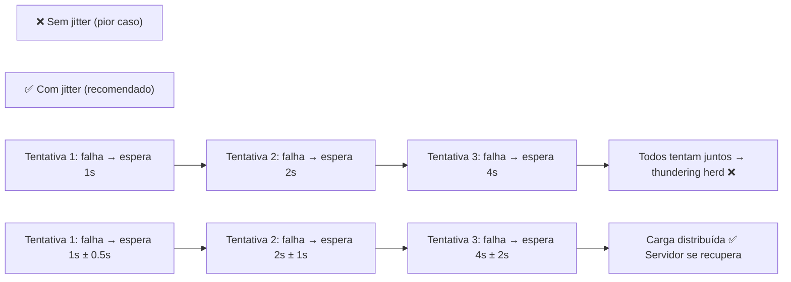

# Módulo 16 — Operations de Produção (CI/CD + Monitoramento)

## ⚠️ Pré-requisito

Você precisa ter concluído o módulo [Módulo 15 — Design e Composição de Skills](../15-skills/MATERIAL.md). Especificamente, precisa saber:

- Como projetar skills reutilizáveis e composáveis
- Patterns de composição de skills para agentes complexos

---

## 📋 Sumário

### 🔵 Core Obrigatório

1. Objetivos de Aprendizagem
2. Por que Monitorar Agentes?
3. Erros Comuns de Iniciantes
4. Métricas Essenciais
5. O que você vai ver
6. Exercício Prático
7. Perguntas para Reflexão
8. Resumo do Módulo

### 🔬 Avançado — OPCIONAL

1. Logging Estruturado
2. Prompt Testing (A/B)
3. Rollback Automático
4. Algoritmo: Exponential Backoff com Jitter

### 🛠️ Prático

 1. 📦 Infraestrutura do Curso
 2. ❓ Troubleshooting

---

## 🎯 Objetivos de Aprendizagem

Ao final deste módulo, você será capaz de:

- [ ] **Implementar** logging estruturado (JSON) para análise programática de logs
- [ ] **Monitorar** métricas essenciais (latência percentil, erro rate, custo/request)
- [ ] **Executar** testes A/B automatizados antes de deploy de prompts
- [ ] **Configurar** rollback automático baseado em degradação de métricas
- [ ] **Aplicar** exponential backoff com jitter para chamadas a APIs instáveis

> 💡 **Dica:** Este é o módulo final do curso — e talvez o mais importante para quem quer trabalhar profissionalmente. Um agente bonito que ninguém monitora é uma bomba-relógio. Ops é o que transforma código funcional em produto confiável.

---

## Conceitos Fundamentais

### Por que Monitorar Agentes?

Em produção, você precisa saber:

- Quantas chamadas estão sendo feitas?
- Quanto está custando?

### Por que isso existe?

Um agente sem monitoramento é como um carro sem painel: você não sabe se está indo bem ou prestes a quebrar.

```
Sem monitoramento: "Acho que está funcionando..."
Com monitoramento: "95% das chamadas < 2s, custo $0.003/call, erro rate 2%"
```

Além disso, agentes de IA têm métricas ÚNICAS que não existem em software convencional:

- **Token consumption**: quanto cada usuário/gastou vs lucro
- **Prompt drift**: prompts mudaram após deploy? Qualidade caiu?
- **Hallucination rate**: quantas respostas foram questionadas pelo usuário?
- **Tool failure rate**: quais ferramentas falham mais?

Sem monitoramento, você descobre problemas quando o cliente reclama — não antes.

### Erros Comuns de Iniciantes

| Erro | Consequência | Correção |
| ------ | -------------- | ---------- |
| Logar tudo sem estrutura | Impossível analisar logs manualmente | JSON estruturado com campos padronizados |
| Não alertar sobre custo | Conta explode sem ninguém perceber | Alerta automático se custo > threshold |
| Só olhar média (mean) | P95 pode ser 10x pior que média | Sempre monitorar percentis (P50, P95, P99) |
| Teste A/B manual | Viés humano na escolha do melhor prompt | Golden dataset + testes automatizados |
| Deploy sem rollback | Bug em produção = horas para corrigir | Rollback automático se métricas degradarem |

### Métricas Essenciais

> 📖 Fonte: **[EN]** AI Engineering · Chip Huyen · 2024 · OEBPS/ch10 —
> "Which metrics you should track are highly application-specific."

| Métrica | O que mede | Threshold típico |
| --------- | ----------- | ----------------- |
| **Latência P50** | Tempo médio | < 1s |
| **Latência P95** | Top 5% mais lento | < 3s |
| **Taxa de erro** | % de falhas | < 5% |
| **Custo/request** | Gasto por chamada | < $0.01 |
| **Requests/min** | Throughput | Variável |

### Prompt Testing (A/B)

> 📖 Fonte: **[EN]** Building LLMs for Production · Peters, Louie & Bouchard, Louis-François · 2024 · OEBPS/cCD —
> "Testing prompts before final use is critical to ensure the output is relevant and error-free."

> 🔬 **AVANÇADO — OPCIONAL**: Antes de deploy, teste novas versões contra dataset golden. Pense como "prova piloto" antes de lançar matéria nova.

Antes de deploy, teste novas versões contra dataset:

```python
tester.add_test_case("Email suspeito", "spam")
tester.add_test_case("Reunião amanhã", "not_spam")

results = await tester.run_test("prompt_v2")
# success_rate: 95% → pode deployar
```

### Rollback Automático

> 📖 Fonte: **[EN]** Autonomous AI Agents for Quantitative Research · Van Der Post, Hayden · 2026 · OEBPS/c3HF —
> "A researcher can pick “canary deployment” and the platform will roll out a sliver of capital, measure drawdowns, and perform an automatic rollback if thresholds are exceeded."

> 🔬 **AVANÇADO — OPCIONAL**: Se métricas degradarem após deploy, rollback automático volta para versão anterior. Pense como "botão de voltar" inteligente.

Se métricas degradarem após deploy, rollback automático:

```python
if dashboard["error_rate"] > 10:
    manager.rollback("spam_classifier")
```

### Logging Estruturado

> 📖 Fonte: **[EN]** Context Engineering for Multi-Agent Systems · Denis Rothman · 2025 · EPUB/Chapter_10 —
> "Instead of writing unstructured text, the engine should emit structured logs, typically in JSON format."

> 🔬 **AVANÇADO — OPCIONAL**: Logs em JSON permitem análise programática automática. Pense como "planilha automática" que cada ação do agente gera uma linha com campos padronizados.

Logs em JSON para facilitar análise:

```json
{
  "timestamp": "2024-01-01T12:00:00Z",
  "level": "info",
  "metric": "latency_ms",
  "value": 250,
  "labels": {"prompt": "v2", "model": "gpt-4o-mini"}
}
```

### Algoritmo: Exponential Backoff com Jitter (retrocesso exponencial com variação aleatória)

> 🔬 **AVANÇADO — OPCIONAL**: Quando API falha, nunca repita imediatamente. Use backoff exponencial + aleatoriedade para evitar "thundering herd" (todos tentam juntos e sobrecarregam servidor).

Quando uma API falha, nunca repita imediatamente. Use exponential backoff (backoff exponencial) — mas com aleatoriedade:



#### A fórmula que todo engenheiro precisa saber

```
wait_time = min(max_delay, base_delay × 2^attempt) + random_jitter

base_delay = 1 segundo
max_delay = 60 segundos
attempt = número da tentativa (0, 1, 2, ...)
random_jitter = random(0, wait_time / 2)

Exemplo prático:
  attempt=0: min(60, 1×2⁰) + rand(0, 0.5) = 1 + 0.3 = 1.3s
  attempt=1: min(60, 1×2¹) + rand(0, 1)   = 2 + 0.7 = 2.7s
  attempt=2: min(60, 1×2²) + rand(0, 2)   = 4 + 1.1 = 5.1s
  attempt=3: min(60, 1×2³) + rand(0, 4)   = 8 + 2.4 = 10.4s
  attempt=5: min(60, 1×2⁵) + rand(0, 8)   = 32 + 3.2 = 35.2s
  attempt=7: min(60, 1×2⁷) + rand(0, 16)  = 60 + 8.1 = 68.1s → capped at 60
```

**Por que jitter é obrigatório?**

Sem jitter, N clientes que falham juntos vão tentar reiniciar juntos. Se N=10.000, você cria um pico de 10.000 requisições simultâneas — exatamente o que causou a falha original. Com jitter, esses 10.000 clientes se espalham por vários segundos, reduzindo a carga instantânea.

**Implementação prática:**

```python
import random
import time

def call_with_retry(api_call, max_retries=5):
    for attempt in range(max_retries):
        try:
            return api_call()
        except Exception as e:
            if attempt == max_retries - 1:
                raise  # último retry, não tenta de novo
            
            wait = min(60, 2 ** attempt) + random.uniform(0, 2 ** (attempt - 1))
            print(f"Tentativa {attempt+1} falhou, esperando {wait:.1f}s")
            time.sleep(wait)
```

Este padrão é usado por AWS SDK, Google Cloud, OpenAI Python client e praticamente toda API de produção.

### 🏗️ Arquitetura de Operations de Produção

> Referência completa: [architecture.md](architecture.md)

O sistema de operations é composto por 4 pilares independentes:

```
[Agentes] → [Metrics Collector] → [Dashboard]
              ↑                      ↓
         [Alert Manager]    [A/B Tester]
              ↑                      ↓
         [Rollback Trigger] [Logging Pipeline]
```

| Pilar | Responsabilidade | Ferramenta |
| ------- | ------------------ | ----------- |
| **Metrics Collector** | Coleta latência, erro rate, custo | openmetrics/prometheus |
| **Logging Pipeline** | Estrutura logs em JSON | logging + JSON formatter |
| **A/B Tester** | Compara prompts contra golden dataset | pytest + custom tester |
| **Rollback Trigger** | Detecta degradação e reverte | threshold-based alert |
| **Alert Manager** | Notifica equipe sobre anomalias | email/slack webhook |

**Fluxo completo:**

1. Agentes rodam em produção → Metrics Collector coleta métricas por request
2. Logging Pipeline estrutura cada evento em JSON com campos padronizados
3. A/B Tester compara nova versão vs atual em golden dataset antes de deploy
4. Se métricas degradam (erro_rate > 10%) → Rollback Trigger reverte automaticamente
5. Alert Manager notifica equipe se anomaly persiste após rollback

**Trade-off chave:** monitorar tudo = visibilidade total mas mais custo de storage; monitorar só o essencial = barato mas pode perder problemas sutis.

## 📦 Infraestrutura do Curso

Este módulo usa os mesmos módulos compartilhados dos anteriores:

```
applied-ai-agents/
├── modules/
│   ├── 16-operacoes/
│   │   ├── run.py          ← Executa metrics collector + prompt tester + rollback manager
│   │   └── exercises.py    ← Exercícios práticos (IMPLEMENTE os TODOs!)
├── shared/                  ← Módulos reutilizáveis em TODOS os módulos
│   ├── cost.py              ← count_tokens(), estimate_cost()
│   └── logging_config.py    ← setup_logging(), measure_latency()
└── ...
```

**Dependências necessárias:** nenhuma extra além dos módulos anteriores.

### Analogia: sys.path.insert(0, ...)

Quando você vê `sys.path.insert(0, str(Path(__file__).parent.parent))` no início de cada arquivo Python, pense assim:

> 📚 **Analogia dos Livros na Estante:** Imagine que o Python é uma pessoa procurando livros numa biblioteca. Normalmente ela só procura nas estantes próximas (diretório atual). O `sys.path.insert(0, ...)` é como dizer: "Antes de procurar aqui, também olhe naquela estante específica!" — neste caso, a estante `shared/` que está dois níveis acima. É como dar um atalho para o Python encontrar os módulos compartilhados sem precisar copiá-los para cada pasta.

### Módulos `shared/` Usados Neste Módulo

| Módulo | Função | Como é usado |
|--------|--------|--------------|
| `shared/cost.py` | Contagem de tokens e estimativa de custo | `count_tokens(text, model)` + `estimate_cost()` para calcular custos por request e alertar quando excede threshold |
| `shared/logging_config.py` | Configuração de logs e medição de latência | `setup_logging()` + `measure_latency()` para logging estruturado e medição de percentis (P50/P95/P99) |

---

## ❓ Troubleshooting

| Problema | Causa Provável | Solução |
| ---------- | ---------------- | --------- |
| `ModuleNotFoundError: No module named 'shared'` | sys.path não configurado corretamente | Verifique `sys.path.insert(0, str(Path(__file__).parent.parent))` no início do arquivo |
| Logs JSON com sintaxe inválida | Aspas ou caracteres especiais não escapados | Use `json.dumps()` sempre para gerar logs, nunca f-strings manuais |
| Percentil P95 muito alto (> 10x P50) | Alguns requests outliers distorcem estatística | Investigar causas específicas (rede lenta, API throttling) |
| Alerta de custo dispara falsamente | Threshold muito baixo para volume real | Ajuste threshold baseado em baseline histórica (ex: 2x média ao invés de valor fixo) |
| Rollback triggers desnecessários | Métricas flutuam naturalmente | Use janela deslizante (ex: média dos últimos 10 minutos) ao invés de ponto único |
| `ImportError: No module named jsonschema` | Dependência não instalada | Execute `pip install jsonschema` se quiser validação rigorosa de schemas |

---

## 🎬 O que você vai ver

Antes de rodar o código, aqui está uma prévia do que o programa vai fazer:

```
$ python modules/16-operacoes/run.py

📋 Registrando prompts...
   prompt_v1: "Classifique a prioridade"
   prompt_v2: "Analise e classifique o ticket"

🧪 Testando prompt_v1...
   Sucesso: 85/100 | Taxa: 85%

🔄 A/B Testing: v1 vs v2
   v1: score=0.85 custo=$0.045
   v2: score=0.92 custo=$0.052
   ✅ v2 aprovado — iniciando deploy

🚀 Deploy progressivo...
   Fase 1: 10% do tráfego → OK
   Fase 2: 50% do tráfego → OK
   Fase 3: 100% do tráfego → ✅ Completo

📊 Dashboard:
   requests/min: 120 | error_rate: 0.5%
   p95_latency: 1.8s | uptime: 99.9%

💓 Health check: todos os serviços OK
```

> ⏸️ **Rode agora — CI/CD de prompts**
>
> Antes de estudar backoff com jitter e rollback, execute o pipeline de operações:
>
> ```bash
> python modules/16-operacoes/run.py
> ```
>
> Você deve ver os prompts registrados e testados (`✅ v1`, `✅ v2`), a comparação A/B, o deploy condicionado ao success_rate acima do threshold e o health check final (`🔎 Health check: todos os serviços OK`).
>
> Se a saída divergir disso, revise os pré-requisitos antes de continuar.

## Exercício Prático

Execute `python modules/16-operacoes/run.py` e observe:

1. Como prompts são registrados e testados
2. Comparação A/B entre versões
3. Deploy só acontece se success_rate > threshold
4. Dashboard com métricas em tempo real
5. Health check do sistema

## Perguntas para Reflexão

1. Se você tivesse 100 prompts ativos, como monitorar tudo sem ser invadido por alerts?
2. Quando fazer rollback manual vs automático?
3. Como criar um dataset de testes representativo para prompts?

---

## 📖 Glossário

| Termo | Definição | Analogia |
| ------- | ----------- | ---------- |
| **Observabilidade** | Capacidade de inferir o estado interno do sistema por suas saídas (logs/métricas/traces) | Painel do carro mostrando temperatura e RPM |
| **Métricas Essenciais** | Indicadores de produção: latência, erro, custo, throughput | Velocímetro, conta-giros e tanque juntos |
| **Rollback Automático** | Reverter para a última versão boa quando uma nova degrada | Botão de desfazer após um deploy ruim |
| **Logging Estruturado** | Registros em campos chave-valor (JSON) pesquisáveis, não texto solto | Planilha de ocorrências em vez de bilhetes |
| **Exponential Backoff** | Aumentar o tempo de espera entre tentativas após falha | Esperar 1s, 2s, 4s... antes de ligar de novo |
| **Jitter** | Variação aleatória somada ao backoff para evitar sincronia de retries | Escalonar horários para não formarem fila |
| **Prompt Testing (A/B)** | Validar mudanças de prompt em produção comparando variantes | Trocar o aviso da vitrine e medir cliques |

---

## 📌 Resumo do Módulo

Production Ops é o que separa protótipos de sistemas em produção:

1. **Logging estruturado = visibilidade** — logs em JSON com trace_id permitem rastrear cada requisição. Sem logging, debugging em produção é impossível.

2. **Métricas essenciais** — latência (p50/p95/p99), taxa de erro, tokens usados, custo por chamada. Dashboards em tempo real alertam antes de usuários reclamarem.

3. **Testes A/B com gates** — nova versão só vai para produção se success_rate > threshold. Rollback automático se métricas pioram. CI/CD com qualidade.

4. **Rollback automático** — se error_rate sobe > 5% após deploy, reverter automaticamente para última versão estável. Tempo de recovery < 5 minutos.

5. **Exponential backoff + jitter** — quando serviços dependentes falham, esperar cada vez mais entre tentativas + variação aleatória. Resolve problemas temporários sem cascata.

> ✅ **Parabéns!** Você completou todo o curso de Agentes de IA Aplicada. Agora tem conhecimento para construir, avaliar, proteger e operar agentes em produção.

## ✅ Checklist Final: O Que Você Dominou

Marque cada item **só se conseguir explicar para alguém**:

- [ ] Entendo o que é LLM e como next-token prediction funciona
- [ ] Sei comparar IA vs regras heurísticas com dados de benchmark
- [ ] Construí um pipeline RAG com embeddings
- [ ] Implementei autoavaliação com max_iterations
- [ ] Dei ferramentas ao agente com tool calling + HITL
- [ ] Adicionei resilience com circuit breaker e checkpoints
- [ ] Entendi arquitetura multi-agentes com supervisor
- [ ] Deployei API com FastAPI + Docker
- [ ] Avaliei qualidade com golden dataset e teste A/B
- [ ] Implementei guardrails contra prompt injection
- [ ] Gerenciei memória de curto e longo prazo
- [ ] Usei streaming para melhor UX
- [ ] Otimizei custos com caching
- [ ] Organizei código com skills versionadas
- [ ] Configurei CI/CD com monitoring e rollback

> 🎓 Se marcou todos os itens, você está pronto para construir agentes de IA em produção!

---

## 🔗 Próximos Passos

Você chegou ao final do curso! Aqui estão sugestões de como continuar:

- **Revisar todos os módulos** — volte aos módulos que achou mais difíceis e pratique novamente
- **Construir projeto próprio** — escolha um problema real e implemente um agente completo usando todas as técnicas aprendidas
- **Explorar frameworks** — LangChain, LlamaIndex, CrewAI, AutoGen — implemente os mesmos padrões em diferentes frameworks
- **Contribuir** — este curso é open source! Envie PRs com melhorias, correções ou novos exercícios

→ Volte ao [README](../../README.md) para ver o roadmap completo do curso.

---

## Material Complementar

(empty)

---

## ✅ Como verificar seus exercícios

Você tem três formas de checar se entendeu e implementou corretamente:

**1. Rodar os exercícios direto no terminal (feedback imediato):**
```bash
python modules/16-operacoes/exercises.py
```
Cada função `test_*` imprime ✓ ou ✗ e mostra quantos passaram. Preencha os `TODO` até ver **"Todos os exercícios passaram!"**.

**2. Validar automaticamente com pytest (modo aluno):**
```bash
CHECK_MY_EXERCISES=1 pytest -k "16-operacoes"
```
Isso roda os `asserts` dos seus exercícios como testes reais — ideal para CI ou para ter certeza antes de entregar.

**3. Comparar com o gabarito:**
Abra [`exercises_solution.py`](exercises_solution.py) depois de tentar sozinho. Ele é a referência oficial e passa em todos os próprios testes.

> 💡 **Dica:** tente primeiro sem olhar a solução. Se travar, releve a seção de conceito; só consulte o gabarito como último recurso — o aprendizado vem do esforço de implementar.

---

## 🧭 Navegação

| ← Anterior | Índice | Próximo → |
| --- | --- | --- |
| [← Módulo 15 — Design e Composição de Skills](../15-skills/MATERIAL.md) | [📖 Sumário do curso](../../README.md) | — |
