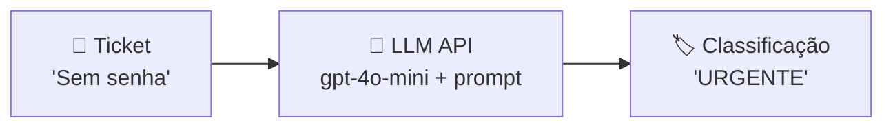
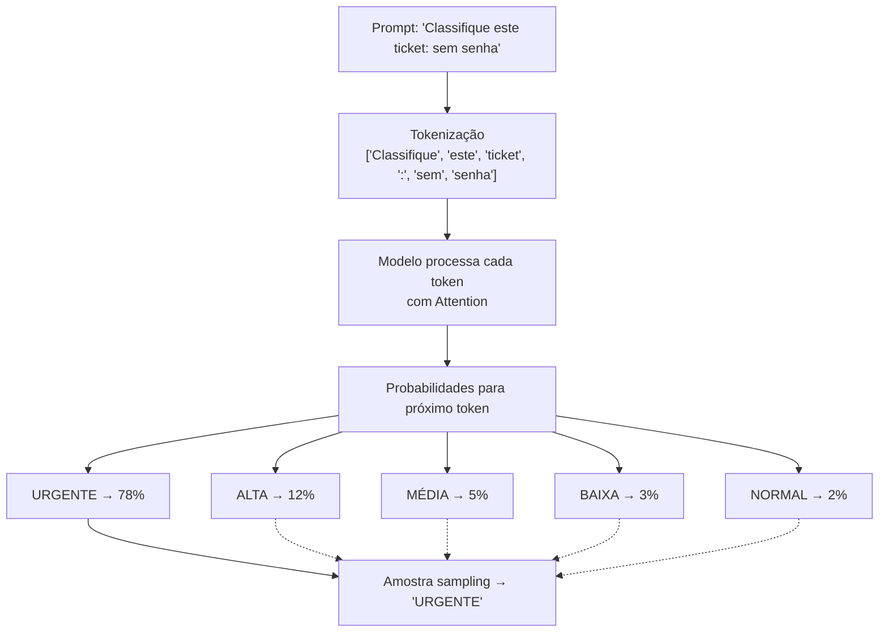

# Material Didático — P0: Primeiro Fluxo com LLM

## ⚙️ Setup Obrigatório

**Antes de começar, leia [SETUP.md](SETUP.md)** para instalar dependências, obter API key e configurar seu ambiente.

---

## ⚠️ Pré-requisito: Leia os Fundamentos Primeiro

Se você **não sabe nada sobre IA ou LLM**, leia primeiro o módulo [p0_fundamentals/MATERIAL.md](../p0_fundamentals/MATERIAL.md). Ele cobre:

- O que é um LLM (e por que ele não "pensa")
- Tokenização e custo
- Prompt engineering básico
- Por que LLMs alucinam
- Glossário de termos essenciais

Este módulo pressupõe que você já entende esses conceitos. **Não vamos repetir o que já está em p0_fundamentals** — vamos focar em construir seu primeiro agente funcional.

---

## 📋 Sumário

1. [O que é um Agente de IA](#o-que-é-um-agente-de-ia)
2. [Fluxo Básico de um Agente](#fluxo-básico-de-um-agente)
3. [System vs. User Messages](#system-vs-user-messages)
4. [A API da OpenAI](#a-api-da-openai)
5. [Estimativa de Custos](#estimativa-de-custos)
6. [Como o LLM Gera Texto](#como-o-llm-gera-texto)
7. [Depuração: Erros Comuns de API](#-depuração-erros-comuns-de-api)
8. [O Problema da Alucinação](#o-problema-da-alucinação)
9. [Algoritmo: BPE](#algoritmo-byte-pair-encoding-bpe)
10. [Reflexão Final](#reflexão-final)

---

## 📦 Infraestrutura do Curso (IMPORTANTE!)

Antes de começar, entenda como o código está organizado:

```
applied-ai-agents/
├── modules/          ← Cada módulo do curso (você está aqui)
│   └── p0_first_llm/
│       ├── MATERIAL.md    ← Este arquivo
│       ├── run.py         ← Código executável
│       └── ...
├── shared/             ← MÓDULOS COMPARTILHADOS (usados em TODOS os módulos)
│   ├── cost.py          ← Funções de custo (count_tokens, estimate_cost)
│   ├── security.py      ← Gerenciamento de API keys
│   └── logging_config.py ← Configuração de logging
└── data/               ← Dados de exemplo
```

### Por que `sys.path.insert(0, ...)` no código?

Quando você roda `python modules/p0_first_llm/run.py`, o Python procura imports **só na pasta atual** (`modules/p0_first_llm/`). Mas o `shared/` fica na raiz (`applied-ai-agents/shared/`).

A linha:

```python
sys.path.insert(0, str(Path(__file__).parent.parent))
```

Diz ao Python: "Além da pasta atual, também procure na pasta **dois níveis acima**" — que é onde o `shared/` está.

> 💡 **Analogia:** É como dizer ao Python para procurar livros não só na estante atual, mas também na prateleira de cima. Sem isso, `from shared.cost import count_tokens` falha com `ModuleNotFoundError`.

### O que cada módulo `shared/` faz?

| Módulo | Função | Quando usar |
| -------- | -------- | ------------- |
| `shared/cost.py` | Contar tokens, estimar custo, formatar preço | Sempre que chamar LLM |
| `shared/security.py` | Ler API keys do `.env` com validação | Sempre que precisar de autenticação |
| `shared/logging_config.py` | Configurar logs estruturados + medir latência | Para debug e monitoramento |

> ⚠️ **Importante:** Você **não precisa entender** a implementação interna do `shared/`. Só precisa saber que essas funções existem e usá-las. A implementação será explicada nos módulos seguintes.

---

## 🎯 Objetivos de Aprendizagem

Ao final deste módulo, você será capaz de:

- [ ] **Construir** o esqueleto mínimo de um agente usando a API da OpenAI
- [ ] **Montar** um prompt completo (system + user messages) para classificação de tickets
- [ ] **Calcular** o custo estimado por chamada baseado no número de tokens
- [ ] **Explicar** como next-token prediction funciona na prática (attention → probs → sampling)
- [ ] **Identificar** quando um LLM vai alucinar e saber mitigar

> 💡 **Dica:** Se você consegue explicar pra um colega por que `temperature=0` é obrigatório para classificação sem olhar o material, está pronto pro próximo módulo.

> 🛑 **Checkpoint:** Pause aqui. Tente responder:
>
> - O que é temperature?
> - Por que classificação precisa de `temperature=0`?
> - Se um ticket tem 200 tokens e gpt-4o-mini custa $0.15/1M tokens, quanto custaria processar 100 tickets?

---

## Conceitos Fundamentais

### O que é um Agente de IA?

Um agente de IA é um sistema que usa modelos de linguagem (LLMs) para tomar decisões e executar tarefas. No nível mais básico, um agente:

1. **Recebe uma entrada** (texto, dados, contexto)
2. **Processa com um LLM** (via API como OpenAI, Anthropic, etc.)
3. **Retorna uma saída** (resposta, decisão, ação)

Neste primeiro módulo, vamos construir o esqueleto mínimo de um agente: receber um "ticket" de suporte e classificar sua prioridade usando o GPT-4o-mini.

### Fluxo Básico de um Agente



Cada chamada passa por 3 etapas:

1. **Montagem do prompt**: sistema + contexto + entrada do usuário
2. **Envio à API**: JSON com model, messages, tokens
3. **Parse da resposta**: extrair conteúdo do JSON retornado

### Por que começar com classificação?

Classificação é uma das tarefas mais comuns em automação com IA:

- Triagem de tickets de suporte
- Filtragem de spam
- Categorização de conteúdo
- Detecção de sentimento

É simples o suficiente para entender o fluxo completo, mas realista o bastante para ser útil no mundo real.

### System vs. User Messages

> 📖 Fonte: **[EN]** AI Engineering · Chip Huyen · 2024 · OEBPS/ch05 —
> "Typically, the instructions provided by application developers are put into the system prompt, while the instructions provided by users are put into the user prompt."

O LLM recebe mensagens organizadas por "papel":

| Papel | Quem fala | Analogia |
|-------|-----------|----------|
| `system` | O programador (instruções gerais) | Manual do assistente |
| `user` | O usuário (pergunta/tarefa) | A solicitação real |

Exemplo:

```python
messages = [
    {"role": "system", "content": "Você é um classificador de tickets."},
    {"role": "user", "content": "Ticket: Sem senha"},
]
```

O **system message** define o comportamento do modelo — como ele deve agir. O **user message** dá a tarefa específica. Separá-los evita que instruções se percam na entrada do usuário.

> 💡 **Analogia:** Pense no system message como as regras de um jogo e o user message como a jogada em si. As regras valem sempre; a jogada muda a cada vez.

---

### A API da OpenAI

> 📖 Fonte: **[EN]** Building LLMs for Production · Peters, Louie & Bouchard, Louis-François · 2024 · OEBPS/cCD —
> "To generate text using LLMs like those provided by OpenAI, you first need an API key for your Python environment."

A OpenAI oferece uma API RESTful para acessar seus modelos. O fluxo básico é:

```python
from openai import OpenAI

client = OpenAI()  # Lê OPENAI_API_KEY do ambiente
response = client.chat.completions.create(
    model="gpt-4o-mini",
    messages=[{"role": "user", "content": "Classifique este ticket..."}]
)
print(response.choices[0].message.content)
```

### Alternativas à OpenAI

> 📖 Fonte: **[EN]** AI Engineering · Chip Huyen · 2024 · OEBPS/ch04 —
> "OpenAI is typically known for their commercial models, but they’ve also open sourced models (GPT-2, CLIP)."

Este curso usa OpenAI porque é a mais documentada, mas os conceitos aplicam-se a qualquer LLM:

| Serviço | Modelo exemplo | Custo relativo |
| --------- | --------------- | ---------------- |
| **OpenAI** | gpt-4o-mini | $$ |
| **Anthropic** | claude-haiku | $$ |
| **Google** | gemini-flash | $ |
| **Alibaba Cloud** | Qwen (Tongyi Qianwen) | $ |
| **Local (grátis)** | Ollama + Llama 3 | Gratuito, mas mais lento |

Para rodar localmente sem custo, explore [Ollama](https://ollama.ai). Para APIs cloud acessíveis, [Alibaba Cloud DashScope](https://dashscope.aliyun.com/) oferece acesso aos modelos Qwen com preços competitivos.

### Estimativa de Custos

> 📖 Fonte: **[EN]** AI Engineering · Chip Huyen · 2024 · OEBPS/ch09 —
> "If each request generates 200 output tokens on average, the cost for decoding 1K requests would be $1.11."

Cada chamada à API tem um custo baseado no número de tokens. Tokens são pedaços de texto (palavras, partes de palavras, pontuação). A OpenAI cobra por milhão de tokens:

| Modelo | Custo por 1M tokens (input) | Custo por 1M tokens (output) |
| -------- | --------------------------- | ---------------------------- |
| gpt-4o-mini | $0.15 | $0.60 |
| gpt-4o | $2.50 | $10.00 |

Para um ticket de 200 tokens, o custo é ~$0.00003 — quase nada, mas importante rastrear em escala.

**Escada do mesmo cálculo** (só multiplicar, com os preços da tabela acima):

| Escala | Cálculo (input gpt-4o-mini) | Custo |
| -------- | ------------------------------- | ------- |
| 1 ticket | 200 ÷ 1.000.000 × $0,15 | ~$0,00003 |
| 100 tickets | 100 × $0,00003 | ~$0,003 |
| 10.000 tickets | 10.000 × $0,00003 | ~$0,30 |

> 💡 Repare: um ticket isolado parece grátis, mas a conta **cresce linearmente** com o
> volume. É por isso que o objetivo do módulo pede pra você *calcular* custo por chamada
> — e por que o checkpoint pergunta quanto custariam 100 tickets.

### Como o LLM Gera Texto

O LLM **não pensa**. Ele faz uma coisa muito específica: prevê o próximo token.



**Attention**: cada palavra no prompt influencia todas as outras. Em "sem senha", a palavra "sem" aumenta a probabilidade de "URGENTE" porque o modelo aprendeu que essa combinação indica prioridade alta.

**Next-token prediction**: o modelo gera uma palavra por vez. Cada palavra gerada vira input para gerar a próxima. É por isso que prompts mal escritos produzem respostas piores — o modelo só vê tokens, não significado.

> 💡 **Analogia:** Imagine um autógrafo preditivo no celular. Você digita "Bom dia" e o celular sugere "como vai você?". O LLM faz algo similar, mas para milhões de palavras diferentes.

---

### 🐛 Depuração: Erros Comuns de API

> 📖 Fonte: **[EN]** Handling Errors · `fastapi-docs-en/docs/tutorial/handling-errors.md` —
> "In these cases, you would normally return an **HTTP status code** in the range of **400** (from 400 to 499)."

Antes de prosseguir, saiba o que fazer quando a API falha. Estes são os 3 erros mais comuns:

| Erro | Causa | Solução |
| ------ | ------- | --------- |
| `InvalidAPIKey` | Chave inválida ou expirada | Verifique `.env` — a chave começa com `sk-`? Está toda copiada? |
| `RateLimitError` | Você excedeu o limite de chamadas | Espere 1 minuto e tente de novo. Configure limites de gasto na dashboard da OpenAI |
| `TimeoutError` | A resposta demorou demais (geralmente >30s) | Tente novamente. Se persistir, use `temperature=0` para respostas mais rápidas |

**Como debugar passo a passo:**

```python
from openai import OpenAI
import os

# 1. Verifique se a variável existe
print("API Key:", os.getenv("OPENAI_API_KEY")[:8] + "...")  # Mostra só os 8 primeiros chars

# 2. Teste com uma chamada mínima
try:
    client = OpenAI()
    response = client.chat.completions.create(
        model="gpt-4o-mini",
        messages=[{"role": "user", "content": "Olá"}],
        max_tokens=10
    )
    print("✅ Funcionando!", response.choices[0].message.content)
except Exception as e:
    print(f"❌ Erro: {e}")
    print("Dica: verifique seu .env e sua conexão com a internet.")
```

Se este teste não funcionar, **não continue** até resolver. Nenhum módulo seguinte vai rodar sem acesso à API.

> 💡 **Dica de segurança:** NUNCA compartilhe sua API key. Se alguém tiver acesso a ela, pode gastar seu crédito. Rotacione (gere uma nova) na [dashboard da OpenAI](https://platform.openai.com/api-keys) se suspeitar que foi exposta.

> 🛑 **Checkpoint:** Pause aqui. Tente responder:
>
> - O que é attention e como ela influencia a classificação de um ticket?
> - Se o prompt diz "sem senha", qual token o modelo tende a gerar primeiro e por quê?
> - Explique next-token prediction com suas próprias palavras (não copie do material).

---

### O Problema da Alucinação

> 📖 Fonte: **[EN]** Building LLMs for Production · Peters, Louie & Bouchard, Louis-François · 2024 · OEBPS/c13B —
> "There are several factors contributing to hallucinations in LLMs."

LLMs **inventam fatos** com confiança. Não é um bug — é consequência direta de como funcionam:

```
Prompt: "Quem foi o primeiro presidente do Brasil?"
Resposta correta: "Deodoro da Fonseca (1889)" ✅

Prompt: "Quem foi o primeiro presidente dos Estados Unidos em 2050?"
Resposta: "John Smith assumiu em janeiro de 2048..." ❌ ALUCINAÇÃO

O modelo NÃO sabe que 2050 ainda não aconteceu.
Ele prevê o próximo token baseado em padrões, não em verdade.
```

**Por que alucinam?**

| Causa | Explicação | Exemplo |
| ------- | ------------ | --------- |
| **Predição, não consulta** | Gera texto provável, não busca fato | Inventa citações de leis |
| **Confiança excessiva** | Tomo assertivo mesmo quando errado | "A resposta é X" (quando não é) |
| **Treino desatualizado** | Dados cortam em data específica | Inventar eventos pós-corte |
| **Prompt ambíguo** | Interpreta mal a intenção | Responde pergunta diferente |

**Como mitigar na prática:**

```
1. RAG (Retrieval Augmented Generation):
   → Modelo responde APENAS com documentos fornecidos
   → Se não tem resposta nos docs → "Não sei"

2. Prompt engineering:
   → "Se você não tem certeza, diga 'não sei'"
   → "Baseie sua resposta SOMENTE nos dados abaixo"

3. Validação posterior:
   → LLM judge verifica se resposta faz sentido
   → Fatos críticos validados contra base de conhecimento

4. Temperature baixa:
   → temperature=0.0 reduz criatividade = menos alucinação
   → Para classificação/extração: SEMPRE usar temp=0
```

**Regra de ouro:** Nunca confie em um LLM para fatos sem verificar. Para tarefas criativas (gerar código, escrever emails), alucinação importa menos. Para tarefas factuais (classificação, extração de dados), alucinação é o problema número 1.

> 🛑 **Checkpoint:** Pause aqui. Tente responder:
>
> - Um LLM pode alucinar ao classificar tickets? Dê um exemplo onde isso aconteceria.
> - Qual técnica de mitigação listada acima seria mais útil para classificação e por quê?
> - Por que `temperature=0` ajuda a reduzir alucinações em tarefas factuais?

---

### Algoritmo: Byte Pair Encoding (BPE) — Visão geral

Tokens não são palavras — são pedaços de bytes combinados por frequência. O BPE aprende padrões frequentes e os compacta em tokens únicos.

**Por que isso importa na prática?**

| Texto | Tokens sem BPE | Tokens com BPE | Custo |
| ------- | --------------- | ---------------- | ------- |
| "I don't know" | 6 tokens | 4 tokens | 33% menos |
| Chinês: "你好世界" | 4 chars | 4 chars | Igual |
| Inglês longo | ~1.3× chars | ~0.4× chars | Muito mais barato |

O BPE economiza dinheiro porque palavras comuns viram 1 token. Palavras raras viram múltiplos tokens.

> 📚 **Quer entender como o BPE funciona por dentro?** Veja a seção avançada abaixo.

---

#### 🔬 Avançado: Como o BPE funciona (OPCIONAL — avançado)

Tokens são pedaços de bytes combinados por frequência. O BPE é um algoritmo de compressão adaptativo:

```
Treino do BPE (pré-processamento):
Texto: "don't don't don't cannot can"
         ↓
[Split em chars]: d,o,n,',t,c,a,n
         ↓
[Frequência]:
  (d,o) → aparece em "don't" (4x), "cannot" (1x) = 5x
  (o,n) → aparece em "don't" (3x), "cannot" (1x) = 4x
  (n,',t) → aparece em "don't" (4x) = 4x
         ↓
[Merge mais frequente]: (d,o) → novo token "do"
Novo vocabulário: "do", "n", "'", "t", "c", "a", ...
         ↓
Repetir N vezes (geralmente 50.000 merges)
Vocabulário final: ~50.000 tokens

Tokenização de entrada:
"don't" → ["do", "n',t"]  (2 tokens, não 5!)
"cannot" → ["ca", "n", "not"] (3 tokens)
```

### Temperature e Sampling: Controle de Criatividade

> 📖 Fonte: **[EN]** AI Engineering · Chip Huyen · 2024 · OEBPS/ch02 —
> "A temperature of 0.7 is often recommended for creative use cases, as it balances creativity and predictability, but you should experiment and find the temperature that works best for you."

O LLM não retorna sempre a mesma resposta para o mesmo prompt. Ele **amostra** do distribution de probabilidades — e você controla isso com `temperature`:

```
Prompt: "Classifique este ticket"
         ↓
LLM calcula probabilidade:
  "URGENTE"    → 78%
  "ALTA"       → 12%
  "MÉDIA"      → 5%
  "BAIXA"      → 3%
  "NORMAL"     → 2%
         ↓
temperature = 0.0 (determinístico):
  → Sempre escolhe "URGENTE" (top-pick)
  → Útil para classificação, extração de dados
temperature = 0.7 (criativo):
  → 78% chance de "URGENTE"
  → 12% chance de "ALTA"
  → 5% chance de "MÉDIA"
  → Pode gerar respostas variadas
  → Útil para brainstorming, geração de texto

> ⚠️ **Importante:** Sempre use `temperature=0` para classificação. Isso garante consistência.

---

## ❓ Erros Comuns e Como Resolver

| Erro | Causa | Solução |
|------|-------|---------|
| `ModuleNotFoundError: No module named 'openai'` | SDK não instalado | Execute `pip install openai` |
| `ValueError: OPENAI_API_KEY não definida` | `.env` ausente | Crie `.env` na raiz com `OPENAI_API_KEY=sua_chave` |
| `AuthenticationError: Incorrect API key` | Chave inválida | Regenerue em platform.openai.com/api-keys |
| `RateLimitError` | Muitas requisições rápido | Espere 5s e tente novamente |
| `ModuleNotFoundError: No module named 'shared'` | Path incorreto | Execute da raiz do projeto |

---

## 📖 Glossário Rápido

| Termo | Definição | Analogia |
|-------|-----------|----------|
| **Token** | Pedaço de texto (palavra, parte de palavra) | Sílabas na leitura |
| **Temperature** | Controle de criatividade (0=determinístico, 1=variado) | Modificador de dado |
| **Prompt** | Texto enviado ao LLM como instrução | Instruções para um assistente muito literal |
| **API Key** | Senha para acessar serviços de IA | Senha para um serviço online |
| **Latency** | Tempo entre envio e resposta | Ping em jogos online |
| **Fallback** | Plano B quando falha | Rota alternativa |
| **JSON** | Formato de dados tipo dicionário Python | Nota estruturada |

---

### 🔬 Avançado: Softmax + Temperature (opcional)

> ⚠️ Esta seção explica o que acontece por dentro. Não é necessária para usar a API.

```python
# Sem temperature (raw logits):
logits = [4.5, 3.2, 1.8, 1.0, 0.5]
probabilities = softmax(logits)  # [0.78, 0.12, 0.05, 0.03, 0.02]

# Com temperature T:
logits_divided = [l / T for l in logits]
if T == 0:  # caso especial
    return argmax(logits)  # só o top
probabilities = softmax(logits_divided)

# T > 1 → distribuição mais plana (mais aleatório)
# T < 1 → distribuição mais afiada (mais certo)
# T = 1 → sem efeito (padrão)
```

**Top-p (nucleus sampling)**: alternativa ao temperature. Em vez de controlar "quão aleatório", controla "quanto do vocabulário considerar":

```
top_p = 0.9 → considera apenas tokens que somam 90% da probabilidade
  ["URGENTE"(78%), "ALTA"(12%)] = 90% → amostra entre esses 2
top_p = 0.5 → só 50% mais prováveis
  ["URGENTE"(78%)] = 78% → precisa de mais tokens → ["URGENTE", "ALTA"]
top_p = 1.0 → todos os tokens possíveis (máxima diversidade)
```

Na prática, use **temperature=0 para classificação** (sempre o mesmo resultado) e **temperature=0.7-1.0 para geração criativa**. Nunca use temperature alta quando precisar de consistência.

### Exemplo Completo: Classificação de Ticket

```python
# Entrada do usuário
ticket = {
    "id": "TKT-001",
    "assunto": "Não consigo acessar minha conta",
    "descricao": "Erro 403 ao tentar logar, já limpei cache"
}

# Prompt enviado ao LLM
prompt = f"""Você é um classificador de tickets de suporte.
Classifique a prioridade deste ticket:

Assunto: {ticket['assunto']}
Descrição: {ticket['descricao']}

Retorne apenas: BAIXA, MEDIA ou ALTA"""

# Resposta do LLM
# → "ALTA"
```

### Regras de Segurança

- **NUNCA** hardcode chaves de API no código
- Use variáveis de ambiente (`.env`)
- Valide que todas as chaves necessárias estão presentes antes de chamar a API
- Nunca exponha chaves nos logs

---

## 🧠 Reflexão Final — Autoavaliação Conceitual

Estas perguntas verificam se você entendeu os conceitos, não só o código. Compare sua resposta com o gabarito abaixo.

### Pergunta 1 — Alucinação

> Analise este prompt:
>
> ```
> "Quais são as melhores práticas de segurança para APIs REST em 2025?"
> ```
>
> O LLM responde com 5 recomendações detalhadas. Porém, nenhuma delas está correta.
>
> **Pergunta:** Por que o LLM alucinou neste caso? Que tipo de tarefa é essa (criativa ou factual)? Qual mitigação você aplicaria?
>
> <details>
> <summary>📝 Gabarito (clique para ver)</summary>
>
> - **Tipo:** Factual — exige conhecimento preciso, não criatividade
> - **Por que alucinou:** O LLM prevê tokens prováveis, não consulta verdade. Ele "sabe" que o formato da pergunta pede uma lista e gerou uma plausível, mas errada.
> - **Mitigação:** Prompt engineering ("Baseie sua resposta SOMENTE nos dados abaixo") + RAG (forçar resposta apenas sobre documentos fornecidos) + temperature=0 para reduzir variação.
>
> </details>

### Pergunta 2 — Next-Token Prediction × Temperature

> **Pergunta:** Explique a relação entre next-token prediction e temperature. Como temperature=0 transforma o processo de "amostragem aleatória" em "decisão determinística"?
>
> <details>
> <summary>📝 Gabarito (clique para ver)</summary>
>
> - **Next-token prediction:** O modelo calcula probabilidades para cada token possível e escolhe um. Com temperature > 0, ele amostra (pode escolher qualquer um, com peso na probabilidade). Com temperature = 0, ele sempre pega o token com maior probabilidade (argmax). É como trocar um dado viciado (temp > 0) por um dado que sempre mostra o mesmo número (temp = 0).
> - **Resultado:** Classificação consistente vs. geração criativa variada.
>
> </details>

---

## 🎬 O que você vai ver

Antes de rodar o código, aqui está uma prévia do que o programa vai fazer:

```
$ python modules/p0_first_llm/run.py

📥 Processando 5 tickets...
🤖 Classificando com LLM (gpt-4o-mini)...

Ticket #1 → URGENTE (custo: $0.001)
Ticket #2 → BAIXA (custo: $0.001)
...

✅ Batch completo!
💰 Custo total: $0.005 | Tempo: 2.3s
```

## Exercício Prático

Execute `python modules/p0_first_llm/run.py` e observe:

1. Como os tickets são processados em batch
2. O relatório de custos gerado automaticamente
3. A diferença entre classificação via LLM vs heurística (regras)

## Perguntas para Reflexão

1. Por que comparar IA com regras heurísticas? Qual a vantagem de cada abordagem?
2. Como você saberia se o LLM está classificando corretamente?
3. O que aconteceria se você processasse 10.000 tickets? Como os custos escalariam?

---

## 📌 Resumo do Módulo

Este foi seu primeiro contato prático com agentes de IA:

1. **Agente = entrada → LLM → saída** — o esqueleto mínimo é simples, mas poderoso. Classificação de tickets é uma das tarefas mais comuns em automação.

2. **Next-token prediction é tudo** — o modelo não "entende" seu prompt, ele calcula probabilidades para cada token seguinte. Attention faz cada palavra influenciar todas as outras. Sampling escolhe entre as probabilidades.

3. **Alucinação é real** — o modelo inventa fatos com confiança. Mitigações: RAG (responder só com docs), temperature=0 para classificação, e prompts explícitos como "se não sabe, diga 'não sei'".

4. **Tokens = custo** — cada chamada custa dinheiro. Para 100 tickets/mês, regras podem bastar. Para 100.000 tickets/mês, IA se paga pela escalabilidade. Sempre rastreie custos.

5. **Segurança primeiro** — nunca hardcode chaves de API. Use variáveis de ambiente (.env). Valide que todas as chaves estão presentes antes de chamar a API.

> ✅ **Você está pronto para:** O próximo módulo (P1) vai te ensinar a comparar IA vs regras com dados reais de benchmark.

---

## ✅ Checklist: Como Saber Se Você Atingiu o Objetivo

Marque cada item **só se conseguir fazer sem olhar o material**:

- [ ] Explico o que é um LLM e next-token prediction em 3 frases
- [ ] Mostro como temperature afeta classificação vs geração criativa
- [ ] Escrevo um prompt anti-alucinação ("se não sabe, diga 'não sei'")
- [ ] Configuro `.env` com API key sem expor a chave no código
- [ ] Rodo `run.py` e explico o que cada linha do output significa
- [ ] Identifico 3 erros comuns de API e como resolvê-los

> ⚠️ Se marcou menos de 4 itens, releia as seções correspondentes antes de prosseguir.

---

## 🔗 Próximos Passos

Agora que você construiu seu primeiro agente, o próximo passo é aprender a **decidir quando usar IA**. Nem toda tarefa precisa de um LLM — às vezes regras heurísticas são melhores (mais rápidas, mais baratas, mais previsíveis).

→ Leia o módulo [P1: Análise de Viabilidade](../p1_feasibility/MATERIAL.md) para aprender a fazer benchmarks comparativos.

---

## 📚 Referências

### Livros

- **"Natural Language Processing with Transformers"** by Lewis et al. (O'Reilly) — Fundamentos teóricos
- **"Designing Machine Learning Systems"** by Chip Huyen (O'Reilly) — Capítulos sobre avaliação e monitoring

### Documentação Oficial

- [OpenAI Python SDK](https://platform.openai.com/docs/libraries/python) — Biblioteca oficial
- [OpenAI Pricing](https://openai.com/api/pricing/) — Tabela de preços por modelo
- [Tokenization Guide](https://platform.openai.com/docs/guides/tokenization) — Como texto vira tokens

### Tutoriais

- [OpenAI Cookbook Examples](https://github.com/openai/openai-cookbook) — Exemplos práticos da OpenAI
- [Python OpenAI SDK Tutorial](https://platform.openai.com/docs/quickstart) — Guia de início rápido
- [Prompt Engineering Guide](https://www.promptingguide.tech/) — Técnicas avançadas de prompt

---

## 🧭 Navegação

| ← Anterior | Índice | Próximo → |
| --- | --- | --- |
| [← P0-F: Fundamentos](../p0_fundamentals/MATERIAL.md) | [📖 Sumário do curso](../../README.md) | [P1: Análise de Viabilidade →](../p1_feasibility/MATERIAL.md) |
