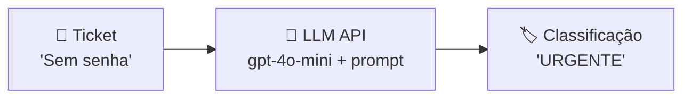
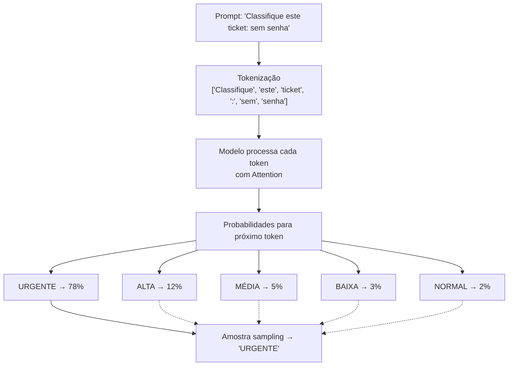

# Material Didático — P0: Primeiro Fluxo com LLM

## ⚠️ Pré-requisito: Leia os Fundamentos Primeiro

Se você **não sabe nada sobre IA ou LLM**, leia primeiro o módulo [p0_fundamentals/MATERIAL.md](../p0_fundamentals/MATERIAL.md). Ele cobre:

- O que é um LLM (e por que ele não "pensa")
- Tokenização e custo
- Prompt engineering básico
- Por que LLMs alucinam
- Glossário de termos essenciais

Este módulo pressupõe que você já entende esses conceitos fundamentais.

---

## Conceitos Fundamentais

### O que é um Agente de IA?

Um agente de IA é um sistema que usa modelos de linguagem (LLMs) para tomar decisões e executar tarefas. No nível mais básico, um agente:

1. **Recebe uma entrada** (texto, dados, contexto)
2. **Processa com um LLM** (via API como OpenAI, Anthropic, etc.)
3. **Retorna uma saída** (resposta, decisão, ação)

Neste primeiro módulo, vamos construir o esqueleto mínimo de um agente: receber um "ticket" de suporte e classificar sua prioridade usando o GPT-4o-mini.

### Fluxo Básico de um Agente



Cada chamada passa por 3 etapas:

1. **Montagem do prompt**: sistema + contexto + entrada do usuário
2. **Envio à API**: JSON com model, messages, tokens
3. **Parse da resposta**: extrair conteúdo do JSON retornado

### Por que começar com classificação?

Classificação é uma das tarefas mais comuns em automação com IA:

- Triagem de tickets de suporte
- Filtragem de spam
- Categorização de conteúdo
- Detecção de sentimento

É simples o suficiente para entender o fluxo completo, mas realista o bastante para ser útil no mundo real.

### A API da OpenAI

A OpenAI oferece uma API RESTful para acessar seus modelos. O fluxo básico é:

```python
from openai import OpenAI

client = OpenAI()  # Lê OPENAI_API_KEY do ambiente
response = client.chat.completions.create(
    model="gpt-4o-mini",
    messages=[{"role": "user", "content": "Classifique este ticket..."}]
)
print(response.choices[0].message.content)
```

### Estimativa de Custos

Cada chamada à API tem um custo baseado no número de tokens. Tokens são pedaços de texto (palavras, partes de palavras, pontuação). A OpenAI cobra por milhão de tokens:

| Modelo | Custo por 1M tokens (input) | Custo por 1M tokens (output) |
| -------- | --------------------------- | ---------------------------- |
| gpt-4o-mini | $0.15 | $0.60 |
| gpt-4o | $2.50 | $10.00 |

Para um ticket de 200 tokens, o custo é ~$0.00003 — quase nada, mas importante rastrear em escala.

### Como o LLM Gera Texto

O LLM **não pensa**. Ele faz uma coisa muito específica: prevê o próximo token.



**Attention**: cada palavra no prompt influencia todas as outras. Em "sem senha", a palavra "sem" aumenta a probabilidade de "URGENTE" porque o modelo aprendeu que essa combinação indica prioridade alta.

**Next-token prediction**: o modelo gera uma palavra por vez. Cada palavra gerada vira input para gerar a próxima. É por isso que prompts mal escritos produzem respostas piores — o modelo só vê tokens, não significado.

### O Problema da Alucinação

LLMs **inventam fatos** com confiança. Não é um bug — é consequência direta de como funcionam:

```
Prompt: "Quem foi o primeiro presidente do Brasil?"
Resposta correta: "Deodoro da Fonseca (1889)" ✅

Prompt: "Quem foi o primeiro presidente dos Estados Unidos em 2050?"
Resposta: "John Smith assumiu em janeiro de 2048..." ❌ ALUCINAÇÃO

O modelo NÃO sabe que 2050 ainda não aconteceu.
Ele prevê o próximo token baseado em padrões, não em verdade.
```

**Por que alucinam?**

| Causa | Explicação | Exemplo |
| ------- | ------------ | --------- |
| **Predição, não consulta** | Gera texto provável, não busca fato | Inventa citações de leis |
| **Confiança excessiva** | Tomo assertivo mesmo quando errado | "A resposta é X" (quando não é) |
| **Treino desatualizado** | Dados cortam em data específica | Inventar eventos pós-corte |
| **Prompt ambíguo** | Interpreta mal a intenção | Responde pergunta diferente |

**Como mitigar na prática:**

```
1. RAG (Retrieval Augmented Generation):
   → Modelo responde APENAS com documentos fornecidos
   → Se não tem resposta nos docs → "Não sei"

2. Prompt engineering:
   → "Se você não tem certeza, diga 'não sei'"
   → "Baseie sua resposta SOMENTE nos dados abaixo"

3. Validação posterior:
   → LLM judge verifica se resposta faz sentido
   → Fatos críticos validados contra base de conhecimento

4. Temperature baixa:
   → temperature=0.0 reduz criatividade = menos alucinação
   → Para classificação/extração: SEMPRE usar temp=0
```

**Regra de ouro:** Nunca confie em um LLM para fatos sem verificar. Para tarefas criativas (gerar código, escrever emails), alucinação importa menos. Para tarefas factuais (classificação, extração de dados), alucinação é o problema número 1.

### Algoritmo: Byte Pair Encoding (BPE)

Tokens não são palavras — são pedaços de bytes combinados por frequência. O BPE é um algoritmo de compressão adaptativo:

```
Treino do BPE (pré-processamento):
Texto: "don't don't don't cannot can"
         ↓
[Split em chars]: d,o,n,',t,c,a,n
         ↓
[Frequência]:
  (d,o) → aparece em "don't" (4x), "cannot" (1x) = 5x
  (o,n) → aparece em "don't" (3x), "cannot" (1x) = 4x
  (n,',t) → aparece em "don't" (4x) = 4x
         ↓
[Merge mais frequente]: (d,o) → novo token "do"
Novo vocabulário: "do", "n", "'", "t", "c", "a", ...
         ↓
Repetir N vezes (geralmente 50.000 merges)
Vocabulário final: ~50.000 tokens

Tokenização de entrada:
"don't" → ["do", "n',t"]  (2 tokens, não 5!)
"cannot" → ["ca", "n", "not"] (3 tokens)
```

**Por que isso importa na prática?**

| Texto | Tokens sem BPE | Tokens com BPE | Custo |
| ------- | --------------- | ---------------- | ------- |
| "I don't know" | 6 (I,d,o,n,',t,k,n,o,w) | 4 (I,do,n't,know) | 33% menos |
| Chinês: "你好世界" | 4 chars | 4 chars | Igual (sem subword) |
| Inglês longo | ~1.3× chars | ~0.4× chars | Muito mais barato |

O BPE economiza dinheiro porque aprende padrões frequentes e os compacta em tokens únicos. Palavras comuns = 1 token. Palavras raras = múltiplos tokens.

### Temperature e Sampling: Controle de Criatividade

O LLM não retorna sempre a mesma resposta para o mesmo prompt. Ele **amostra** do distribution de probabilidades — e você controla isso com `temperature`:

```
Prompt: "Classifique este ticket"
         ↓
LLM calcula probabilidade:
  "URGENTE"    → 78%
  "ALTA"       → 12%
  "MÉDIA"      → 5%
  "BAIXA"      → 3%
  "NORMAL"     → 2%
         ↓
temperature = 0.0 (determinístico):
  → Sempre escolhe "URGENTE" (top-pick)
  → Útil para classificação, extração de dados
temperature = 0.7 (criativo):
  → 78% chance de "URGENTE"
  → 12% chance de "ALTA"
  → 5% chance de "MÉDIA"
  → Pode gerar respostas variadas
  → Útil para brainstorming, geração de texto
temperature = 1.5 (muito criativo):
  → Distribuição mais plana
  → Mais surpresas, menos preciso
  → Útil para ideias inovadoras, mas arriscado
```

#### Como funciona internamente: Softmax + Temperature

```python
# Sem temperature (raw logits):
logits = [4.5, 3.2, 1.8, 1.0, 0.5]
probabilities = softmax(logits)  # [0.78, 0.12, 0.05, 0.03, 0.02]

# Com temperature T:
logits_divided = [l / T for l in logits]
if T == 0:  # caso especial
    return argmax(logits)  # só o top
probabilities = softmax(logits_divided)

# T > 1 → distribuição mais plana (mais aleatório)
# T < 1 → distribuição mais afiada (mais certo)
# T = 1 → sem efeito (padrão)
```

**Top-p (nucleus sampling)**: alternativa ao temperature. Em vez de controlar "quão aleatório", controla "quanto do vocabulário considerar":

```
top_p = 0.9 → considera apenas tokens que somam 90% da probabilidade
  ["URGENTE"(78%), "ALTA"(12%)] = 90% → amostra entre esses 2
top_p = 0.5 → só 50% mais prováveis
  ["URGENTE"(78%)] = 78% → precisa de mais tokens → ["URGENTE", "ALTA"]
top_p = 1.0 → todos os tokens possíveis (máxima diversidade)
```

Na prática, use **temperature=0 para classificação** (sempre o mesmo resultado) e **temperature=0.7-1.0 para geração criativa**. Nunca use temperature alta quando precisar de consistência.

### Exemplo Completo: Classificação de Ticket

```python
# Entrada do usuário
ticket = {
    "id": "TKT-001",
    "assunto": "Não consigo acessar minha conta",
    "descricao": "Erro 403 ao tentar logar, já limpei cache"
}

# Prompt enviado ao LLM
prompt = f"""Você é um classificador de tickets de suporte.
Classifique a prioridade deste ticket:

Assunto: {ticket['assunto']}
Descrição: {ticket['descricao']}

Retorne apenas: BAIXA, MEDIA ou ALTA"""

# Resposta do LLM
# → "ALTA"
```

### Regras de Segurança

- **NUNCA** hardcode chaves de API no código
- Use variáveis de ambiente (`.env`)
- Valide que todas as chaves necessárias estão presentes antes de chamar a API
- Nunca exponha chaves nos logs

---

## Exercício Prático

Execute `python modules/p0_first_llm/run.py` e observe:

1. Como os tickets são processados em batch
2. O relatório de custos gerado automaticamente
3. A diferença entre classificação via LLM vs heurística (regras)

## Perguntas para Reflexão

1. Por que comparar IA com regras heurísticas? Qual a vantagem de cada abordagem?
2. Como você saberia se o LLM está classificando corretamente?
3. O que aconteceria se você processasse 10.000 tickets? Como os custos escalariam?

---

## Referências

### Livros

- **"Natural Language Processing with Transformers"** by Lewis et al. (O'Reilly)

### Documentação Oficial

- [OpenAI Python SDK](https://platform.openai.com/docs/libraries/python)
- [OpenAI Pricing](https://openai.com/api/pricing/)
- [Tokenization Guide](https://platform.openai.com/docs/guides/tokenization)

### Tutoriais

- [OpenAI Cookbook Examples](https://github.com/openai/openai-cookbook) — GitHub
- [Python OpenAI SDK Tutorial](https://platform.openai.com/docs/quickstart) — OpenAI Docs
