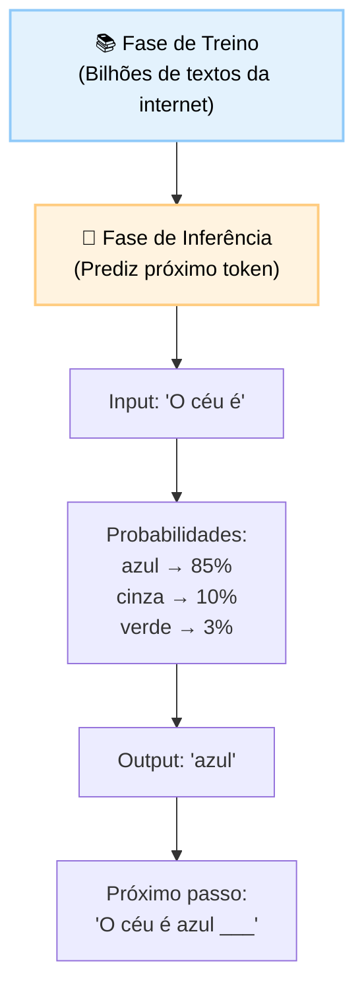
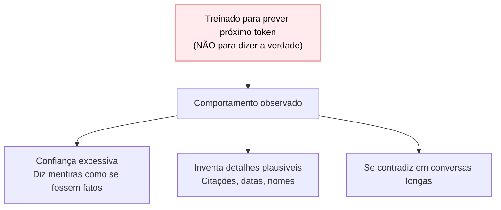

# Material Didático — Fundamentos: O que é IA e LLM?

> 📌 **Nota:** Este material foi revisado para focar nos conceitos essenciais. Seções marcadas como **🔬 Avançado — OPCIONAL** podem ser puladas na primeira leitura.

Este módulo é o **ponto de partida obrigatório** para quem nunca estudou IA ou LLM. Ele responde às perguntas fundamentais que todo agente de IA pressupõe.

---

## ⚠️ Pré-requisito

Nenhum conhecimento técnico prévio é necessário. Este módulo foi projetado para ser acessível a qualquer pessoa — basta saber usar um computador e ter curiosidade sobre como a IA funciona por dentro.

Se você já tem experiência com programação, vai entender os exemplos mais rápido. Se não tem, foque nos conceitos e use o glossário sempre que encontrar siglas.

---

## 📋 Sumário

### Core (obrigatório)

1. [O que é Inteligência Artificial (IA)?](#o-que-é-inteligência-artificial-ia)
2. [O que é um LLM?](#o-que-é-um-llm)
3. [Tokenização: Como texto vira números](#tokenização-como-texto-vire-números)
4. [Prompt Engineering: A arte de falar com LLMs](#prompt-engineering-a-arte-de-falar-com-llms)
5. [Por que LLMs Alucinam?](#por-que-llms-alucinam)
6. [Glossário de Termos Essenciais](#glossário-de-termos-essenciais)

### 🔬 Avançado (opcional na primeira leitura)

1. [Algoritmo: BPE](#algoritmo-byte-pair-encoding-bpe)

### Prático

1. [📦 Infraestrutura do Curso](#infraestrutura-do-curso-importante)
2. [Resumo do Módulo](#resumo-do-módulo)
3. [Checklist Final](#checklist-como-saber-se-você-atingiu-o-objetivo)
4. [Troubleshooting](#troubleshooting)
5. [Exercício Prático](#exercício-prático)

---

## 🔧 Conceitos Técnicos que Usaremos (leitura rápida)

Antes de entrar em IA, precisamos entender 4 conceitos técnicos que aparecerão o tempo todo no curso. **Não precisa dominar agora** — só ter uma intuição geral.

### O que é JSON?

JSON é um formato de texto para organizar dados em pares `chave: valor`. Parece uma ficha de personagem de RPG:

```json
{
  "nome": "João",
  "nivel": 5,
  "equipamento": ["espada", "escudo"]
}
```

**Por que importa?** Toda comunicação entre seu código e a API da OpenAI usa JSON. Quando você envia um prompt, ele vai dentro de um JSON. Quando recebe a resposta, vem em JSON também.

### O que é uma API / HTTP?

API é como um **delivery de comida**: você faz um pedido (requisição) e recebe uma resposta. HTTP é o protocolo — a "linguagem" que seu código fala com servidores na internet.

```
Seu código → POST /chat → {"message": "Olá"} → Servidor OpenAI → Resposta
```

**Por que importa?** Você vai chamar APIs o tempo todo. Cada chamada custa tokens (e dinheiro). Entender que é "pedido → resposta" ajuda a debugar quando algo dá errado.

### O que são variáveis de ambiente e `.env`?

São **chaves secretas** — como a senha do seu jogo. Você coloca num arquivo `.env` que nunca vai para o repositório:

```
OPENAI_API_KEY=sk-abc123def456...
```

Seus códigos leem essa variável ao invés de escrever a chave direto no código. Assim, se alguém clonar seu projeto, não rouba sua chave.

**Por que importa?** Todo módulo do curso usa pelo menos uma variável de ambiente. Se o código diz "não encontrou OPENAI_API_KEY", é porque o `.env` não está configurado corretamente.

### Terminal básico

Você vai usar 3 comandos no terminal:

| Comando | O que faz | Analogia |
| --------- | ----------- | ---------- |
| `cd pasta` | Entra numa pasta | Abrir uma gaveta |
| `ls` ou `dir` | Lista arquivos da pasta | Olhar dentro da gaveta |
| `python arquivo.py` | Executa um script Python | Apertar o botão de play |

**Por que importa?** Todos os exercícios rodam no terminal. Se não sabe navegar pastas, vai travar nos exercícios.

> 💡 **Teste rápido:** Abra o terminal e digite `python --version`. Se mostrar a versão do Python, você está pronto. Se não, siga o SETUP.md antes de continuar.

---

## 📦 Infraestrutura do Curso (IMPORTANTE!)

Antes de começar, entenda como o código está organizado:

```
applied-ai-agents/
├── modules/          ← Cada módulo do curso (você está aqui)
│   └── p0_fundamentals/
│       ├── MATERIAL.md    ← Este arquivo
│       ├── run.py         ← Código executável (4 demos)
│       └── exercises.py   ← Exercícios práticos (IMPLEMENTE os TODOs!)
├── shared/             ← MÓDULOS COMPARTILHADOS (usados em TODOS os módulos)
│   ├── cost.py          ← Funções de custo (count_tokens, estimate_cost)
│   ├── security.py      ← Gerenciamento de API keys
│   └── logging_config.py ← Configuração de logging
└── data/               ← Dados de exemplo
```

### Por que `sys.path.insert(0, ...)` no código?

Quando você roda `python modules/p0_fundamentals/run.py`, o Python procura imports **só na pasta atual** (`modules/p0_fundamentals/`). Mas o `shared/` fica na raiz (`applied-ai-agents/shared/`).

A linha:

```python
sys.path.insert(0, str(Path(__file__).parent.parent))
```

Diz ao Python: "Além da pasta atual, também procure na pasta **dois níveis acima**" — que é onde o `shared/` está.

> 💡 **Analogia:** É como dizer ao Python para procurar livros não só na estante atual, mas também na prateleira de cima. Sem isso, `from shared.cost import count_tokens` falha com `ModuleNotFoundError`.

### Dependências Necessárias

> 📖 Fonte: **[EN]** First dependency "dependable" · `fastapi-docs-en/docs/tutorial/dependencies/sub-dependencies.md` —
> "This is quite simple (not very useful), but will help us focus on how the sub-dependencies work."

Este módulo usa duas bibliotecas externas:

```bash
pip install openai rich
```

| Biblioteca | Para que serve |
|------------|----------------|
| `openai` | Chamar a API da OpenAI (gpt-4o-mini) |
| `rich` | Output bonito no terminal (painéis, cores) |

Se não instalar, o `run.py` avisa e pula os demos que precisam da API — mas os exercícios ainda funcionam.

---

## 🎯 Objetivos de Aprendizagem

Ao final deste módulo, você será capaz de:

- [ ] **Explicar** o que é um LLM e como ele funciona internamente (predição de tokens)
- [ ] **Entender** por que texto vira números (tokenização BPE) e por que isso importa pra custo
- [ ] **Aplicar** técnicas básicas de prompt engineering para obter respostas melhores
- [ ] **Reconhecer** sinais de alucinação e saber mitigá-las na prática
- [ ] **Usar** o glossário de 16 termos sempre que encontrar siglas ou jargões

> 💡 **Dica:** Marque cada checkbox APÓS conseguir explicar o conceito para alguém sem olhar suas anotações. Se não consegue explicar simples, ainda precisa revisar.

---

## 1. O que é Inteligência Artificial (IA)?

IA é um campo da ciência da computação que busca criar sistemas capazes de realizar tarefas que normalmente requerem inteligência humana: entender linguagem, reconhecer imagens, tomar decisões, aprender com dados.

### Subáreas da IA

> 📖 Fonte: **[EN]** Systems Design for the LLM Era · Sampriti Mitra · OEBPS/Text/Chapter_1 —
> "This is the technology that powers self-driving cars, advanced language translation, and generative AI tools."

| Área | O que faz | Exemplo prático |
| ------ | ----------- | ----------------- |
| **Machine Learning (ML)** | Aprende padrões a partir de dados | Recomendação de filmes na Netflix |
| **Deep Learning (DL)** | ML com redes neurais profundas | Reconhecimento facial no celular |
| **NLP (Processamento de Linguagem Natural)** | Entende e gera texto | Tradutor automático, chatbot |
| **Computer Vision** | Interpreta imagens/vídeos | Carro autônomo detectando pedestres |

Os agentes que vamos construir neste curso usam principalmente **NLP + Deep Learning**.

---

## 2. O que é um LLM?

**LLM = Large Language Model** (Modelo de Linguagem Grande). É um tipo de software treinado para entender e gerar texto em linguagem natural.

### Analogia simples

Pense em um estudante que leu **quase toda a internet**: livros, artigos, fóruns, sites, manuais. Esse estudante pode:

- Responder perguntas sobre qualquer assunto
- Escrever emails, códigos, histórias
- Traduzir entre idiomas
- Classificar textos por categoria

Mas há um detalhe crucial: **ele não "entende" como humanos**. Ele prevê qual palavra vem depois de outras palavras, baseado nos padrões que viu durante o treino.

### Como funciona internamente



**Dois momentos distintos:**

| Momento | O que acontece | Duração | Custo |
|---------|----------------|---------|-------|
| **Treino** | Modelo lê trilhões de palavras, ajusta bilhões de parâmetros | Semanas/meses | Milhões de dólares |
| **Inferência** | Modelo recebe prompt e gera resposta | Milissegundos a segundos | Centavos por chamada |

Quando você usa a API da OpenAI, está usando um modelo já treinado. Não treina nada — só faz inferência.

### Por que "Large"?

| Tamanho do Modelo | Parâmetros | Capacidade | Custo |
| ------------------- | ------------ | ------------ | ------- |
| Pequeno (ex: GPT-2) | 1.5 bilhões | Bom para tarefas simples | Barato |
| Médio (ex: Llama 3 8B) | 8 bilhões | Bom equilíbrio | Moderado |
| Grande (ex: GPT-4) | ~1 trilhão* | Excelente para tarefas complexas | Caro |

*\*Número estimado — a OpenAI não divulga o número exato de parâmetros do GPT-4.*

**Parâmetros** são os "botões internos" que o modelo ajustou durante o treino. Mais parâmetros = mais capacidade de capturar nuances, mas também mais custo computacional.

---

## 3. Tokenização: Como texto vira números

Computadores não entendem texto — entendem números. Antes de processar qualquer coisa, o texto é dividido em **tokens**.

### O que é um token?

Token é uma unidade básica de texto. Pode ser:

- Uma palavra inteira (`"ola"`)
- Parte de uma palavra (`"ing"` em `"running"`)
- Pontuação (`"."`, `","`)
- Espaço em branco

```
Texto: "Hello, world!"
Tokens: ["Hello", ",", "world", "!"]
IDs: [15496, 11, 995, 0]
```

### Por que tokens importam?

1. **Custo**: Cada token custa dinheiro. Texto longo = conta alta
2. **Velocidade**: Mais tokens = mais tempo de processamento
3. **Limite**: Todo modelo tem limite máximo (gpt-4o-mini: 128K tokens)
4. **Idioma**: Inglês precisa menos tokens que português ou chinês

### Comparação: palavras vs tokens

> 📖 Fonte: **[EN]** AI Engineering · Chip Huyen · 2024 · OEBPS/ch01 —
> "Tokens balance having fewer units than words while retaining more meaning than individual characters."

| Idioma | "Olá, mundo! Como vai você?" | Tokens aproximados |
| -------- | ------------------------------ | ------------------- |
| Inglês | "Hello, world! How are you?" | ~7 tokens |
| Português | "Olá, mundo! Como vai você?" | ~8 tokens |
| Chinês | "你好，世界！你好吗？" | ~6 tokens |

---

## 4. Prompt Engineering: A arte de falar com LLMs

Um **prompt** é o texto que você envia ao modelo. A qualidade do prompt determina diretamente a qualidade da resposta.

### Estrutura de um prompt

> 📖 Fonte: **[EN]** AI Engineering · Chip Huyen · 2024 · OEBPS/ch05 —
> "You can experiment with different ways to structure your prompts to see which one works best."

```
[SYSTEM PROMPT] — Define o comportamento do modelo
Você é um assistente útil, seguro e conciso.

[USER MESSAGE] — A entrada do usuário
Classifique este ticket: "Não consigo acessar minha conta"

[ASSISTANT MESSAGE] — Resposta do modelo (se houver histórico)
Prioridade: ALTA
```

### Técnicas básicas de prompt engineering

> 📖 Fonte: **[EN]** AI Engineering · Chip Huyen · 2024 · OEBPS/ch05 —
> "Now that we’ve discussed what a prompt is and why prompting works, let’s discuss the best practices for writing effective prompts."

| Técnica | Exemplo | Efeito |
| --------- | --------- | -------- |
| **Ser específico** | "Retorne apenas BAIXA/MEDIA/ALTA" vs "Classifique" | Reduz alucinação |
| **Dar contexto** | "Você é um analista de suporte técnico..." | Melhora relevância |
| **Few-shot examples** | Incluir exemplos de input/output no prompt | Aumenta consistência |
| **Chain of thought** | "Pense passo a passo antes de responder" | Melhora raciocínio |
| **Formato estruturado** | Pedir JSON, tabela ou lista | Facilita parsing posterior |

### Erros Comuns de Iniciantes

| Erro | Por que é ruim | Correção |
| ------ | ---------------- | ---------- |
| Prompt muito vago | Modelo "adivinha" a intenção | Ser específico sobre formato e conteúdo |
| Esperar perfeição na primeira vez | LLMs precisam iteração | Refinar prompt com base nos resultados |
| Ignorar o system prompt | Define o "personalidade" do modelo | Sempre definir papel e restrições |
| Prompt excessivamente longo | Custa mais e pode confundir | Ser direto e objetivo |

---

## 5. Por que LLMs Alucinam?

Alucinação é quando um LLM gera informações falsas com total confiança. **Isso não é um bug — é consequência direta de como funcionam.**

### Causas fundamentais



### Mitigações práticas

| Técnica | Como funciona | Quando usar |
| --------- | --------------- | ------------- |
| **RAG** | Modelo responde APENAS com documentos fornecidos | Tarefas factuais |
| **Temperature baixa** | `temperature=0` reduz criatividade | Classificação, extração |
| **Prompt explícito** | "Se não sabe, diga 'não sei'" | Respostas honestas |
| **Validação posterior** | Outro LLM ou regra verifica a resposta | Dados críticos |
| **Few-shot examples** | Mostra exemplos corretos no prompt | Consistência |

---

## 6. Glossário de Termos Essenciais

Termos que aparecerão repetidamente ao longo do curso:

| Termo | Definição | Analogia |
| ------- | ----------- | ---------- |
| **LLM** | Large Language Model — modelo treinado em texto | Um leitor voraz que prevê a próxima palavra |
| **Prompt** | Entrada enviada ao modelo | A pergunta ou instrução que você faz |
| **Token** | Unidade básica de texto (palavra/parte de palavra) | Sílabas para o modelo |
| **API** | Interface para chamar o modelo remotamente | O "telefone" para falar com o LLM |
| **Inferência** | Gerar resposta a partir de um prompt | Usar o modelo (vs treinar) |
| **Embedding** | Vetor numérico que representa significado de texto | Coordenadas GPS para significado |
| **Temperature** | Controle de aleatoriedade nas respostas | Criatividade vs precisão |
| **Latência** | Tempo entre enviar prompt e receber resposta | Quão rápido responde |
| **Throughput** | Quantas requisições por segundo o sistema aguenta | Capacidade de escala |
| **Alucinação** | Resposta plausível mas factualmente errada | Mentir com confiança |
| **Fine-tuning** | Treinar adicionalmente um modelo pré-treinado | Especializar o modelo |
| **Context window** | Limite de tokens que o modelo pode processar | Memória de trabalho do modelo |
| **System prompt** | Instrução que define o comportamento do modelo | O "manual de instruções" interno |
| **Tool calling** | Modelo decide chamar funções externas | Agente usando ferramentas |
| **RAG** | Retrieval Augmented Generation — busca contexto antes de responder | Consultar enciclopédia antes de responder |
| **SSE** | Server-Sent Events — protocolo para streaming unidirecional | Canal aberto para enviar dados progressivos |

---

## ❓ Troubleshooting

Erros comuns que iniciantes encontram neste módulo:

| Erro | Causa | Solução |
| ------ | ------- | --------- |
| `ModuleNotFoundError: No module named 'shared'` | Esqueceu `sys.path.insert(0, ...)` ou roda do diretório errado | Certifique-se de rodar `python modules/p0_fundamentals/run.py` a partir da raiz do projeto |
| `ModuleNotFoundError: No module named 'openai'` | Não instalou dependências | Execute `pip install openai rich` |
| `OpenAIError: No API key found` | `.env` não configurado ou variável com nome errado | Verifique `.env`: deve ter `OPENAI_API_KEY=sk-...` (sem espaços) |
| Output do `run.py` aparece cortado | Terminal muito pequeno | Aumente o terminal ou redirecione para arquivo: `python run.py > output.txt` |
| Respostas diferentes com `temperature=0` | Bug temporário da API ou modelo mudou | Isso é raro; se acontecer, é comportamento do servidor, não do seu código |
| Tokenização estimada está errada | Simulação grosseira (split + pontuação) | Isso é intencional — tokenização real usa BPE/tiktoken. O importante é entender o conceito |

---

## 📌 Resumo do Módulo

Este módulo plantou as bases que você usará em TODO o curso:

1. **LLMs não pensam** — eles predizem o próximo token baseado em padrões aprendidos durante o treino. Não há "entendimento" real, apenas estatística sofisticada. Mais parâmetros = mais capacidade, mas também mais custo.

2. **Tokens = dinheiro** — cada palavra/parte de palavra custa algo. BPE compacta palavras frequentes em tokens únicos (don't → 2 tokens vs 5 chars). Inglês usa menos tokens que português ou chinês. Prompt engineering eficiente começa entendendo tokenização.

3. **Alucinação é inevitável** — a única defesa é validar respostas críticas. LLMs foram treinados para prever próximo token, NÃO para dizer a verdade. Use RAG para fatos, temperature baixa para classificação, e validação posterior para dados críticos.

4. **Prompt engineering importa** — ser específico, dar contexto, usar few-shot examples, chain of thought e pedir formato estruturado faz diferença enorme na qualidade da resposta. System prompt define a "personalidade" do modelo — nunca ignore.

5. **Glossário é seu amigo** — sempre que encontrar siglas (LLM, RAG, BPE, SSE), consulte a tabela de 16 termos. Dominar essa vocabulária acelera muito o aprendizado dos módulos seguintes.

> ⚠️ **Importante:** Se algum conceito ainda parece confuso, releia esta seção ANTES de prosseguir. Os próximos módulos assumem que você entende estes fundamentos.

---

## ✅ Checklist: Como Saber Se Você Atingiu o Objetivo

Marque cada item **só se conseguir fazer sem olhar o material**:

- [ ] Explico o que é um LLM para alguém usando uma analogia do dia a dia
- [ ] Explico a diferença entre treino e inferência em 2 frases
- [ ] Mostro por que "don't" = menos tokens que "do not"
- [ ] Escrevo um prompt usando pelo menos 2 técnicas (few-shot, chain of thought, formato estruturado)
- [ ] Digo 3 causas de alucinação e 3 mitigações
- [ ] Consulto o glossário quando encontro siglas desconhecidas

> ⚠️ Se marcou menos de 4 itens, releia as seções correspondentes antes de prosseguir.

### Estimativa de Custo Real

> 📖 Fonte: **[EN]** AI Engineering · Chip Huyen · 2024 · OEBPS/ch01 —
> "You may decide to build a model in-house because it seems cheaper than paying for model providers, only to find out after three months that model providers have dropped their prices in half, making in-house the expensive option."

Antes de começar a programar, saiba quanto custa brincar com IA:

| Operação | Modelo | Custo aproximado |
| ---------- | -------- | ------------------ |
| 1 chamada simples | gpt-4o-mini | ~$0.003 (0,3 centavos) |
| Prompt longo (5K tokens) | gpt-4o | ~$0.05 (5 centavos) |
| 100 chamadas de teste | gpt-4o-mini | ~$0,30 |
| Golden dataset com 100 exemplos | gpt-4o-mini | ~$0,30 |

**Regra prática:** No início do curso, use **sempre gpt-4o-mini**. Custa ~10× menos que gpt-4o e é suficiente para aprender. Só troque quando um módulo exigir especificamente um modelo mais poderoso.

---

## 🔗 Próximos Passos

Agora que você entende o que é um LLM e como ele funciona por dentro, está pronto para construir seu primeiro agente de IA.

→ Leia o módulo [P0-First-LLM](../p0_first_llm/MATERIAL.md) para implementar um classificador de tickets com esqueleto mínimo.

---

## Perguntas para Reflexão

1. Por que um LLM pode responder com tanta confiança algo que é completamente falso? O que isso revela sobre como ele foi treinado?
2. Se tokens = dinheiro, como você reescreveria um prompt longo para usar menos tokens mantendo a mesma qualidade?
3. Alucinação é um bug do modelo ou uma característica inevitável? Como isso muda sua abordagem ao usar IA?

---

## Exercício Prático

Este exercício tem duas partes: conceitual + mini-código.

### Parte A — Conceitual (sem código)

Leia este material duas vezes. Na segunda leitura, tente explicar cada um dos 6 tópicos em voz alta como se estivesse ensinando para alguém:

1. Explique o que é um LLM usando uma analogia do dia a dia (cozinha, biblioteca, etc.)
2. Pegue uma frase qualquer e conte quantos tokens ela teria em inglês vs português
3. Escreva um prompt mal formulado e depois reescreva-o usando pelo menos 3 técnicas vistas (few-shot, chain of thought, formato estruturado)
4. Liste 3 situações onde um LLM provavelmente alucinará e 3 mitigações para cada
5. Consulte o glossário e explique 5 termos para alguém

### Parte B — Mini-código (comparação de prompts)

Escolha UM dos prompts que você reescreveu na Parte A. Envie-o para um LLM (pode ser o chat da OpenAI, Claude, ou qualquer outro) e compare:

1. **Prompt original (ruim):** envie e anote a resposta
2. **Prompt refinado:** envie e anote a resposta
3. **Compare:** qual foi melhor? Por quê? O que mudou?

> 💡 Não precisa instalar nada aqui. Use qualquer interface de chat com LLM disponível. O objetivo é sentir na prática a diferença entre um bom e um mau prompt.

---

## Material Complementar

(empty)

### Livros em Inglês

- **"Designing Machine Learning Systems"** by Chip Huyen (O'Reilly) — Capítulos sobre avaliação e monitoring
- **"The Mythical Man-Month"** by Frederick Brooks — Sobre trade-offs em engenharia

### Documentação Oficial

- [OpenAI API Documentation](https://platform.openai.com/docs) — Referência completa da API
- [Python Documentation](https://docs.python.org/3/) — Documentação oficial do Python

### Tutoriais Online

- [Hugging Face Course](https://huggingface.co/course) — Curso gratuito de NLP
- [DeepLearning.AI Short Courses](https://www.deeplearning.ai/short-courses/) — Microcursos sobre IA

---

## 🧭 Navegação

| ← Anterior | Índice | Próximo → |
| --- | --- | --- |
| — | [📖 Sumário do curso](../../README.md) | [P0: Primeiro Fluxo com LLM →](../p0_first_llm/MATERIAL.md) |
