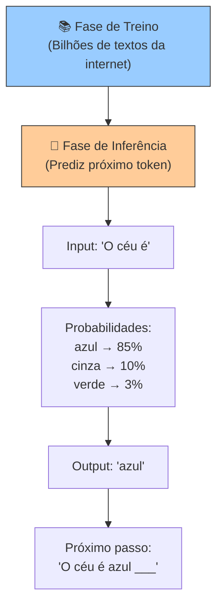
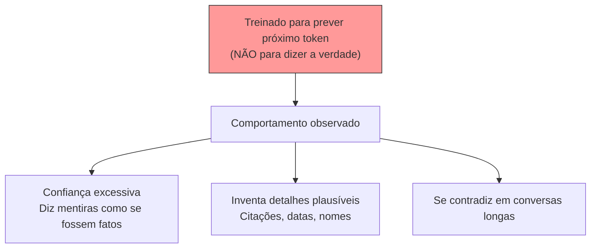

# Material Didático — Fundamentos: O que é IA e LLM?

Este módulo é o **ponto de partida obrigatório** para quem nunca estudou IA ou LLM. Ele responde às perguntas fundamentais que todo agente de IA pressupõe.

---

## 1. O que é Inteligência Artificial (IA)?

IA é um campo da ciência da computação que busca criar sistemas capazes de realizar tarefas que normalmente requerem inteligência humana: entender linguagem, reconhecer imagens, tomar decisões, aprender com dados.

### Subáreas da IA

| Área | O que faz | Exemplo prático |
| ------ | ----------- | ----------------- |
| **Machine Learning (ML)** | Aprende padrões a partir de dados | Recomendação de filmes na Netflix |
| **Deep Learning (DL)** | ML com redes neurais profundas | Reconhecimento facial no celular |
| **NLP (Processamento de Linguagem Natural)** | Entende e gera texto | Tradutor automático, chatbot |
| **Computer Vision** | Interpreta imagens/vídeos | Carro autônomo detectando pedestres |

Os agentes que vamos construir neste curso usam principalmente **NLP + Deep Learning**.

---

## 2. O que é um LLM?

**LLM = Large Language Model** (Modelo de Linguagem Grande). É um tipo de software treinado para entender e gerar texto em linguagem natural.

### Analogia simples

Pense em um estudante que leu **quase toda a internet**: livros, artigos, fóruns, sites, manuais. Esse estudante pode:

- Responder perguntas sobre qualquer assunto
- Escrever emails, códigos, histórias
- Traduzir entre idiomas
- Classificar textos por categoria

Mas há um detalhe crucial: **ele não "entende" como humanos**. Ele prevê qual palavra vem depois de outras palavras, baseado nos padrões que viu durante o treino.

### Como funciona internamente



**Dois momentos distintos:**

| Momento | O que acontece | Duração | Custo |
|---------|----------------|---------|-------|
| **Treino** | Modelo lê trilhões de palavras, ajusta bilhões de parâmetros | Semanas/meses | Milhões de dólares |
| **Inferência** | Modelo recebe prompt e gera resposta | Milissegundos a segundos | Centavos por chamada |

Quando você usa a API da OpenAI, está usando um modelo já treinado. Não treina nada — só faz inferência.

### Por que "Large"?

| Tamanho do Modelo | Parâmetros | Capacidade | Custo |
| ------------------- | ------------ | ------------ | ------- |
| Pequeno (ex: GPT-2) | 1.5 bilhões | Bom para tarefas simples | Barato |
| Médio (ex: Llama 3 8B) | 8 bilhões | Bom equilíbrio | Moderado |
| Grande (ex: GPT-4) | ~1 trilhão* | Excelente para tarefas complexas | Caro |

*\*Número estimado — a OpenAI não divulga o número exato de parâmetros do GPT-4.*

**Parâmetros** são os "botões internos" que o modelo ajustou durante o treino. Mais parâmetros = mais capacidade de capturar nuances, mas também mais custo computacional.

---

## 3. Tokenização: Como texto vira números

Computadores não entendem texto — entendem números. Antes de processar qualquer coisa, o texto é dividido em **tokens**.

### O que é um token?

Token é uma unidade básica de texto. Pode ser:

- Uma palavra inteira (`"ola"`)
- Parte de uma palavra (`"ing"` em `"running"`)
- Pontuação (`"."`, `","`)
- Espaço em branco

```
Texto: "Hello, world!"
Tokens: ["Hello", ",", "world", "!"]
IDs: [15496, 11, 995, 0]
```

### Por que tokens importam?

1. **Custo**: Cada token custa dinheiro. Texto longo = conta alta
2. **Velocidade**: Mais tokens = mais tempo de processamento
3. **Limite**: Todo modelo tem limite máximo (gpt-4o-mini: 128K tokens)
4. **Idioma**: Inglês precisa menos tokens que português ou chinês

### Comparação: palavras vs tokens

| Idioma | "Olá, mundo! Como vai você?" | Tokens aproximados |
| -------- | ------------------------------ | ------------------- |
| Inglês | "Hello, world! How are you?" | ~7 tokens |
| Português | "Olá, mundo! Como vai você?" | ~8 tokens |
| Chinês | "你好，世界！你好吗？" | ~6 tokens |

---

## 4. Prompt Engineering: A arte de falar com LLMs

Um **prompt** é o texto que você envia ao modelo. A qualidade do prompt determina diretamente a qualidade da resposta.

### Estrutura de um prompt

```
[SYSTEM PROMPT] — Define o comportamento do modelo
Você é um assistente útil, seguro e conciso.

[USER MESSAGE] — A entrada do usuário
Classifique este ticket: "Não consigo acessar minha conta"

[ASSISTANT MESSAGE] — Resposta do modelo (se houver histórico)
Prioridade: ALTA
```

### Técnicas básicas de prompt engineering

| Técnica | Exemplo | Efeito |
| --------- | --------- | -------- |
| **Ser específico** | "Retorne apenas BAIXA/MEDIA/ALTA" vs "Classifique" | Reduz alucinação |
| **Dar contexto** | "Você é um analista de suporte técnico..." | Melhora relevância |
| **Exemp few-shot** | Incluir exemplos de input/output no prompt | Aumenta consistência |
| **Chain of thought** | "Pense passo a passo antes de responder" | Melhora raciocínio |
| **Formato estruturado** | Pedir JSON, tabela ou lista | Facilita parsing posterior |

### Erros comuns de iniciantes

| Erro | Por que é ruim | Correção |
| ------ | ---------------- | ---------- |
| Prompt muito vago | Modelo "adivinha" a intenção | Ser específico sobre formato e conteúdo |
| Esperar perfeição na primeira vez | LLMs precisam iteração | Refinar prompt com base nos resultados |
| Ignorar o system prompt | Define o "personalidade" do modelo | Sempre definir papel e restrições |
| Prompt excessivamente longo | Custa mais e pode confundir | Ser direto e objetivo |

---

## 5. Por que LLMs Alucinam?

Alucinação é quando um LLM gera informações falsas com total confiança. **Isso não é um bug — é consequência direta de como funcionam.**

### Causas fundamentais



### Mitigações práticas

| Técnica | Como funciona | Quando usar |
| --------- | --------------- | ------------- |
| **RAG** | Modelo responde APENAS com documentos fornecidos | Tarefas factuais |
| **Temperature baixa** | `temperature=0` reduz criatividade | Classificação, extração |
| **Prompt explícito** | "Se não sabe, diga 'não sei'" | Respostas honestas |
| **Validação posterior** | Outro LLM ou regra verifica a resposta | Dados críticos |
| **Few-shot examples** | Mostra exemplos corretos no prompt | Consistência |

---

## 6. Glossário de Termos Essenciais

Termos que aparecerão repetidamente ao longo do curso:

| Termo | Definição | Analogia |
| ------- | ----------- | ---------- |
| **LLM** | Large Language Model — modelo treinado em texto | Um leitor voraz que prevê a próxima palavra |
| **Prompt** | Entrada enviada ao modelo | A pergunta ou instrução que você faz |
| **Token** | Unidade básica de texto (palavra/parte de palavra) | Sílabas para o modelo |
| **API** | Interface para chamar o modelo remotamente | O "telefone" para falar com o LLM |
| **Inferência** | Gerar resposta a partir de um prompt | Usar o modelo (vs treinar) |
| **Embedding** | Vetor numérico que representa significado de texto | Coordenadas GPS para significado |
| **Temperature** | Controle de aleatoriedade nas respostas | Criatividade vs precisão |
| **Latência** | Tempo entre enviar prompt e receber resposta | Quão rápido responde |
| **Throughput** | Quantas requisições por segundo o sistema aguenta | Capacidade de escala |
| **Alucinação** | Resposta plausível mas factualmente errada | Mentir com confiança |
| **Fine-tuning** | Treinar adicionalmente um modelo pré-treinado | Especializar o modelo |
| **Context window** | Limite de tokens que o modelo pode processar | Memória de trabalho do modelo |
| **System prompt** | Instrução que define o comportamento do modelo | O "manual de instruções" interno |
| **Tool calling** | Modelo decide chamar funções externas | Agente usando ferramentas |
| **RAG** | Retrieval Augmented Generation — busca contexto antes de responder | Consultar enciclopédia antes de responder |
| **SSE** | Server-Sent Events — protocolo para streaming unidirecional | Canal aberto para enviar dados progressivos |

---

## Resumo

Antes de construir agentes, você precisa entender três coisas:

1. **LLMs não pensam** — eles predizem o próximo token baseado em padrões aprendidos durante o treino
2. **Tokens = dinheiro** — cada palavra/parte de palavra custa algo, então eficiência importa
3. **Alucinação é inevitável** — a única defesa é validar respostas críticas

Estes conceitos aparecem em TODOS os módulos seguintes. Se algo parecer confuso, volte aqui para revisar.
