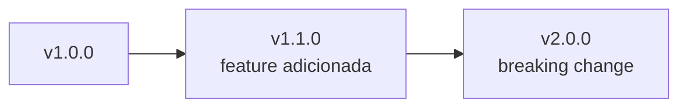
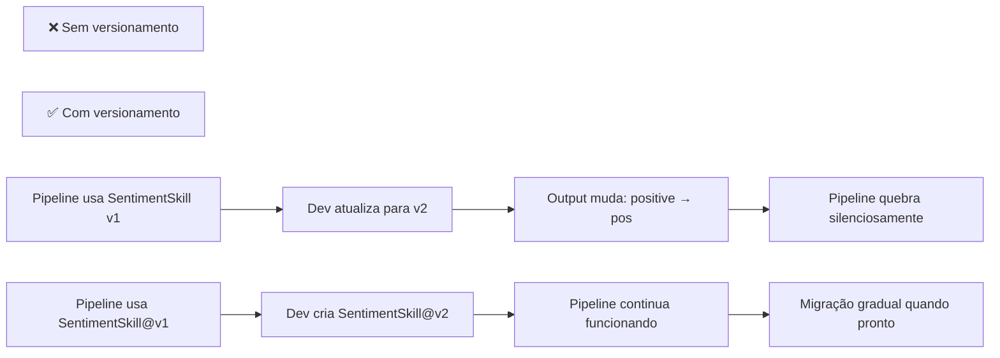
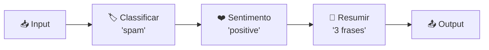

# Material Didático — P10: Design e Composição de Skills

## Conceitos Fundamentais

### O que é uma Skill?

Uma skill é uma função especializada com interface bem definida:

```python
class SentimentSkill(BaseSkill):
    def execute(self, input_data: dict) -> dict:
        # Input: {"text": "Produto excelente!"}
        # Output: {"sentiment": "positive", "confidence": 0.85}
```

Skills são como APIs internas — cada uma faz UMA coisa bem.

### Interface Padrão de uma Skill

Toda skill segue o mesmo contrato:

```python
class BaseSkill:
    name: str                    # Identificador único
    version: str                 # SemVer (1.0.0)
    description: str             # O que esta skill faz
    input_schema: dict           # JSON Schema do input esperado
    output_schema: dict          # JSON Schema do output garantido
    
    def execute(self, input_data: dict) -> dict:
        """Executa a skill. Lança Exception em caso de erro."""
        ...
    
    def validate_input(self, data: dict) -> bool:
        """Valida input antes da execução."""
        ...
```

**Por que schemas?** Porque skills trocam dados entre si. Se a skill A produz `{"sentiment": "positive"}` e a skill B espera `{"label": "pos"}`, o pipeline quebra. Schemas garantem compatibilidade.

### Versionamento Semântico

Cada skill pode ter múltiplas versões:



O registry gerencia qual versão está ativa.

#### Por que versionar skills?



### Pipeline Composition

Encadeia skills como corrente de montagem:



Cada step recebe o output do anterior.

#### Pattern de Pipeline

```python
class SkillPipeline:
    def __init__(self):
        self.steps = []
        self.filters = []
    
    def add_step(self, skill: BaseSkill):
        """Adiciona skill ao pipeline."""
        self.steps.append(skill)
    
    def add_filter(self, name: str, condition: callable):
        """Adiciona filtro que pode abortar o pipeline."""
        self.filters.append((name, condition))
    
    async def run(self, input_data: dict) -> dict:
        current = input_data
        
        # Aplica filtros antes de cada step
        for step in self.steps:
            for filter_name, condition in self.filters:
                if not condition(current):
                    return {
                        "error": f"Filtro '{filter_name}' falhou",
                        "input": current
                    }
            
            # Executa skill
            try:
                current = await step.execute(current)
            except Exception as e:
                return {
                    "error": f"Skill {step.name} falhou: {e}",
                    "input": current
                }
        
        return current
```

### Filtros no Pipeline

Filtros podem abortar o pipeline se condições não forem satisfeitas:

```python
pipeline.add_filter("qualidade", lambda data: data["confidence"] > 0.7)
```

Se confiança < 0.7, pipeline aborta.

#### Patterns Comuns de Filtro

| Filtro | Quando usar | Exemplo |
| -------- | ------------- | --------- |
| **Confiança mínima** | Antes de processar resultado incerto | `confidence > 0.7` |
| **Tipo de entrada** | Só processar certos tipos | `category == "spam"` |
| **Rate limiting** | Evitar sobrecarga | `calls_per_min < 60` |
| **Conteúdo proibido** | Bloquear inputs inadequados | `has_toxicity(input) == False` |
| **Timeout** | Abortar se demorar demais | `elapsed < 5s` |

### Error Handling em Pipelines

Quando uma skill falha, você tem 3 opções:

```
Opção 1: Fail-fast (padrão)
  [A] → [B] → [C]
  [A] OK → [B] FAIL → Retorna erro imediatamente
  → Melhor para: dados críticos onde erro não pode ser ignorado

Opção 2: Fallback (resiliência)
  [A] → [B] → [C]
  [A] OK → [B] FAIL → Usa resultado alternativo de B
  [Fallback] OK → [C] OK
  → Melhor para: serviços externos instáveis

Opção 3: Partial success (tolerância)
  [A] → [B] → [C]
  [A] OK → [B] FAIL → Continua com dados parciais
  [C] processa com o que tem
  → Melhor para: resultados aproximados são aceitáveis
```

### Registry de Skills

O registry é um dicionário que mapeia nomes para implementações:

```python
registry = SkillRegistry()

# Registro
registry.register(SentimentSkill())
registry.register(ClassificationSkill())
registry.register(SummarizationSkill())

# Lookup por nome (útil para config dinâmica)
skill = registry.get("sentiment", version="1.0.0")
result = await skill.execute({"text": "Excelente produto!"})
```

**Vantagens do registry:**

- Skills são plugáveis: adicione novas sem mudar código existente
- Testabilidade: substitua skill real por mock no teste
- Observabilidade: logue todas as chamadas via registry
- Feature flags: canary deploy nova versão sem quebrar pipeline

---

## Exercício Prático

Execute `python modules/p10_skills/run.py` e observe:

1. Como as skills são registradas no registry
2. Execução individual de cada skill
3. Pipeline encadeando múltiplas skills
4. Estatísticas de uso por skill

## Perguntas para Reflexão

1. Quando criar uma nova skill vs combinar existentes?
2. Se uma skill falha no meio do pipeline, como rollback?
3. Como testar pipelines sem chamar LLMs reais?

---

## Referências

### Livros

- **"Designing Machine Learning Systems"** by Chip Huyen — Capítulos sobre modular agent architecture
- **"Domain-Driven Design"** by Eric Evans — Bounded contexts como skills

### Documentação Oficial

- [LangChain Tools](https://python.langchain.com/docs/modules/agents/tools/) — LangChain Docs
- [Semantic Versioning](https://semver.org/) — SemVer Spec

### Tutoriais

- [LangGraph Pipelines](https://langchain-ai.github.io/langgraph/) — LangGraph Docs
- [Skill Design Patterns](https://github.com/langchain-ai/langchain/tree/master/templates) — LangChain Templates
