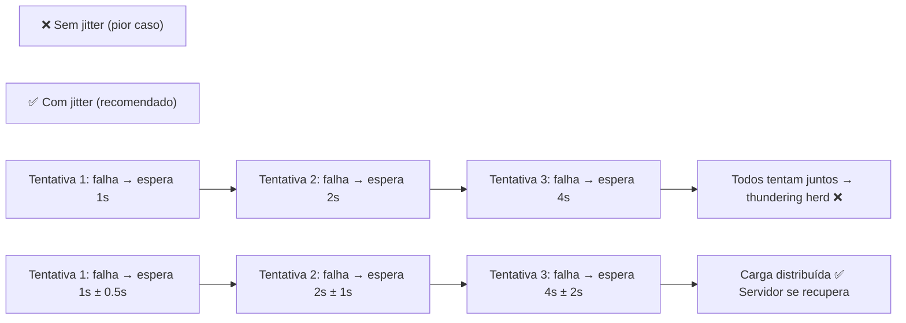

# Material Didático — P11: Operations de Produção (CI/CD + Monitoramento)

## ⚠️ Pré-requisito

Leia antes:

- [p0_fundamentals/MATERIAL.md](../p0_fundamentals/MATERIAL.md) — Fundamentos de IA e LLM
- [p4_production/MATERIAL.md](../p4_production/MATERIAL.md) — Produção com API
- [p5_evaluation/MATERIAL.md](../p5_evaluation/MATERIAL.md) — Avaliação

---

## Conceitos Fundamentais

### Por que Monitorar Agentes?

Em produção, você precisa saber:

- Quantas chamadas estão sendo feitas?
- Quanto está custando?

### Por que isso existe?

Um agente sem monitoramento é como um carro sem painel: você não sabe se está indo bem ou prestes a quebrar.

```
Sem monitoramento: "Acho que está funcionando..."
Com monitoramento: "95% das chamadas < 2s, custo $0.003/call, erro rate 2%"
```

Além disso, agentes de IA têm métricas ÚNICAS que não existem em software convencional:

- **Token consumption**: quanto cada usuário/gastou vs lucro
- **Prompt drift**: prompts mudaram após deploy? Qualidade caiu?
- **Hallucination rate**: quantas respostas foram questionadas pelo usuário?
- **Tool failure rate**: quais ferramentas falham mais?

Sem monitoramento, você descobre problemas quando o cliente reclama — não antes.

### Erros Comuns de Iniciantes

| Erro | Consequência | Correção |
| ------ | -------------- | ---------- |
| Logar tudo sem estrutura | Impossível analisar logs manualmente | JSON estruturado com campos padronizados |
| Não alertar sobre custo | Conta explode sem ninguém perceber | Alerta automático se custo > threshold |
| Só olhar média (mean) | P95 pode ser 10x pior que média | Sempre monitorar percentis (P50, P95, P99) |
| Teste A/B manual | Viés humano na escolha do melhor prompt | Golden dataset + testes automatizados |
| Deploy sem rollback | Bug em produção = horas para corrigir | Rollback automático se métricas degradarem |

---

## Exercício Prático

- Qual a latência média?
- Algum prompt quebrou após deploy?

### Métricas Essenciais

| Métrica | O que mede | Threshold típico |
| --------- | ----------- | ----------------- |
| **Latência P50** | Tempo médio | < 1s |
| **Latência P95** | Top 5% mais lento | < 3s |
| **Taxa de erro** | % de falhas | < 5% |
| **Custo/request** | Gasto por chamada | < $0.01 |
| **Requests/min** | Throughput | Variável |

### Prompt Testing (A/B)

Antes de deploy, teste novas versões contra dataset:

```python
tester.add_test_case("Email suspeito", "spam")
tester.add_test_case("Reunião amanhã", "not_spam")

results = await tester.run_test("prompt_v2")
# success_rate: 95% → pode deployar
```

### Rollback Automático

Se métricas degradarem após deploy, rollback automático:

```python
if dashboard["error_rate"] > 10:
    manager.rollback("spam_classifier")
```

### Logging Estruturado

Logs em JSON para facilitar análise:

```json
{
  "timestamp": "2024-01-01T12:00:00Z",
  "level": "info",
  "metric": "latency_ms",
  "value": 250,
  "labels": {"prompt": "v2", "model": "gpt-4o-mini"}
}
```

### Algoritmo: Exponential Backoff com Jitter

Quando uma API falha, nunca repita imediatamente. Use backoff exponencial — mas com aleatoriedade:



#### A fórmula que todo engenheiro precisa saber

```
wait_time = min(max_delay, base_delay × 2^attempt) + random_jitter

base_delay = 1 segundo
max_delay = 60 segundos
attempt = número da tentativa (0, 1, 2, ...)
random_jitter = random(0, wait_time / 2)

Exemplo prático:
  attempt=0: min(60, 1×2⁰) + rand(0, 0.5) = 1 + 0.3 = 1.3s
  attempt=1: min(60, 1×2¹) + rand(0, 1)   = 2 + 0.7 = 2.7s
  attempt=2: min(60, 1×2²) + rand(0, 2)   = 4 + 1.1 = 5.1s
  attempt=3: min(60, 1×2³) + rand(0, 4)   = 8 + 2.4 = 10.4s
  attempt=5: min(60, 1×2⁵) + rand(0, 8)   = 32 + 3.2 = 35.2s
  attempt=7: min(60, 1×2⁷) + rand(0, 16)  = 60 + 8.1 = 68.1s → capped at 60
```

**Por que jitter é obrigatório?**

Sem jitter, N clientes que falham juntos vão tentar reiniciar juntos. Se N=10.000, você cria um pico de 10.000 requisições simultâneas — exatamente o que causou a falha original. Com jitter, esses 10.000 clientes se espalham por vários segundos, reduzindo a carga instantânea.

**Implementação prática:**

```python
import random
import time

def call_with_retry(api_call, max_retries=5):
    for attempt in range(max_retries):
        try:
            return api_call()
        except Exception as e:
            if attempt == max_retries - 1:
                raise  # último retry, não tenta de novo
            
            wait = min(60, 2 ** attempt) + random.uniform(0, 2 ** (attempt - 1))
            print(f"Tentativa {attempt+1} falhou, esperando {wait:.1f}s")
            time.sleep(wait)
```

Este padrão é usado por AWS SDK, Google Cloud, OpenAI Python client e praticamente toda API de produção.

---

## Exercício Prático

Execute `python modules/p11_production_ops/run.py` e observe:

1. Como prompts são registrados e testados
2. Comparação A/B entre versões
3. Deploy só acontece se success_rate > threshold
4. Dashboard com métricas em tempo real
5. Health check do sistema

## Perguntas para Reflexão

1. Se você tivesse 100 prompts ativos, como monitorar tudo sem ser invadido por alerts?
2. Quando fazer rollback manual vs automático?
3. Como criar um dataset de testes representativo para prompts?

---

## Referências

### Livros

- **"Designing Machine Learning Systems"** by Chip Huyen — Capítulos sobre production monitoring and observability
- **"Site Reliability Engineering"** by Betsy Beyer et al. — SLOs e error budgets

### Documentação Oficial

- [OpenAI Observability](https://platform.openai.com/docs/guides/observability) — OpenAI Docs
- [Prometheus Metrics](https://prometheus.io/docs/concepts/metric_types/) — Prometheus Docs

### Tutoriais

- [LangSmith Observability](https://www.langchain.com/langsmith) — LangSmith Docs
- [Grafana Dashboards](https://grafana.com/docs/) — Grafana Docs
