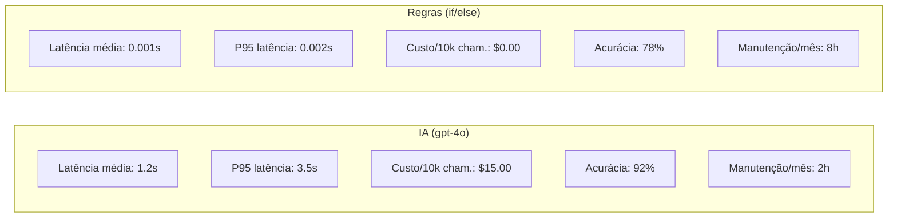
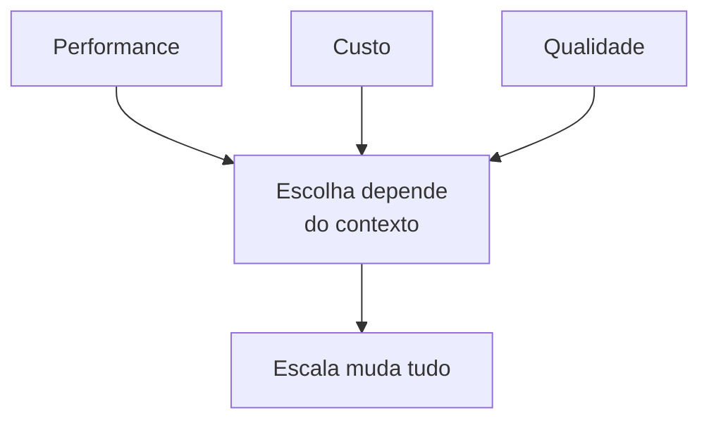

# Material Didático — P1: Análise de Viabilidade

> ⚠️ **MÓDULO OPCIONAL / BÔNUS** — Este módulo pode ser estudado DEPOIS de construir seu primeiro agente funcional (p0_first_llm) ou até após o módulo multiagente (p3b). Ele não bloqueia os próximos módulos, mas é recomendado para quem quer tomar decisões técnicas baseadas em dados.

Este módulo ensina a tomar decisões entre IA e regras heurísticas usando dados reais de benchmark.

---

## ⚠️ Pré-requisito

**Opcional:** Você pode pular este módulo e voltar depois de construir um agente funcional (p0_first_llm ou p3b). Se quiser estudar agora, precisa ter concluído o módulo [P0-Fundamentals](../p0_fundamentals/MATERIAL.md). Especificamente, precisa entender:

- O que é um LLM e como ele prediz tokens
- Por que tokens custam dinheiro
- O que é alucinação e como mitigar

Sem esses fundamentos, não faz sentido comparar IA com regras — você não terá base técnica para interpretar os resultados do benchmark.

---

## 🎯 Objetivos de Aprendizagem

Ao final deste módulo, você será capaz de:

- [ ] **Comparar** lado a lado uma solução baseada em IA vs regras heurísticas
- [ ] **Medir** latência (avg + p95), custo e manutenção de ambas as abordagens
- [ ] **Construir** um memorando técnico baseado em dados reais de benchmark
- [ ] **Decidir** quando IA vale a pena vs quando regras bastam (threshold de escala)
- [ ] **Explicar** trade-offs de performance/custo/qualidade para stakeholders não-técnicos

> 💡 **Dica:** O objetivo não é provar que IA é sempre melhor. É aprender a tomar decisões baseadas em dados — às vezes a resposta correta é "não usar IA".

---

## Conceitos Fundamentais

### Por que Benchmark Antes de Decidir?

Antes de investir em IA, toda empresa precisa responder: **vale a pena?** A resposta não vem de slides ou vendas — vem de dados reais. Este módulo ensina a comparar duas abordagens lado a lado:

| Abordagem | Vantagem | Desvantagem |
|-----------|----------|-------------|
| **IA (LLM)** | Entende contexto, adapta-se, lida com ambiguidade | Mais lenta, mais cara, menos previsível |
| **Regras (if/else)** | Instantânea, barata, determinística | Não entende nuances, manutenção manual |

### Métricas que Importam

Ao avaliar uma solução de IA, você deve medir:

1. **Latência** — Quanto tempo leva para processar?
   - `avg_latency_ms`: Tempo médio por chamada
   - `p95_latency_ms`: Tempo no 95º percentil (o que 95% das chamadas respeitam)

2. **Custo** — Quanto custa por chamada e em escala?
   - `cost_per_call`: Custo médio por solicitação
   - `total_cost_10k_calls`: Projeção para 10.000 chamadas

3. **Manutenção** — Quanto esforço humano é necessário?
   - Regras precisam de ajuste contínuo de keywords
   - IA precisa de monitoramento de qualidade + ajuste de prompts

### Exemplo de Benchmark: IA vs Regras



Para 100 tickets/mês → regras podem bastar.
Para 100.000 tickets/mês → IA se paga pela escalabilidade.

### Memorando Técnico

Um memorando técnico é um documento de decisão baseado em dados. Ele deve conter:

- **Contexto**: Qual problema estamos resolvendo?
- **Dados**: Resultados de benchmarks reais
- **Critérios**: Quais limites definimos como aceitáveis?
- **Recomendação**: Baseada nos dados, qual caminho seguir?

### Trade-offs na Prática

Nenhum sistema é perfeito. Sempre há trade-offs:



Para 100 tickets/mês → regras podem bastar.
Para 100.000 tickets/mês → IA se paga pela escalabilidade.

## 🎬 O que você vai ver

Antes de rodar o código, aqui está uma prévia do que o programa vai fazer:

```
$ python modules/p1_feasibility/run.py

📊 Benchmarking: IA vs Regras

🤖 LLM (gpt-4o-mini):
   Latência avg: 1.2s | p95: 2.1s
   Custo total: $0.045

⚡ Regras (if/else):
   Latência avg: 0.001s
   Custo: $0.000

📋 Memorando gerado:
   Recomendação: Use regras para volume < 10k/mês
   Justificativa: Custo-benefício 45× melhor
```

## Exercício Prático

Execute `python modules/p1_feasibility/run.py` e observe:

1. Como a latência da IA varia entre chamadas
2. O custo real medido vs estimado
3. Como o memorando gera recomendação automaticamente baseada nos thresholds

## Perguntas para Reflexão

1. Se o volume de tickets triplicasse, qual abordagem se tornaria mais vantajosa?
2. Como você mediria a "qualidade" da classificação além da latência e custo?
3. Quando faria sentido usar AMBAS as abordagens juntas (regras para triagem rápida, IA para casos complexos)?

---

## 📌 Resumo do Módulo

Este módulo ensinou a tomar decisões baseadas em dados, não em intuição:

1. **Benchmark antes de decidir** — nunca invista em IA sem comparar lado a lado com regras heurísticas. Meça latência (avg + p95), custo e manutenção.

2. **Trade-offs dependem de escala** — para 100 tickets/mês, regras podem bastar. Para 100.000 tickets/mês, IA se paga pela escalabilidade. O threshold muda tudo.

3. **Memorando técnico = decisão baseada em dados** — contexto + dados reais + critérios claros + recomendação fundamentada. Stakeholders não-técnicos entendem dados, não slides.

4. **IA vs Regras** — IA entende contexto e adapta-se (mas é lenta e cara). Regras são instantâneas e baratas (mas não entendem nuances). Às vezes usar AMBAS faz sentido.

5. **Manutenção importa** — regras precisam de ajuste contínuo de keywords. IA precisa de monitoramento de qualidade + ajuste de prompts. Ambos têm custo de manutenção.

> ✅ **Você está pronto para:** Agora que sabe quando usar IA, vamos construir um agente que responde perguntas com conhecimento interno — o pipeline RAG.

## ✅ Checklist: Como Saber Se Você Atingiu o Objetivo

Marque cada item **só se conseguir fazer sem olhar o material**:

- [ ] Explico a diferença entre IA e regras heurísticas em 3 frases
- [ ] Comparo latência e custo das duas abordagens com números
- [ ] Explico por que escala muda a decisão (100 vs 100.000 tickets)
- [ ] Rodo `run.py` e interpreto o memorando gerado
- [ ] Digo 3 situações onde regras são melhores que IA

> ⚠️ Se marcou menos de 3 itens, releia as seções correspondentes antes de prosseguir.

---

## 🔗 Próximos Passos

Com a viabilidade estabelecida, o próximo passo é resolver o problema mais comum em produção: **como fazer o agente responder perguntas usando documentos internos sem enviar tudo para o LLM**.

→ Leia o módulo [P2: Pipeline RAG](../p2_rag/MATERIAL.md) para aprender recuperação de contexto com embeddings.

---

## Referências

(empty)
