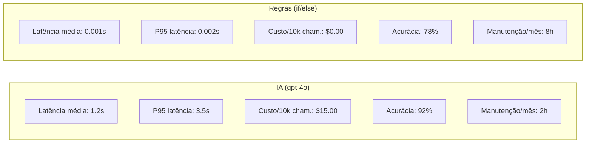
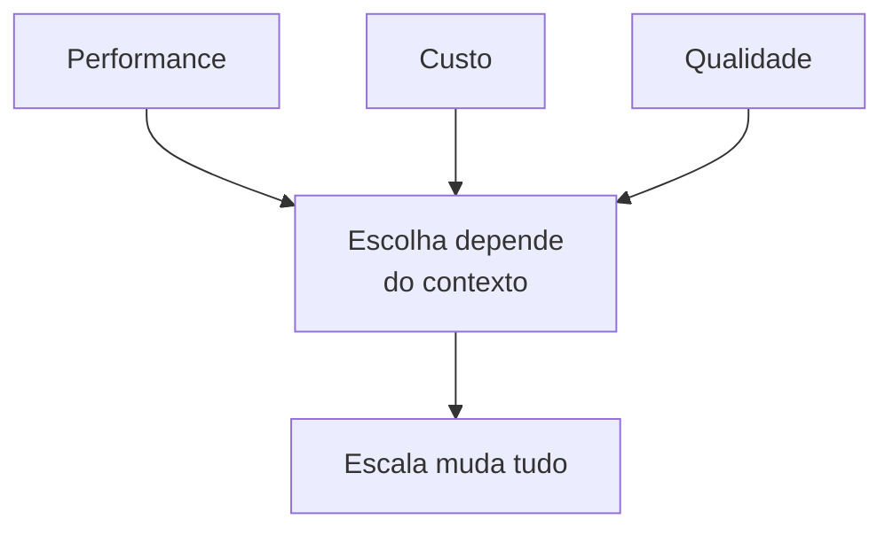

# Material Didático — P1: Análise de Viabilidade

## Conceitos Fundamentais

### Por que Benchmark Antes de Decidir?

Antes de investir em IA, toda empresa precisa responder: **vale a pena?** A resposta não vem de slides ou vendas — vem de dados reais. Este módulo ensina a comparar duas abordagens lado a lado:

| Abordagem | Vantagem | Desvantagem |
|-----------|----------|-------------|
| **IA (LLM)** | Entende contexto, adapta-se, lida com ambiguidade | Mais lenta, mais cara, menos previsível |
| **Regras (if/else)** | Instantânea, barata, determinística | Não entende nuances, manutenção manual |

### Métricas que Importam

Ao avaliar uma solução de IA, você deve medir:

1. **Latência** — Quanto tempo leva para processar?
   - `avg_latency_ms`: Tempo médio por chamada
   - `p95_latency_ms`: Tempo no 95º percentil (o que 95% das chamadas respeitam)

2. **Custo** — Quanto custa por chamada e em escala?
   - `cost_per_call`: Custo médio por solicitação
   - `total_cost_10k_calls`: Projeção para 10.000 chamadas

3. **Manutenção** — Quanto esforço humano é necessário?
   - Regras precisam de ajuste contínuo de keywords
   - IA precisa de monitoramento de qualidade + ajuste de prompts

### Exemplo de Benchmark: IA vs Regras

Para 100 tickets/mês → regras podem bastar.
Para 100.000 tickets/mês → IA se paga pela escalabilidade.

### Memorando Técnico

Um memorando técnico é um documento de decisão baseado em dados. Ele deve conter:

- **Contexto**: Qual problema estamos resolvendo?
- **Dados**: Resultados de benchmarks reais
- **Critérios**: Quais limites definimos como aceitáveis?
- **Recomendação**: Baseada nos dados, qual caminho seguir?

### Trade-offs na Prática

Nenhum sistema é perfeito. Sempre há trade-offs:

Para 100 tickets/mês → regras podem bastar.
Para 100.000 tickets/mês → IA se paga pela escalabilidade.

---

## Exercício Prático

Execute `python modules/p1_feasibility/run.py` e observe:

1. Como a latência da IA varia entre chamadas
2. O custo real medido vs estimado
3. Como o memorando gera recomendação automaticamente baseada nos thresholds

## Perguntas para Reflexão

1. Se o volume de tickets triplicasse, qual abordagem se tornaria mais vantajosa?
2. Como você mediria a "qualidade" da classificação além da latência e custo?
3. Quando faria sentido usar AMBAS as abordagens juntas (regras para triagem rápida, IA para casos complexos)?

---

## Referências

### Livros

- **"Designing Machine Learning Systems"** by Chip Huyen (O'Reilly) — Capítulos sobre avaliação e monitoring
- **"The Mythical Man-Month"** by Frederick Brooks — Sobre trade-offs em engenharia

### Documentação Oficial

- [OpenAI Latency Benchmarks](https://platform.openai.com/docs/guides/rate-limits)
- [ML System Design Principles](https://developers.google.com/machine-learning/guidelines/rules-of-ml)

### Tutoriais

- [ML Observability Guide](https://mlflow.org/docs/latest/index.html) — MLflow Docs
- [Benchmarking LLM Applications](https://github.com/openai/openai-cookbook/tree/main/examples/benchmarking) — OpenAI Cookbook
