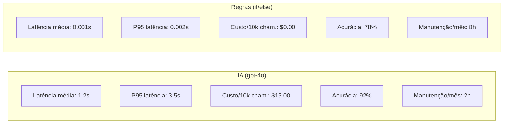
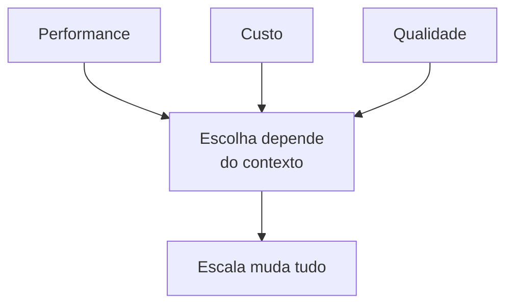

# Material Didático — P1: Análise de Viabilidade

> ⚠️ **MÓDULO OPCIONAL / BÔNUS** — Este módulo pode ser estudado DEPOIS de construir seu primeiro agente funcional (p0_first_llm) ou até após o módulo multiagente (p3b). Ele não bloqueia os próximos módulos.

Este módulo ensina a tomar decisões entre IA e regras heurísticas usando dados reais de benchmark.

---

## ⚠️ Pré-requisito

**Opcional:** Você pode pular este módulo e voltar depois de construir um agente funcional (p0_first_llm ou p3b). Se quiser estudar agora, precisa ter concluído o módulo [P0-Fundamentals](../p0_fundamentals/MATERIAL.md). Especificamente, precisa entender:

- O que é um LLM e como ele prediz tokens
- Por que tokens custam dinheiro
- O que é alucinação e como mitigar

Sem esses fundamentos, não faz sentido comparar IA com regras — você não terá base técnica para interpretar os resultados do benchmark.

---

## 📋 Sumário

1. [Por que Benchmark Antes de Decidir?](#por-que-benchmark-antes-de-decidir)
2. [Métricas que Importam](#métricas-que-importam)
3. [Exemplo de Benchmark: IA vs Regras](#exemplo-de-benchmark-ia-vs-regras)
4. [Memorando Técnico](#memorando-técnico)
5. [Trade-offs na Prática](#trade-offs-na-prática)
6. [O que você vai ver](#o-que-você-vai-ver)
7. [Perguntas para Reflexão](#perguntas-para-reflexão)
8. [Troubleshooting](#troubleshooting)
9. [Glossário](#glossário)

---

## 📦 Infraestrutura do Curso

Como este módulo usa os mesmos arquivos `shared/` dos outros módulos, aqui está um resumo rápido:

```
applied-ai-agents/
├── modules/p1_feasibility/
│   ├── MATERIAL.md    ← Este arquivo
│   ├── run.py         ← Código executável
│   └── ...
├── shared/
│   ├── cost.py          ← count_tokens, estimate_cost, format_cost
│   ├── security.py      ← get_required_secret (API keys)
│   └── logging_config.py ← setup_logging, measure_latency
```

### Por que `sys.path.insert(0, ...)` no código?

Quando roda `python modules/p1_feasibility/run.py`, o Python procura imports **só na pasta atual**. Mas o `shared/` fica na raiz do projeto.

A linha `sys.path.insert(0, str(Path(__file__).parent.parent))` diz ao Python para também procurar **dois níveis acima** — onde o `shared/` está.

> 💡 **Analogia:** É como dizer ao Python para procurar livros não só na estante atual, mas também na prateleira de cima.

### O que cada módulo `shared/` faz?

| Módulo | Função | Quando usar |
| -------- | -------- | ------------- |
| `shared/cost.py` | Contar tokens, estimar custo, formatar preço | Sempre que chamar LLM |
| `shared/security.py` | Ler API keys do `.env` com validação | Sempre que precisar autenticação |
| `shared/logging_config.py` | Configurar logs + medir latência | Para debug e monitoramento |

> ⚠️ **Importante:** Você **não precisa entender** a implementação interna do `shared/`. Só precisa saber que essas funções existem e usá-las.

---

## 🎯 Objetivos de Aprendizagem

Ao final deste módulo, você será capaz de:

- [ ] **Comparar** lado a lado uma solução baseada em IA vs regras heurísticas
- [ ] **Medir** latência (avg + p95), custo e manutenção de ambas as abordagens
- [ ] **Construir** um memorando técnico baseado em dados reais de benchmark
- [ ] **Decidir** quando IA vale a pena vs quando regras bastam (threshold de escala)
- [ ] **Explicar** trade-offs de performance/custo/qualidade para stakeholders não-técnicos

> 💡 **Dica:** O objetivo não é provar que IA é sempre melhor. É aprender a tomar decisões baseadas em dados — às vezes a resposta correta é "não usar IA".

---

## Conceitos Fundamentais

### Por que Benchmark Antes de Decidir?

Antes de investir em IA, toda empresa precisa responder: **vale a pena?** A resposta não vem de slides ou vendas — vem de dados reais.

> 💡 **Referência:** Os conceitos de LLM, tokens e custo já foram explicados em [p0_fundamentals](../p0_fundamentals/MATERIAL.md). Aqui vamos direto à comparação prática.

Este módulo ensina a comparar duas abordagens lado a lado:

| Abordagem | Vantagem | Desvantagem |
|-----------|----------|-------------|
| **IA (LLM)** | Entende contexto, adapta-se, lida com ambiguidade | Mais lenta, mais cara, menos previsível |
| **Regras (if/else)** | Instantânea, barata, determinística | Não entende nuances, manutenção manual |

### Métricas que Importam

> 📖 Fonte: **[EN]** AI Engineering · Chip Huyen · 2024 · OEBPS/ch04 —
> "The application’s metrics must be considered in the context of the business problem it’s built to solve."

Ao avaliar uma solução de IA, você deve medir:

1. **Latência** — Quanto tempo leva para processar?
   - `avg_latency_ms`: Tempo médio por chamada
   - `p95_latency_ms`: Tempo no 95º percentil (o que 95% das chamadas respeitam)

2. **Custo** — Quanto custa por chamada e em escala?
   - `cost_per_call`: Custo médio por solicitação
   - `total_cost_10k_calls`: Projeção para 10.000 chamadas

3. **Manutenção** — Quanto esforço humano é necessário?
   - Regras precisam de ajuste contínuo de keywords
   - IA precisa de monitoramento de qualidade + ajuste de prompts

### Exemplo de Benchmark: IA vs Regras

> 📖 Fonte: **[ZH]** Agent Skills橙皮书 · 2026 · EPUB/Text/page_1_split_62 —
> "对于大多数个人用户来说，Benchmark模式不是必须的。但如果你发现自己的Skill经常在不该触发的时候乱入，或者该触发的时候没反应，跑一轮Benchmark能帮你把description调到比较理想的状态。"



Para 100 tickets/mês → regras podem bastar.
Para 100.000 tickets/mês → IA se paga pela escalabilidade.

**De onde vem esse threshold?** Percorrendo os números do próprio benchmark acima:

| Volume/mês | Custo IA (input) | Custo regras (manutenção*) | Quem vence |
| ------------ | ------------------ | ---------------------------- | ------------ |
| 100 | ~$0,15 | 8h × seu R$/h | Regras |
| 10.000 | $15,00 | 8h × seu R$/h | Depende do valor-hora |
| 100.000 | $150,00 | 8h × seu R$/h | IA |

> \* A manutenção das regras foi medida em **horas** (8h/mês no diagrama), não em dinheiro.
> Para comparar, converta: se suas 8h custam mais que o preço da IA naquele volume, a IA
> passou a valer a pena. Esse cruzamento é o **break-even** do glossário — e ele desce
> conforme o volume sobe, porque o custo das regras é quase **fixo** (ajustar keywords) e o
> da IA é **linear** por chamada.

---

### Memorando Técnico

Um memorando técnico é um documento de decisão baseado em dados. Ele deve conter:

- **Contexto**: Qual problema estamos resolvendo?
- **Dados**: Resultados de benchmarks reais
- **Critérios**: Quais limites definimos como aceitáveis?
- **Recomendação**: Baseada nos dados, qual caminho seguir?

### Trade-offs na Prática

Nenhum sistema é perfeito. Sempre há trade-offs:



Para 100 tickets/mês → regras podem bastar.
Para 100.000 tickets/mês → IA se paga pela escalabilidade.

## 🎬 O que você vai ver

Antes de rodar o código, aqui está uma prévia do que o programa vai fazer:

```
$ python modules/p1_feasibility/run.py

📊 Benchmarking: IA vs Regras

🤖 LLM (gpt-4o-mini):
   Latência avg: 1.2s | p95: 2.1s
   Custo total: $0.045

⚡ Regras (if/else):
   Latência avg: 0.001s
   Custo: $0.000

📋 Memorando gerado:
   Recomendação: Use regras para volume < 10k/mês
   Justificativa: Custo-benefício 45× melhor
```

## Exercício Prático

Execute `python modules/p1_feasibility/run.py` e observe:

1. Como a latência da IA varia entre chamadas
2. O custo real medido vs estimado
3. Como o memorando gera recomendação automaticamente baseada nos thresholds

## Perguntas para Reflexão

1. Se o volume de tickets triplicasse, qual abordagem se tornaria mais vantajosa?
2. Como você mediria a "qualidade" da classificação além da latência e custo?
3. Quando faria sentido usar AMBAS as abordagens juntas (regras para triagem rápida, IA para casos complexos)?

---

## 📌 Resumo do Módulo

Este módulo ensinou a tomar decisões baseadas em dados, não em intuição:

1. **Benchmark antes de decidir** — nunca invista em IA sem comparar lado a lado com regras heurísticas. Meça latência (avg + p95), custo e manutenção.

2. **Trade-offs dependem de escala** — para 100 tickets/mês, regras podem bastar. Para 100.000 tickets/mês, IA se paga pela escalabilidade. O threshold muda tudo.

3. **Memorando técnico = decisão baseada em dados** — contexto + dados reais + critérios claros + recomendação fundamentada. Stakeholders não-técnicos entendem dados, não slides.

4. **IA vs Regras** — IA entende contexto e adapta-se (mas é lenta e cara). Regras são instantâneas e baratas (mas não entendem nuances). Às vezes usar AMBAS faz sentido.

5. **Manutenção importa** — regras precisam de ajuste contínuo de keywords. IA precisa de monitoramento de qualidade + ajuste de prompts. Ambos têm custo de manutenção.

> ✅ **Você está pronto para:** Agora que sabe quando usar IA, vamos construir um agente que responde perguntas com conhecimento interno — o pipeline RAG.

## ✅ Checklist: Como Saber Se Você Atingiu o Objetivo

Marque cada item **só se conseguir fazer sem olhar o material**:

- [ ] Explico a diferença entre IA e regras heurísticas em 3 frases
- [ ] Comparo latência e custo das duas abordagens com números
- [ ] Explico por que escala muda a decisão (100 vs 100.000 tickets)
- [ ] Rodo `run.py` e interpreto o memorando gerado
- [ ] Digo 3 situações onde regras são melhores que IA

> ⚠️ Se marcou menos de 3 itens, releia as seções correspondentes antes de prosseguir.

---

## ❓ Troubleshooting

| Erro | Causa | Solução |
| ------ | ------- | --------- |
| `ModuleNotFoundError: No module named 'openai'` | SDK não instalado | Execute `pip install openai` |
| `ValueError: OPENAI_API_KEY não definida` | `.env` ausente | Crie `.env` na raiz com `OPENAI_API_KEY=sua_chave` |
| `AuthenticationError: Incorrect API key` | Chave inválida | Regenerue em platform.openai.com/api-keys |
| `RateLimitError` | Muitas requisições rápido | Espere 5s e tente novamente |
| `ModuleNotFoundError: No module named 'shared'` | Path incorreto | Execute da raiz do projeto |

---

## 📖 Glossário

| Termo | Definição | Analogia |
| ------- | ----------- | ---------- |
| **Benchmark** | Teste comparativo entre soluções | Corrida para ver quem é mais rápido |
| **Latência P95** | Tempo que 95% das chamadas respeitam | "Quase sempre é mais rápido que isso" |
| **Threshold** | Limite mínimo aceitável | "A partir daqui é problema" |
| **Memorando** | Documento de decisão baseado em dados | "Relatório executivo" |
| **Break-even** | Ponto onde custos se igualam | "A partir daqui compensa investir" |
| **Heurística** | Regra prática simples | "Regra de dedo" |

---

## 🔗 Próximos Passos

Com a viabilidade estabelecida, o próximo passo é resolver o problema mais comum em produção: **como fazer o agente responder perguntas usando documentos internos sem enviar tudo para o LLM**.

→ Leia o módulo [P2: Pipeline RAG](../p2_rag/MATERIAL.md) para aprender recuperação de contexto com embeddings.

---

## Material Complementar

(empty)

---

## 🧭 Navegação

| ← Anterior | Índice | Próximo → |
| --- | --- | --- |
| [← P0: Primeiro Fluxo com LLM](../p0_first_llm/MATERIAL.md) | [📖 Sumário do curso](../../README.md) | [P2: Pipeline RAG →](../p2_rag/MATERIAL.md) |
