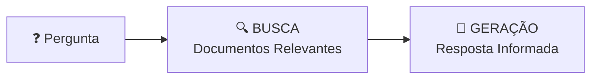
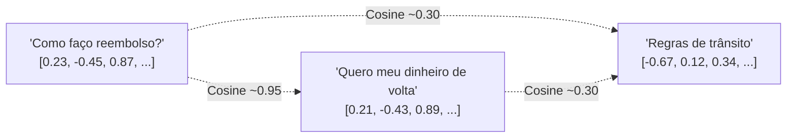
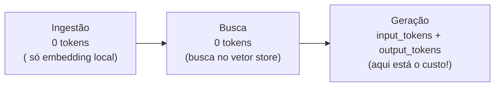
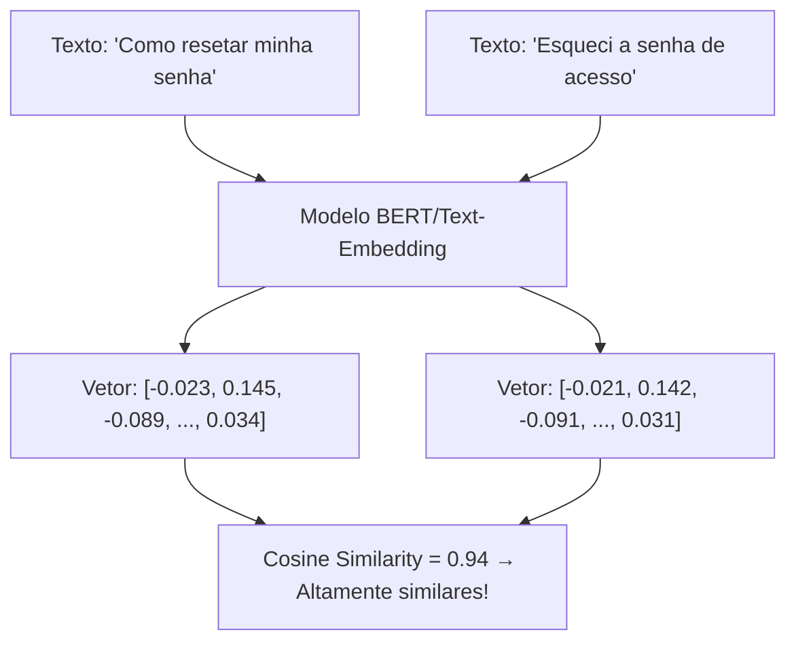
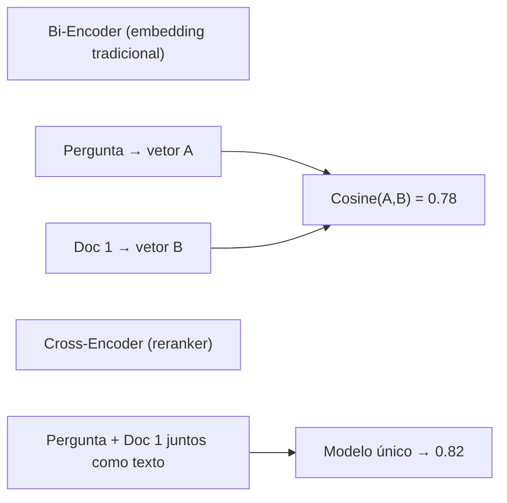
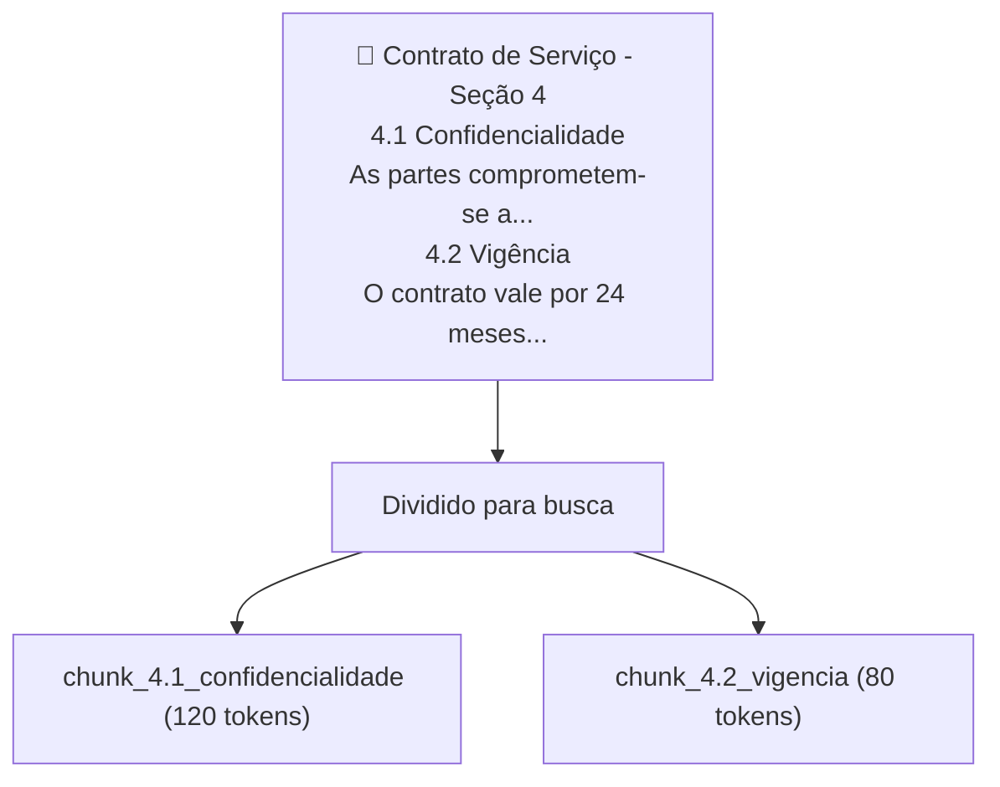

# Material Didático — P2: Pipeline RAG (Recuperação de Contexto)

> 📌 **Nota:** Este material foi revisado para focar nos conceitos essenciais. Seções marcadas como **🔬 Avançado — OPCIONAL** podem ser puladas na primeira leitura.

Este módulo implementa o padrão mais usado em produção para dar conhecimento interno ao LLM.

---

## ⚠️ Pré-requisito

Você precisa ter concluído o módulo [P0-First-LLM](../p0_first_llm/MATERIAL.md). Especificamente, precisa saber:

- Como construir um agente simples com OpenAI API
- O que é tokenização e por que tokens custam dinheiro

### Conhecimento técnico necessário antes de P2

Este módulo usa Python de forma mais avançada. Você **precisa saber**:

| Conceito | Por que aparece em P2 | Nível necessário |
| ---------- | ---------------------- | ------------------ |
| **Funções** (`def`) | Todo pipeline RAG é organizado em funções | Saber definir e chamar |
| **Dicionários** (`{}`) | Prompts, respostas da API, metadados são dicts | Ler/escrever chaves e valores |
| **Listas** (`[]`) | Documentos, chunks, embeddings são listas | Iterar, fatiar, append |
| **Import/Module** | `import chromadb`, `from openai import OpenAI` | Entender como importar bibliotecas |
| **Classes básicas** | `ChromaClient`, `BaseModel` aparecem no código | Entender instância e método |

Se não domina algum desses conceitos, revise-os antes de continuar. Não é matemática avançada — é Python básico.

> 💡 **Sobre embeddings:** Se nunca ouviu falar, foque na intuição: *vetores capturam significado*. "Como resetar senha" e "Esqueci a senha" têm vetores próximos mesmo sem palavras em comum. A matemática vem depois.

---

## 📋 Sumário

### Core (obrigatório)

1. [O Problema do Contexto Limitado](#o-problema-do-contexto-limitado)
2. [RAG — Retrieval Augmented Generation](#rag--retrieval-augmented-generation)
3. [Embeddings — A Chave da Busca Semântica](#embeddings--a-chave-da-busca-semântica)
4. [Chunking — Divisão Inteligente](#chunking--divisão-inteligente-de-documentos)
5. [Tokens no Pipeline RAG](#tokens-no-pipeline-rag)

### 🔬 Avançado (opcional — pule na primeira leitura)

1. [🔬 Técnicas Avançadas de Produção](#técnicas-avançadas-de-produção)
2. [🔬 Arquitetura Completa](#-arquitetura-do-pipeline-rag)

### Prático

1. [O que você vai ver](#o-que-você-vai-ver)
2. [Troubleshooting](#troubleshooting)
3. [Glossário](#glossário)

---

## 📦 Infraestrutura do Curso

Como este módulo usa os mesmos arquivos `shared/` dos outros módulos, aqui está um resumo rápido:

```
applied-ai-agents/
├── modules/p2_rag/
│   ├── MATERIAL.md    ← Este arquivo
│   ├── run.py         ← Código executável
│   └── ...
├── shared/
│   ├── cost.py          ← count_tokens, estimate_cost, format_cost
│   ├── security.py      ← get_required_secret (API keys)
│   └── logging_config.py ← setup_logging, measure_latency
```

### Por que `sys.path.insert(0, ...)` no código?

Quando roda `python modules/p2_rag/run.py`, o Python procura imports **só na pasta atual**. Mas o `shared/` fica na raiz do projeto.

A linha `sys.path.insert(0, str(Path(__file__).parent.parent))` diz ao Python para também procurar **dois níveis acima** — onde o `shared/` está.

> 💡 **Analogia:** É como dizer ao Python para procurar livros não só na estante atual, mas também na prateleira de cima.

### Dependências Necessárias

> 📖 Fonte: **[EN]** First dependency "dependable" · `fastapi-docs-en/docs/tutorial/dependencies/sub-dependencies.md` —
> "This is quite simple (not very useful), but will help us focus on how the sub-dependencies work."

```bash
pip install chromadb rich python-dotenv
```

- `chromadb`: Banco de dados vetorial (armazena embeddings)
- `rich`: Output bonito no terminal
- `python-dotenv`: Lê variáveis de ambiente do `.env`

### O que cada módulo `shared/` faz?

| Módulo | Função | Quando usar |
| -------- | -------- | ------------- |
| `shared/cost.py` | Contar tokens, estimar custo, formatar preço | Sempre que chamar LLM |
| `shared/security.py` | Ler API keys do `.env` com validação | Sempre que precisar autenticação |
| `shared/logging_config.py` | Configurar logs + medir latência | Para debug e monitoramento |

> ⚠️ **Importante:** Você **não precisa entender** a implementação interna do `shared/`. Só precisa saber que essas funções existem e usá-las.

---

## 🎯 Objetivos de Aprendizagem

Ao final deste módulo, você será capaz de:

- [ ] **Explicar** o problema que RAG resolve (contexto limitado + custo de tokens)
- [ ] **Implementar** um pipeline RAG com ChromaDB (ingestão → busca → geração)
- [ ] **Compreender** como embeddings capturam significado semântico (não apenas palavras-chave)
- [ ] **Aplicar** chunking inteligente para manter contexto nos documentos
- [ ] **Avaliar** técnicas avançadas (busca híbrida, re-ranking, parent-child chunking, query rewriting)

> 💡 **Dica:** RAG é o padrão mais usado em produção hoje. Se você dominar este módulo, consegue construir 80% dos agentes de IA empresariais.

---

## Conceitos Fundamentais

### O Problema do Contexto Limitado

> 📖 Fonte: **[EN]** AI Engineering · Chip Huyen · 2024 · OEBPS/ch05 —
> "Clear instructions, such as “answer using only the provided context”, along with examples of questions it shouldn’t be able to answer, can help."

LLMs têm um limite de tokens que podem processar por vez. Imagine que você tem 50 documentos internos e quer que um agente responda perguntas baseadas neles. Enviar TODOS os documentos para cada chamada seria:

- **Caro**: Cada token custa dinheiro
- **Lento**: Mais texto = mais tempo de processamento
- **Ineficiente**: A maioria dos documentos não é relevante para a pergunta

### RAG — Retrieval Augmented Generation

RAG resolve esse problema com três etapas:



1. **Retrieval (Busca)**: Encontra os documentos mais relevantes para a pergunta
2. **Augmentation (Augmentação)**: Combina a pergunta com os documentos encontrados
3. **Generation (Geração)**: O LLM responde usando o contexto fornecido

### Embeddings — A Chave da Busca Semântica

Embeddings são vetores numéricos que representam o significado de texto. Duas frases com significado similar terão vetores próximos no espaço multidimensional:



A similaridade entre vetores é medida por **cosseno** ou **distância euclidiana**. Quanto mais próximos, mais similares são semanticamente.

### ChromaDB — Vetor Store

ChromaDB é um banco de dados vetorial open-source que:

- Armazena embeddings + metadados + conteúdo original
- Faz busca por similaridade em milissegundos
- Suporta filtros por metadados (ex: só buscar em "Políticas")
- Persiste dados em disco automaticamente

### 🏗️ Arquitetura do Pipeline RAG

> 📖 Fonte: **[EN]** AI Engineering · Chip Huyen · 2024 · OEBPS/ch06 —
> "Now that we’ve covered the primary components, let’s consider an example of how a RAG system works."

> 🔬 **AVANÇADO — OPCIONAL** — Esta seção pode ser pulada na primeira leitura. Para referência completa, veja [architecture.md](architecture.md).

O pipeline RAG é composto por 4 componentes principais:

```
[Documentos] → [Embedder] → [Vector DB] → [Retriever] → [LLM]
      ↑              ↑              ↑            ↑
   Ingestão     Embedding     Busca semântica  Contexto + Prompt
```

| Componente | Responsabilidade | Onde falha | Fallback |
| ------------ | ------------------ | ------------ | ---------- |
| **Embedder** | Converte texto → vetor | API indisponível | Embedder local (BGE) |
| **Vector DB** | Armazena e busca vetores | Corrompido/descoberto | ChromaDB local |
| **Retriever** | Seleciona docs relevantes | Threshold muito alto | Aumentar top_k |
| **LLM** | Gera resposta final | Rate limit/timeout | Retry com backoff |

**Fluxo completo:**

1. **Ingestão**: documentos → chunking → embedding → salvar no vector DB
2. **Busca**: pergunta → embedding → busca similaridade → top_k docs
3. **Geração**: pergunta + docs → prompt → LLM → resposta

Cada etapa tem trade-offs: chunk menor = mais preciso mas mais embeddings; top_k maior = mais contexto mas mais custo.

### Chunking — Divisão Inteligente de Documentos

Documentos longos devem ser divididos em chunks menores (tipicamente 200-500 tokens):

| Chunk muito pequeno | Chunk ideal | Chunk muito grande |
|---------------------|-------------|-------------------|
| Perde contexto | Mantém sentido completo | Muito específico demais |
| Embedding impreciso | Similaridade funciona bem | Ruído na busca |

### Tokens no Pipeline RAG

> 📖 Fonte: **[EN]** Systems Thinking for Agentic AI · Ediz Najim · 2026 · OEBPS/c4MY —
> "Token budget — The practical limit on how many tokens can be used for prompts, retrieved context, history, and output within a request."

Cada etapa consome tokens:



O custo está apenas na geração — a busca é gratuita quando usa embedder local.

### Como Embeddings Capturam Significado

Embeddings transformam texto em **vetores de números** (geralmente 768 ou 1536 dimensões). A mágica não é matemática — é **treino**.



**Cosine Similarity** (similaridade cosseno): mede o ângulo entre dois vetores, não a distância. Quanto mais próximo de 1, mais similares são semanticamente.

> 💡 **Intuição:** Pense em duas setas apontando na mesma direção → similaridade alta. Setas apontando para lados opostos → similaridade baixa. Não precisa calcular — o modelo já aprendeu isso durante o treino.

Resultado típico:

```
"Senha" vs "Contraseña"    → 0.92 (diferente idioma, mesmo sentido)
"Senha" vs "Preço do produto" → 0.31 (sem relação)
```

**Onde fica a linha entre "recupera" e "é ruído"?** Olhe os três números acima: os pares
relevantes ficam em **0.92–0.94**, o par sem relação cai para **0.31**. Existe um salto
grande entre eles — e é aí que um *threshold* de corte atua na prática: abaixo dele, o
chunk é descartado como ruído; acima, vira contexto. (Não há um valor universal: cada
base calibra o seu, tipicamente entre ~0.3 e ~0.7.)

> ⚠️ **Cuidado com duas escalas que apontam para lados opostos.** Acima usamos **similaridade
> cosseno**: **maior = melhor** (0.94 ganha de 0.31). Mas o `run.py` mostra o documento mais
> relevante com **score 0.15** — porque ChromaDB devolve **distância**, onde **menor = melhor**.
> São a mesma ideia medida ao contrário: `distância ≈ 1 − similaridade`. Logo, um cosseno de
> ~0.85 vira distância ~0.15. Nunca compare um número de uma escala com o da outra.

O modelo aprendeu durante o treino que textos com significado similar produzem vetores próximos no espaço multidimensional. Não é busca por palavra-chave — é busca por **significado**.

---

## 🔬 Técnicas Avançadas de Produção (OPCIONAL)

> ⚠️ **Esta seção é para produção.** Pode ser pulada na primeira leitura.

### 1. Busca Híbrida (Vetorial + BM25)

Em sistemas reais, usuários buscam códigos de produto, números de chamado, IDs de erro, siglas internas. Vetores puros falham nesses casos:

```
Usuário: "Qual o status do chamado INC-4892?"
         ↓
[Busca vetorial] → docs sobre "status" e "chamado" mas não encontra INC-4892
[Busca BM25]     → encontra EXATAMENTE "INC-4892" ✅
         ↓
[RRF] Combina os rankings → resultado correto
```

**RRF (Reciprocal Rank Fusion / fusão de classificação recíproca)**: combina rankings de duas buscas sem precisar normalizar scores:

```
RRF(score) = Σ 1 / (k + rank_da_busca_i)

k = constante (geralmente 60)
Quanto melhor o rank, maior o score final.
```

Nenhum banco vetorial faz busca híbrida nativamente — é código na aplicação. Elasticsearch, OpenSearch e Qdrant já oferecem isso embutido.

#### Por que BM25 ainda existe?

BM25 é um algoritmo de busca lexical de 1994 que conta palavras com ponderação IDF (termos raros valem mais). Ele é:

- **Determinístico**: "INC-4892" sempre encontra "INC-4892"
- **Rápido**: sem cálculo de vetores
- **Barato**: roda em qualquer servidor

Vetorial entende significado; BM25 entende exatidão. Juntos, cobrem tudo.

### 2. Re-ranking (Cross-Encoder)

Após buscar N documentos, um reranker reavalia só os top-K com muito mais precisão:

```
Passo 1 — Embedding (fast, impreciso):
  Pergunta → [Embedder] → vetor
  Docs → [Embedder] → vetores
  Top-50 por cosine similarity
         ↓
Passo 2 — Reranker (slow, preciso):
  Para cada um dos 50:
    [Cross-Encoder] pergunta + doc → score 0-1
  Top-5 para o LLM
```

**Diferença fundamental:**

| Embedding (Bi-Encoder) | Reranker (Cross-Encoder) |
| ------------------------ | -------------------------- |
| Processa pergunta e doc separadamente | Processa pergunta E doc juntos |
| ~10ms por par | ~100ms por par |
| Escala para milhões de docs | Só escala para centenas |
| Similaridade grosseira | Entende nuances contextuais |

Empresas usam APIs cloud (Cohere Rerank, Azure AI Search Semantic Ranker) ou modelos locais (`bge-reranker` em GPU, otimizado via ONNX/TensorRT).

#### Bi-Encoder vs Cross-Encoder: Interação entre Palavras



O cross-encoder vê interações entre palavras da pergunta E do documento.
"Senha" na pergunta + "resetar senha" no doc → atenção cruzada forte.
No bi-encoder, essa interação é perdida.

### 3. Parent-Child / Chunking Estruturado

Chunking por tamanho arbitrário (500 tokens) quebra tabelas, assinaturas e cláusulas. A solução:



Se usuário busca "prazos do contrato":
  chunk_4.2 vence (cosine alta)
         ↓
Mas devolvemos ao LLM o PAI inteiro:
  → Modelo vê contexto completo da seção 4

**Por que funciona:** chunks pequenos = embedding preciso. Devolver o pai = contexto rico.

### 4. Query Rewriting / Contextualização Conversacional

Em chatbots, perguntas sequenciais perdem referência:

```

Usuário: "Como faço login no sistema?"
  → Busca: "login sistema" → docs corretos ✅
         ↓
Usuário: "E se eu esquecer a senha?"
  → Busca literal: "esquecer senha" → docs genéricos ❌
  → Query rewriting: "como resetar senha no sistema de login"
  → Busca: "resetar senha sistema login" → docs corretos ✅

```

Um modelo rápido e barato (gpt-4o-mini, não gpt-4o) reescreve a pergunta mantendo contexto:

```python
prompt_rewrite = f"""
Reescreva esta pergunta mantendo o contexto da conversa:

Conversa anterior:
{conversation_history[-3:]}

Pergunta atual: {user_question}

Responda APENAS com a pergunta reescrita, sem explicação."""
```

#### Custo do Rewriting: ROI Real

```
Sem rewriting:        Com rewriting:
Custo busca: $0       Custo busca: $0
Custo LLM judge: $0   Custo rewrite: $0.0001
Custo geração: $0.05  Custo geração: $0.04 (menos tokens)
Custo total: $0.05    Custo total: $0.0501

Ganho: resposta mais precisa = menos iterações do usuário
Perda: $0.0001 por passo conversacional
ROI: positivo a partir de 1 iteração economizada
```

## 🎬 O que você vai ver

Antes de rodar o código, aqui está uma prévia do que o programa vai fazer:

```
$ python modules/p2_rag/run.py

📥 Ingestão de documentos...
   3 documentos indexados no ChromaDB

🔍 Buscando contexto para pergunta...
   Documento mais relevante: guia_segurança.pdf (score: 0.15)

🤖 Gerando resposta com contexto RAG...
   "Baseado no guia de segurança, você deve..."

💰 Custo total: $0.003 | Tempo: 1.8s
```

> 💡 **Nota:** ChromaDB é apenas uma opção. No mercado existem alternativas como Pinecone, Qdrant e Weaviate. O conceito é o mesmo — mudar o banco de vetores.

## Exercício Prático

Execute `python modules/p2_rag/run.py` e observe:

1. Como os documentos são ingeridos e indexados
2. A similaridade retornada pela busca (menor = mais relevante)
3. Como o prompt final combina pergunta + contexto dos docs
4. O relatório de custos gerado

## Perguntas para Reflexão

1. Por que usar embeddings ao invés de busca por palavras-chave? Dê um exemplo onde busca semântica supera busca lexical.
2. Se você tivesse 10.000 documentos, como o pipeline mudaria?
3. Qual o impacto de usar um embedder ruim? Como você mediria a qualidade da recuperação?

---

## 📌 Resumo do Módulo

RAG é o padrão mais usado em produção para dar conhecimento interno ao LLM:

1. **O problema** — enviar 50 documentos para cada chamada é caro, lento e ineficiente. A maioria não é relevante para a pergunta.

2. **A solução RAG** — busca semântica (embeddings) encontra só os docs relevantes → combina com a pergunta → LLM responde com contexto certo. Custo só na geração, busca é gratuita.

3. **Embeddings capturam significado** — não é busca por palavra-chave. "Como resetar minha senha" e "Esqueci a senha de acesso" têm vetores próximos (cosine 0.94) mesmo sem palavras em comum.

4. **Chunking inteligente importa** — chunks pequenos = embedding preciso. Devolver o pai = contexto rico. Query rewriting mantém contexto conversacional.

5. **Técnicas avançadas** — busca híbrida (vetorial + BM25) resolve códigos/IDs exatos. Re-ranking (cross-encoder) reavalia top-K com precisão. ROI real: $0.0001 de rewrite vs resposta mais precisa.

> ✅ **Você está pronto para:** Agora que seu agente pode buscar conhecimento, vamos aprender a fazer ele **agir** — tool calling.

## ✅ Checklist: Como Saber Se Você Atingiu o Objetivo

Marque cada item **só se conseguir fazer sem olhar o material**:

- [ ] Explico o problema que RAG resolve em 3 frases
- [ ] Descrevo os 4 passos do pipeline RAG (ingestão → busca → geração)
- [ ] Explico embeddings com uma analogia (vetores capturam significado)
- [ ] Rodo `run.py` e explico como contexto dos docs é combinado na resposta
- [ ] Cito 2 alternativas ao ChromaDB (Pinecone, Qdrant, Weaviate)

> ⚠️ Se marcou menos de 3 itens, releia as seções correspondentes antes de prosseguir.

---

## 🔗 Próximos Passos

Com RAG, seu agente pode responder perguntas com base em documentos. Mas no mundo real, agentes precisam ir além de responder — eles precisam **executar ações**.

→ Leia o módulo [P3a-1: Autoavaliação](../p3a1_self_eval/MATERIAL.md) para aprender a verificar qualidade antes de entregar respostas.

---

## ❓ Troubleshooting

| Erro | Causa | Solução |
| ------ | ------- | --------- |
| `ModuleNotFoundError: No module named 'chromadb'` | SDK não instalado | Execute `pip install chromadb` |
| `ModuleNotFoundError: No module named 'openai'` | SDK não instalado | Execute `pip install openai` |
| `ValueError: OPENAI_API_KEY não definida` | `.env` ausente | Crie `.env` na raiz com `OPENAI_API_KEY=sua_chave` |
| `AuthenticationError: Incorrect API key` | Chave inválida | Regenerue em platform.openai.com/api-keys |
| `RateLimitError` | Muitas requisições rápido | Espere 5s e tente novamente |
| `ModuleNotFoundError: No module named 'shared'` | Path incorreto | Execute da raiz do projeto |
| ChromaDB crash / corrompido | Arquivo local danificado | Apague `.chroma/` e reingira documentos |

---

## 📖 Glossário

| Termo | Definição | Analogia |
| ------- | ----------- | ---------- |
| **RAG** | Retrieval-Augmented Generation — busca docs relevantes antes de responder | "Abrir o livro certo antes de responder a pergunta" |
| **Embedding** | Vetor numérico que representa significado de texto | "GPS para significado" — textos similares ficam próximos |
| **Vector DB** | Banco que armazena e busca embeddings rapidamente | "Biblioteca com catálogo inteligente" |
| **Chunking** | Dividir texto longo em pedaços menores | "Cortar livro em capítulos para ler melhor" |
| **Cosine Similarity** | Medida de similaridade entre vetores (0 a 1) | "Quanto mais próximos os GPS, mais similares os textos" |
| **ChromaDB** | Banco vetorial open-source leve | "Uma opção de Vector DB, como escolher entre Spotify ou Apple Music" |
| **top_k** | Número de resultados retornados pela busca | "Pedir os 3 melhores resultados" |

---

## Material Complementar

(empty)

---

## 🧭 Navegação

| ← Anterior | Índice | Próximo → |
| --- | --- | --- |
| [← P1: Análise de Viabilidade](../p1_feasibility/MATERIAL.md) | [📖 Sumário do curso](../../README.md) | [P3a-1: Autoavaliação →](../p3a1_self_eval/MATERIAL.md) |
