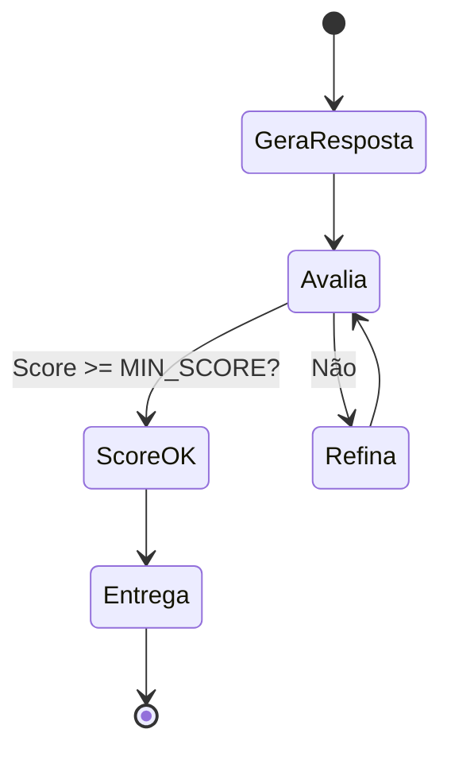

# Material Didático — P3a-1: Autoavaliação e Reflexão

## ⚠️ Pré-requisito

Leia antes:

- [p0_fundamentals/MATERIAL.md](../p0_fundamentals/MATERIAL.md) — Fundamentos de IA e LLM
- [p0_first_llm/MATERIAL.md](../p0_first_llm/MATERIAL.md) — Primeiro fluxo com LLM

---

## Conceitos Fundamentais

### O Problema da Confiança

LLMs são poderosos mas não são perfeitos. Eles podem:

- Inventar fatos (alucinação)
- Ser incompletos ou vagos
- Perder nuances importantes
- Gerar respostas plausíveis mas erradas

Como saber se a resposta está boa **antes** de entregá-la ao usuário?

### Por que isso existe?

Nos primeiros módulos, o agente gerava uma resposta e pronto. Mas em produção, você **não pode entregar respostas sem verificar**. Imagine um agente que:

- Classifica um ticket como "BAIXA" quando na verdade é "URGENTE" → cliente frustrado
- Extrai dados errados de um formulário → processo administrativo travado
- Gera código com bug silencioso → vulnerabilidade de segurança

A autoavaliação resolve isso criando um **loop de qualidade** antes da entrega.

### Erros Comuns de Iniciantes

| Erro | Consequência | Correção |
| ------ | -------------- | ---------- |
| Usar `temperature > 0` na avaliação | Score muda a cada chamada → impossível comparar | Sempre `temperature=0` para avaliação |
| Não limitar iterações | Loop infinito gastando tokens | `max_iterations=3` como padrão |
| Avaliar com texto livre | JSON inválido, parsing falha | SEMPRE usar Pydantic structured output |
| Feedback genérico no refinamento | Modelo não sabe o que corrigir | Feedback específico: "Falta X", "Y está errado" |

### Autoavaliação com Structured Outputs

Pydantic permite definir um **schema estruturado** que o LLM deve seguir. Ao invés de texto livre, o modelo retorna JSON validado:

```python
class SelfEvaluation(BaseModel):
    accuracy: int = Field(ge=1, le=10)  # Sempre 1-10
    completeness: int = Field(ge=1, le=10)
    clarity: int = Field(ge=1, le=10)
    issues: list[str]
    needs_improvement: bool
```

Isso garante que a avaliação seja **consistente** e **programática** — podemos tomar decisões baseadas nos scores.

### O Loop de Refinamento



Este loop é inspirado em como humanos revisam textos: escrevemos, lemos, identificamos problemas, reescrevemos.

### Por que Limitar Iterações?

Sem limite, o agente poderia entrar em loop infinito refinando infinitamente. O `max_iterations` define um teto seguro:

| Iterações | Vantagem | Desvantagem |
| ----------- | ---------- | ------------- |
| 1 | Rápido, barato | Qualidade incerta |
| 3 | Equilíbrio | Custo moderado |
| 5+ | Alta qualidade | Custo elevado, diminishing returns |

### beta.chat.completions.parse()

A API da OpenAI com `beta.chat.completions.parse()` faz mágica:

1. Envia prompt ao LLM
2. Parseia a resposta JSON automaticamente
3. Valida contra o schema Pydantic
4. Lança `ValidationError` se falhar

Isso elimina parsing manual e garante tipagem forte.

---

## Exercício Prático

Execute `python modules/p3a1_self_eval/run.py` e observe:

1. Como a primeira resposta pode ser aprovada na primeira iteração
2. Quando o feedback melhora a resposta nas iterações seguintes
3. O que acontece quando `max_iterations` é atingido
4. Como os custos acumulam com múltiplas iterações

## Perguntas para Reflexão

1. Se a autoavaliação também fosse feita por um LLM, ela não seria "o lobo guardando o próprio aprisco"? Como mitigar?
2. Que critérios adicionais você adicionaria além de accuracy/completeness/clarity?
3. Como você saberia quantas iterações são suficientes para um caso de uso real?

---

## Referências

### Livros

- **"Human Compatible"** by Stuart Russell — Sobre controle e alinhamento de IA
- **"The AI Engineering Revolution"** by Thomas Palmer — Capítulos sobre quality gates

### Documentação Oficial

- [OpenAI Structured Outputs](https://platform.openai.com/docs/guides/structured-outputs)
- [Pydantic v2 Documentation](https://docs.pydantic.dev/latest/)
- [Function Calling Guide](https://platform.openai.com/docs/guides/function-calling)

### Tutoriais

- [Pydantic AI Examples](https://github.com/pydantic/pydantic-ai) — Pydantic GitHub
- [OpenAI Cookbook: Structured Outputs](https://github.com/openai/openai-cookbook/tree/main/examples/structured_outputs) — GitHub
