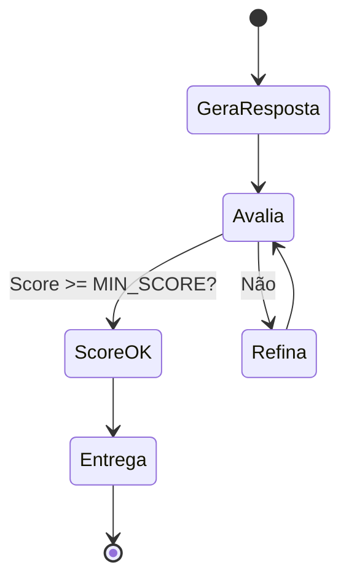

# Material Didático — P3a-1: Autoavaliação e Reflexão

## ⚠️ Pré-requisito

Você precisa ter concluído o módulo [P2-RAG](../p2_rag/MATERIAL.md). Especificamente, precisa saber:

- Como um agente gera respostas usando LLMs e por que a autoavaliação é necessária antes de entregar

---

## 🎯 Objetivos de Aprendizagem

Ao final deste módulo, você será capaz de:

- [ ] **Explicar** por que autoavaliação é necessária antes de entregar respostas ao usuário
- [ ] **Implementar** um loop de refinamento (gera → avalia → refina → reavalia)
- [ ] **Usar** Pydantic structured outputs para garantir JSON consistente e validado
- [ ] **Configurar** limites seguros de iteração (max_iterations) para evitar gasto infinito
- [ ] **Entender** quando a autoavaliação pode ser "o lobo guardando o próprio aprisco"

> 💡 **Dica:** Este módulo introduz o conceito mais importante de qualidade em agentes: nunca confie na primeira resposta sem verificar. Todo agente de produção precisa desse loop.

---

## Conceitos Fundamentais

### O Problema da Confiança

LLMs são poderosos mas não são perfeitos. Eles podem:

- Inventar fatos (alucinação)
- Ser incompletos ou vagos
- Perder nuances importantes
- Gerar respostas plausíveis mas erradas

Como saber se a resposta está boa **antes** de entregá-la ao usuário?

### Por que isso existe?

Nos primeiros módulos, o agente gerava uma resposta e pronto. Mas em produção, você **não pode entregar respostas sem verificar**. Imagine um agente que:

- Classifica um ticket como "BAIXA" quando na verdade é "URGENTE" → cliente frustrado
- Extrai dados errados de um formulário → processo administrativo travado
- Gera código com bug silencioso → vulnerabilidade de segurança

A autoavaliação resolve isso criando um **loop de qualidade** antes da entrega.

### Erros Comuns de Iniciantes

| Erro | Consequência | Correção |
| ------ | -------------- | ---------- |
| Usar `temperature > 0` na avaliação | Score muda a cada chamada → impossível comparar | Sempre `temperature=0` para avaliação |
| Não limitar iterações | Loop infinito gastando tokens | `max_iterations=3` como padrão |
| Avaliar com texto livre | JSON inválido, parsing falha | SEMPRE usar Pydantic structured output |
| Feedback genérico no refinamento | Modelo não sabe o que corrigir | Feedback específico: "Falta X", "Y está errado" |

### Autoavaliação com Structured Outputs

Pydantic permite definir um **schema estruturado** que o LLM deve seguir. Ao invés de texto livre, o modelo retorna JSON validado:

```python
class SelfEvaluation(BaseModel):
    accuracy: int = Field(ge=1, le=10)  # Sempre 1-10
    completeness: int = Field(ge=1, le=10)
    clarity: int = Field(ge=1, le=10)
    issues: list[str]
    needs_improvement: bool
```

Isso garante que a avaliação seja **consistente** e **programática** — podemos tomar decisões baseadas nos scores.

### O Loop de Refinamento



Este loop é inspirado em como humanos revisam textos: escrevemos, lemos, identificamos problemas, reescrevemos.

### Por que Limitar Iterações?

Sem limite, o agente poderia entrar em loop infinito refinando infinitamente. O `max_iterations` define um teto seguro:

| Iterações | Vantagem | Desvantagem |
| ----------- | ---------- | ------------- |
| 1 | Rápido, barato | Qualidade incerta |
| 3 | Equilíbrio | Custo moderado |
| 5+ | Alta qualidade | Custo elevado, diminishing returns |

### beta.chat.completions.parse()

A API da OpenAI com `beta.chat.completions.parse()` faz mágica:

1. Envia prompt ao LLM
2. Parseia a resposta JSON automaticamente
3. Valida contra o schema Pydantic
4. Lança `ValidationError` se falhar

Isso elimina parsing manual e garante tipagem forte.

## 🎬 O que você vai ver

Antes de rodar o código, aqui está uma prévia do que o programa vai fazer:

```
$ python modules/p3a1_self_eval/run.py

🤖 Gerando resposta inicial...
   Iteração 1: "Resposta parcial..."

🔍 Avaliando qualidade...
   Feedback: "Faltam detalhes sobre segurança"

🔄 Refinando resposta...
   Iteração 2: "Resposta completa com segurança..."

✅ Aprovado! (custo total: $0.008)
```

## Exercício Prático

Execute `python modules/p3a1_self_eval/run.py` e observe:

1. Como a primeira resposta pode ser aprovada na primeira iteração
2. Quando o feedback melhora a resposta nas iterações seguintes
3. O que acontece quando `max_iterations` é atingido
4. Como os custos acumulam com múltiplas iterações

## Perguntas para Reflexão

1. Se a autoavaliação também fosse feita por um LLM, ela não seria "o lobo guardando o próprio aprisco"? Como mitigar?
2. Que critérios adicionais você adicionaria além de accuracy/completeness/clarity?
3. Como você saberia quantas iterações são suficientes para um caso de uso real?

---

## 📌 Resumo do Módulo

Autoavaliação é o conceito mais importante de qualidade em agentes:

1. **Nunca confie na primeira resposta** — LLMs podem alucinar, ser incompletos ou plausíveis mas errados. Sempre verifique antes de entregar.

2. **Structured outputs (Pydantic) são obrigatórios** — JSON validado garante consistência e permite tomar decisões programáticas baseadas em scores. Nunca use texto livre para avaliação.

3. **Loop de refinamento = gera → avalia → refina → reavalia** — inspirado em como humanos revisam textos. Score >= MIN_SCORE? Entrega. Não? Feedback específico → reescreve.

4. **Limite iterações (max=3)** — sem limite, loop infinito gastando tokens. 3 iterações é equilíbrio entre custo e qualidade. Diminishing returns após isso.

5. **Temperature=0 SEMPRE para avaliação** — se score muda a cada chamada, impossível comparar. Avaliação precisa ser determinística.

> ✅ **Você está pronto para:** Agora que seu agente se autoavalia, vamos dar a ele poder de **agir** — tool calling.

## ✅ Checklist: Como Saber Se Você Atingiu o Objetivo

Marque cada item **só se conseguir fazer sem olhar o material**:

- [ ] Explico por que avaliar a resposta antes de entregá-la ao usuário
- [ ] Mostro como max_iterations previne loops infinitos
- [ ] Explico a diferença entre feedback construtivo e validação simples
- [ ] Rodo `run.py` e explico como custos acumulam com iterações
- [ ] Digo 3 sinais de que uma resposta precisa ser refinada

> ⚠️ Se marcou menos de 3 itens, releia as seções correspondentes antes de prosseguir.

---

## 🔗 Próximos Passos

Com autoavaliação, seu agente verifica a qualidade antes de entregar. Mas ainda só gera texto — não executa ações no mundo real.

→ Leia o módulo [P3a-2: Tool Calling](../p3a2_tool_calling/MATERIAL.md) para aprender como agentes usam ferramentas externas.

---

## Referências

(empty)
