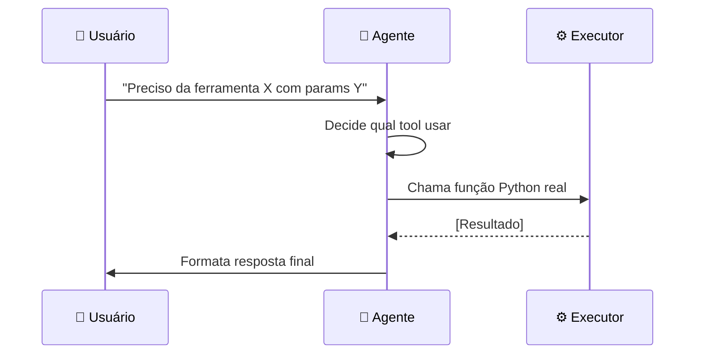
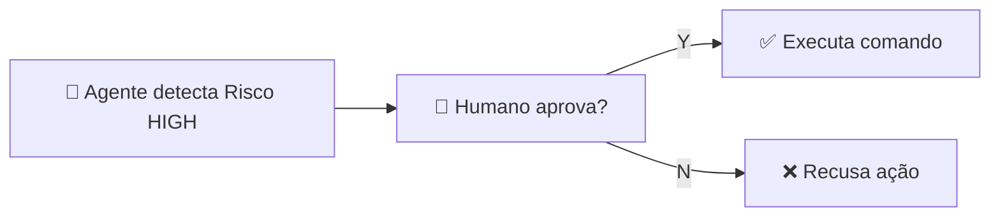

# Material Didático — P3a-2: Tool Calling (Uso Autônomo de Ferramentas)

## ⚠️ Pré-requisito

Você precisa ter concluído o módulo [P3a-1: Autoavaliação](../p3a1_self_eval/MATERIAL.md). Especificamente, precisa saber:

- Por que avaliar a resposta antes de entregá-la ao usuário
- Como configurar limites seguros de iteração (max_iterations)

---

## 🎯 Objetivos de Aprendizagem

Ao final deste módulo, você será capaz de:

- [ ] **Explicar** a diferença entre um chatbot passivo e um agente ativo com ferramentas
- [ ] **Definir** schemas JSON para ferramentas com descrições claras que o modelo entenda
- [ ] **Implementar** o pattern de tool calling (decide → executa → retorna resultado)
- [ ] **Aplicar** camadas de segurança (whitelist, risk levels, HITL) para agentes com acesso a ferramentas
- [ ] **Entender** como o modelo decide qual ferramenta usar (attention entre prompt + schemas)

> 💡 **Dica:** Tool calling é o que transforma um LLM de "dicionário" em "assistente que age". Este é o conceito mais próximo de "agência real" no curso.

---

## Conceitos Fundamentais

### Do Texto à Ação

Até agora, nossos agentes só **geravam texto**. Mas no mundo real, agentes precisam:

- Ler arquivos do sistema de arquivos
- Consultar APIs externas
- Executar comandos
- Modificar estados

Tool calling transforma um LLM passivo em um agente ativo.

### Por que isso existe?

Sem tool calling, o agente é apenas um chatbot — ele pode responder perguntas mas não pode **fazer nada**. Imagine um assistente que sabe a resposta mas não consegue:

- Abrir um arquivo para ler dados reais
- Enviar um email quando solicitado
- Consultar uma API de clima para dar informação atualizada

Com tool calling, o LLM deixa de ser um dicionário e vira um **assistente que age**.

### Erros Comuns de Iniciantes

| Erro | Consequência | Correção |
| ------ | -------------- | ---------- |
| Schema de tool sem `description` | Modelo não sabe quando chamar a tool | Sempre descrever claramente o que cada tool faz |
| Permitir ferramentas perigosas sem restrição | Agente pode apagar arquivos, executar comandos maliciosos | Whitelist + risk levels + HITL |
| Não validar JSON da resposta | Crash se modelo retorna JSON inválido | SEMPRE usar Pydantic validation |
| Tool muito genérica | Modelo confunde quando usar qual tool | Uma tool = uma função específica bem definida |

### O Pattern de Tool Calling



O LLM não executa a ferramenta diretamente — ele **decide** qual ferramenta usar e **descreve** os parâmetros. Um executor seguro roda a função real.

### JSON Schema como Contrato

Cada ferramenta tem um schema que define seus parâmetros:

```json
{
  "type": "function",
  "function": {
    "name": "read_file",
    "description": "Lê conteúdo de um arquivo",
    "parameters": {
      "type": "object",
      "properties": {
        "file_path": {"type": "string", "description": "Caminho do arquivo"},
        "max_lines": {"type": "integer", "default": 100}
      },
      "required": ["file_path"]
    }
  }
}
```

Este schema é enviado ao LLM junto com o prompt. O modelo responde com JSON estruturado que pode ser validado e executado programaticamente.

### Como o Modelo Decide Chamar uma Tool

O modelo **não tem um switch ligado/desligado** para ferramentas. Ele foi **fine-tuned** durante o treinamento para reconhecer padrões nos prompts que indicam necessidade de ação.

```
Prompt recebido:
  system: "Você é um assistente com 3 ferramentas..."
  tools: [read_file, list_dir, execute_command]
  user: "Leia /etc/hosts"
         ↓
[Modelo processa com attention entre user + tools schemas]
         ↓
O modelo reconhece:
  - A palavra "Leia" → mapeia para função read_file
  - "/etc/hosts" → extrai como argumento file_path
         ↓
Resposta do modelo (JSON):
{
  "tool_calls": [
    {
      "id": "call_abc123",
      "type": "function",
      "function": {
        "name": "read_file",
        "arguments": '{"file_path": "/etc/hosts"}'
      }
    }
  ]
}
```

**Por que às vezes o modelo ignora ferramentas?**

1. **Schema mal descrito**: Se `description` é vago, o modelo não associa a ferramenta à intenção do usuário
2. **Prompt ambíguo**: "Me dá uma info sobre isso" — qual tool? Nenhuma descrição combina bem
3. **Overfitting**: Modelos treinados em dados específicos tendem a usar tools só quando o padrão é familiar

**Por que às vezes inventa argumentos?**

O modelo tenta ser útil. Se você pediu algo que nenhuma tool cobre, ele pode "alucinar" parâmetros imaginários tentando forçar uma chamada. Por isso a validação rigorosa é obrigatória.

### 🏗️ Arquitetura do Loop Tool-Calling

> Referência completa: [architecture.md](architecture.md)

O sistema tool-calling é um loop fechado com 5 componentes:

```
[Usuário] → [LLM] → [JSON Parser] → [Whitelist Checker] → [Executor]
    ↑                                                        ↓
    ←─────── [Resultado formatado] ←─────── [Tool real Python]
```

| Componente | Responsabilidade | O que valida |
| ------------ | ------------------ | -------------- |
| **LLM** | Decide qual tool usar + parâmetros | Nenhum (confia no schema) |
| **JSON Parser** | Converte resposta LLM → dict Python | JSON válido? Chaves corretas? |
| **Whitelist Checker** | Verifica se tool está permitida | Nome da tool na lista? |
| **Risk Level** | Classifica perigo da operação | LOW/MEDIUM/HIGH/CRITICAL |
| **Executor** | Roda função Python real | HITL aprovado? |

**Fluxo completo:**

1. Usuário envia pergunta → LLM recebe prompt + schemas das tools
2. LLM responde com JSON: `{"tool": "read_file", "params": {"path": "/etc/hosts"}}`
3. Parser valida JSON → Whitelist verifica nome da tool
4. Risk Level classifica → Se HIGH, HITL pede aprovação humana
5. Executor roda `read_file("/etc/hosts")` → resultado volta ao LLM
6. LLM formata resposta final para usuário

Cada seta neste diagrama = uma decisão + possível ponto de falha.

### Segurança: Princípio do Menor Privilégio

Agentes com acesso a ferramentas são perigosos se não forem restritos:

| Camada de Segurança | O que faz |
| --------------------- | ----------- |
| **Whitelist** | Só permite comandos/funções pré-aprovados |
| **Risk Levels** | Classifica cada tool (LOW/MEDIUM/HIGH/CRITICAL) |
| **Human-in-the-Loop** | Pede aprovação humana para ações críticas |
| **Timeouts** | Limita tempo de execução |
| **Output Limits** | Trunca respostas muito longas |

### Human-in-the-Loop (HITL)

Para ações de risco HIGH ou CRITICAL, o agente pausa e pergunta ao humano:



⚠️ **AÇÃO REQUER APROVAÇÃO HUMANA**

- Tool: `execute_command`
- Comando: `rm -rf /tmp/cache`
- Risco: HIGH

Isso garante que humanos mantenham controle sobre decisões importantes.

## 🎬 O que você vai ver

Antes de rodar o código, aqui está uma prévia do que o programa vai fazer:

```
$ python modules/p3a2_tool_calling/run.py

🤖 Usuário pergunta: "Qual o tamanho da pasta /tmp?"

🔧 Agente decide: usar tool 'list_directory'
   Input: {path: "/tmp"}

📋 Tool retorna: "512MB"

💬 Resposta: "A pasta /tmp tem 512MB."

⚠️ Usuário pergunta: "Apague todos os arquivos temporários"
   Risco detectado: HIGH → HITL acionado
   Agente aguarda aprovação humana...

💰 Custo por ferramenta: list_directory=$0.002
```

## Exercício Prático

Execute `python modules/p3a2_tool_calling/run.py` e observe:

1. Como o agente decide qual ferramenta usar baseado na pergunta
2. As ferramentas sendo executadas (ler arquivo, listar diretório, buscar)
3. Quando o HITL é acionado para ações de alto risco
4. O relatório de custos por ferramenta usada

## Perguntas para Reflexão

1. Que riscos existem em permitir que um LLM execute comandos shell? Como você mitigaria?
2. Se uma tool falhasse com erro, o agente deveria tentar outra tool ou pedir ajuda humana?
3. Como você implementaria rate limiting para evitar abuso de ferramentas?

## 📌 Resumo do Módulo

Tool calling é o que transforma um chatbot em agente:

1. **Chatbot vs Agente** — chatbot responde perguntas, agente executa ações (chamar API, salvar no banco, enviar email). A diferença está nas ferramentas.

2. **Schema = contrato** — descreva claramente o que cada ferramenta faz, quais parâmetros são obrigatórios e qual o formato de retorno. O modelo segue o schema como se fosse código.

3. **HITL (Human-in-the-Loop) é essencial** — para operações críticas (deletar dados, enviar emails), sempre peça confirmação humana antes de executar. Nunca confie cegamente no modelo.

4. **Validação é sua responsabilidade** — o modelo pode passar parâmetros errados. Sempre valide antes de chamar a função real. Use Pydantic models para garantir tipos corretos.

5. **Ferramentas são extensões seguras** — cada tool define os limites do que o agente pode fazer. Ferramentas mal definidas = comportamento imprevisível. Defina permissões com cuidado.

> ✅ **Você está pronto para:** Agora que seu agente pode agir, vamos aprender a lidar quando as coisas dão errado — resilience patterns.

## ✅ Checklist: Como Saber Se Você Atingiu o Objetivo

Marque cada item **só se conseguir fazer sem olhar o material**:

- [ ] Explico a diferença entre chatbot passivo e agente com ferramentas
- [ ] Descrevo o pattern tool calling (decide → executa → retorna resultado)
- [ ] Explico por que HITL é necessário para ações de alto risco
- [ ] Rodo `run.py` e explico como o agente escolhe qual ferramenta usar
- [ ] Digo 3 riscos de permitir que LLM execute comandos shell

> ⚠️ Se marcou menos de 3 itens, releia as seções correspondentes antes de prosseguir.

---

## 🔗 Próximos Passos

Com tool calling, seu agente pode executar ações. Mas o mundo real é caótico — APIs falham, timeouts acontecem, serviços ficam indisponíveis.

→ Leia o módulo [P3a-3: Resilience Patterns](../p3a3_planning/MATERIAL.md) para aprender circuit breakers, checkpoints e retry strategies.

---

## Referências

(empty)
