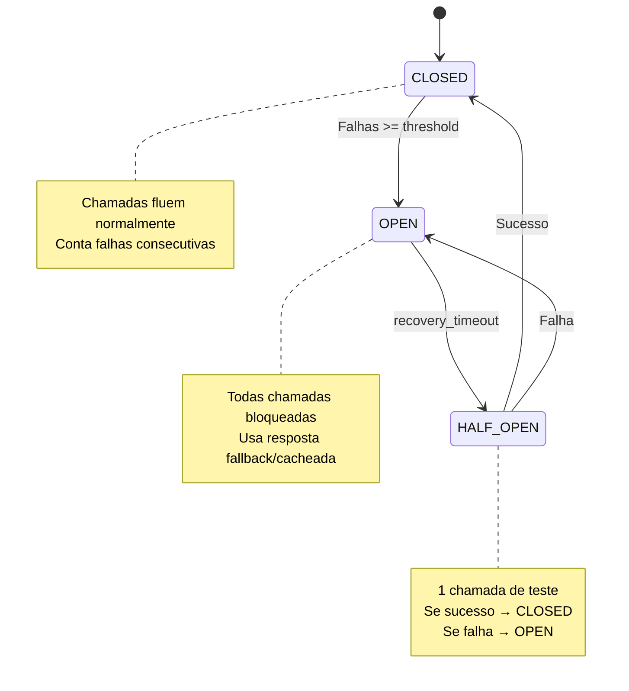

# Material Didático — P3a-3: Planejamento e Retomada

## Conceitos Fundamentais

### Por que Planejadores Precisam Ser Resilientes?

Em produção, coisas falham:

- APIs externas caem (503 Service Unavailable)
- Rate limits são atingidos (429 Too Many Requests)
- Timeouts ocorrem em chamadas lentas
- Serviços são reiniciados para deploy

Um planejador ingênuo falha completamente quando um passo falha. Um planejador resiliente:

1. **Detecta** a falha rapidamente
2. **Protege** contra retries inúteis (circuit breaker)
3. **Salva** progresso periodicamente (checkpoint)
4. **Recupera** de onde parou ao tentar novamente

### Circuit Breaker Pattern

Inspirado em disjuntores elétricos: se muitos erros acontecem, o circuito "abre" e para de tentar por um tempo.



Este pattern evita o **cascata de falhas**: quando um serviço lento faz todos os outros serviços esperarem até esgotar memória.

### Checkpoints — Salvar o Progresso

Checkpoint é um snapshot do estado completo do sistema:

```json
{
  "timestamp": 1729500000,
  "step_index": 3,           // Já completou 3 passos
  "tokens_consumed": 15420,  // Tokens gastos até agora
  "cost_accumulated": 0.023, // Custo acumulado
  "circuits_status": {
    "external_api": {"state": "closed", "failures": 0}
  }
}
```

Se o sistema crashar ou precisar ser reiniciado, carregamos o checkpoint e continuamos do passo 3 — não do passo 1.

### Trade-offs de Resiliência

| Técnica | Vantagem | Custo |
| --------- | ---------- | ------- |
| Circuit Breaker | Evita cascata de falhas | Latência adicional (fallback) |
| Checkpoints | Recuperação após crash | I/O de escrita em disco |
| Retry com backoff | Tenta novamente suavemente | Atraso na resposta |
| Fallbacks | Sistema continua funcionando | Resposta degradada |

### Simulação de Serviço

O módulo usa `SimulatedService` para testar circuit breakers sem depender de API real:

```python
class SimulatedService:
    """Simula uma API externa que falha intermitentemente."""
    
    def __init__(self, failure_rate: float = 0.3):
        self.failure_rate = failure_rate
        self.call_count = 0
    
    def call(self) -> str:
        self.call_count += 1
        if random.random() < self.failure_rate:
            raise ConnectionError("Serviço indisponível")
        return f"Resposta #{self.call_count}"
```

Isso permite testar estados do circuit breaker de forma determinística.

---

## Exercício Prático

Execute `python modules/p3a3_planning/run.py` e observe:

1. Como o circuit breaker transiciona entre estados
2. Quando o fallback é acionado vs quando a chamada real funciona
3. O checkpoint sendo salvo após cada passo
4. Como o planner recupera estado ao restaurar checkpoint

## Perguntas para Reflexão

1. Qual threshold de falhas seria ideal para um circuit breaker em produção? Mais ou menos que 3?
2. Se você tivesse múltiplas APIs dependentes, como gerenciaria os circuit breakers?
3. Que informações seriam críticas salvar no checkpoint para recuperação completa?

---

## Referências

### Livros

- **"Patterns of Enterprise Application Architecture"** by Martin Fowler — Capítulo sobre Circuit Breaker
- **"Designing Data-Intensive Applications"** by Martin Kleppmann — Capítulos sobre fault tolerance

### Documentação Oficial

- [Circuit Breaker Pattern](https://docs.microsoft.com/en-us/azure/architecture/patterns/circuit-breaker) — Microsoft Docs
- [Resilience Patterns in Microservices](https://docs.aws.amazon.com/wellarchitected/latest/reliability-pillar/retrying-connections.html) — AWS Well-Architected

### Tutoriais

- [Pydantic for State Management](https://docs.pydantic.dev/latest/concepts/models/) — Pydantic Docs
- [JSON Serialization Best Practices](https://realpython.com/python-json/) — Real Python
