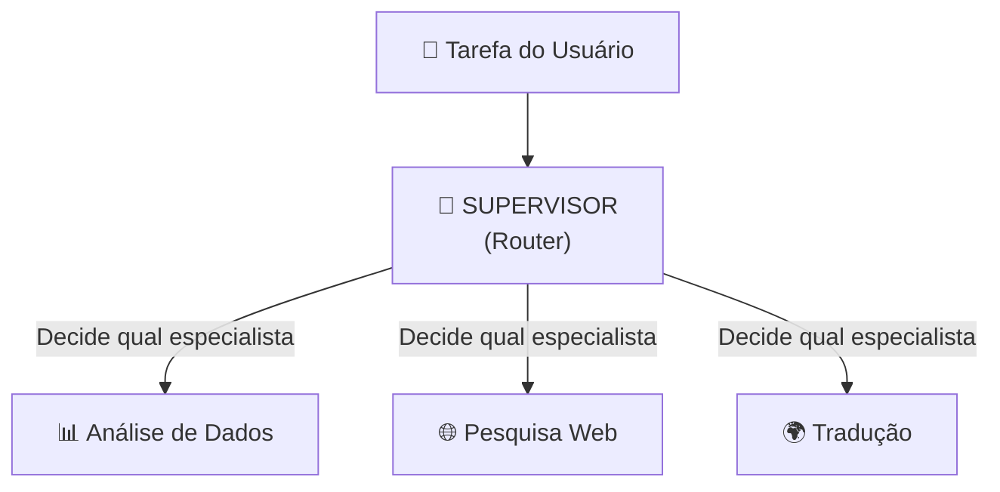

# Material Didático — P3b: Sistema Multiagente

## ⚠️ Pré-requisito

Você precisa ter concluído o módulo [P3a-3: Planejamento](../p3a3_planning/MATERIAL.md). Especificamente, precisa saber:

- Como planejar sequências de ações para agentes autônomos
- Quando um agente deve agir sozinho vs. coordenar com outros

---

## 🎯 Objetivos de Aprendizagem

Ao final deste módulo, você será capaz de:

- [ ] **Explicar** por que múltiplos agentes especializados superam um agente genérico único
- [ ] **Projetar** uma arquitetura supervisor-especialista com roteamento adequado
- [ ] **Comparar** roteamento baseado em LLM vs heurísticas (custo vs flexibilidade)
- [ ] **Implementar** graceful degradation quando um especialista falha
- [ ] **Calcular** custos adicionais do multiagente (supervisor + especialistas)

> 💡 **Dica:** Multiagente é mais caro que agente único, mas entrega qualidade muito superior. O segredo é usar modelos pequenos no supervisor e só escalar para modelos grandes nos especialistas quando necessário.

---

## Conceitos Fundamentais

### Por que Múltiplos Agentes?

Um único agente tentando fazer tudo é como um generalista tentando ser expert em todas as áreas. Sistemas multiagente oferecem:

| Agente Único | Múltiplos Agentes |
| -------------- | ------------------- |
| Prompt genérico | Prompts especializados por domínio |
| Falha única = sistema todo falha | Especialista falha = fallback para outro |
| Custo alto (contexto grande) | Custo otimizado (cada agente tem contexto mínimo) |
| Dificil de debugar | Isolamento de problemas por especialista |

### Por que isso existe?

Agentes únicos têm um problema fundamental: **quanto mais fazem, pior ficam**.

Quando você dá a um único modelo 5 tarefas diferentes (analisar dados, pesquisar na web, traduzir, classificar texto, gerar código), o prompt precisa cobrir todos os casos. Isso significa:

- Prompt enorme e confuso
- Modelo se confunde entre contextos diferentes
- Se uma tarefa falha, todas as outras também

Com múltiplos agentes especializados:

- Cada um tem um prompt focado na sua área
- Falha isolada não derruba o sistema
- Fácil de adicionar novos especialistas sem tocar nos existentes

### Erros Comuns de Iniciantes

| Erro | Consequência | Correção |
| ------ | -------------- | ---------- |
| Supervisor muito inteligente | Custa mais (LLM grande no roteamento) | Usar modelo pequeno (gpt-4o-mini) para rotear |
| Especialistas com prompts sobrepostos | Supervisor não sabe qual chamar | Delimitar claramente o escopo de cada especialista |
| Sem fallback | Um especialista falha = sistema para | Graceful degradation: tenta outro ou retorna parcial |
| Contexto compartilhado demais | Custo explode (cada agente vê tudo) | Cada agente recebe APENAS o necessário |

### Arquitetura Supervisor-Especialista



O supervisor:

1. **Entende** a intenção da tarefa
2. **Roteia** para o especialista mais adequado
3. **Coordena** retries e fallbacks
4. **Consolida** a resposta final

### Roteamento: LLM vs Heurísticas

Dois approaches para decidir qual especialista chamar:

**LLM-based routing** (produção):

```python
response = client.chat.completions.create(
    model="gpt-4o-mini",
    messages=[{"role": "user", "content": 
        f"Qual especialista deve lidar com: '{task}'?\n"
        f"Especialistas disponíveis: {specialists}"}]
)
```

**Heuristic routing** (demonstração):

```python
if "dados" in task.lower():
    return data_analyst_agent
elif "traduz" in task.lower():
    return translation_agent
```

Heurísticas são mais rápidas e baratas, mas menos flexíveis. LLM routing adapta-se a novas tarefas sem código novo.

### Degradation Elegante

Quando um especialista falha, o sistema não para — ele tenta alternativas:

```
Especialista A falha → Tenta Especialista B → Se B também falhar → Resposta parcial + aviso
```

Isso é chamado de **graceful degradation**: o sistema continua funcionando (mesmo que parcialmente) ao invés de crashar completamente.

### Custos em Multiagente

Cada chamada ao LLM custa tokens. Em multiagente, temos custos adicionais:

```
Custo Total = Custo_Supervisor + Σ Custo_Especialistas
```

O supervisor faz pelo menos 1 chamada (roteamento), e cada especialista pode fazer múltiplas chamadas (com retry). Isso significa que multiagente é tipicamente **mais caro** que agente único — mas entrega **melhor qualidade**.

---

## Exercício Prático

Execute `python modules/p3b_multi_agent/run.py` e observe:

1. Como o supervisor roteia diferentes tipos de tarefas
2. O que acontece quando um especialista falha (simulado)
3. Como o fallback redistribui para outro especialista
4. O log completo de roteamento gerado

## Perguntas para Reflexão

1. Se você tivesse 20 especialistas, o roteamento ficaria caro demais? Que alternativa existiria?
2. Como coordenar dois especialistas que precisam trabalhar juntos na mesma tarefa?
3. Quando faria sentido ter agentes hierárquicos (supervisor → sub-supervisores → especialistas)?

---

## 📌 Resumo do Módulo

Multi-agent supervisor é a arquitetura mais usada para tarefas complexas:

1. **Especialização > Generalização** — um supervisor roteia perguntas para especialistas. Cada especialista domina uma área, não precisa entender tudo.

2. **Roteamento LLM vs Heurística** — heurística (keyword matching) é barata e rápida mas inflexível. LLM routing entende intenção mas custa tokens. Use heurística para categorias claras, LLM para ambíguas.

3. **Graceful degradation = plano B** — se o especialista de finanças falha, fallback para generalista é melhor que erro 500. Sempre tenha fallbacks.

4. **Custos multiplicados** — cada especialista adiciona chamadas. Supervisor → Especialista = 2 chamadas por pergunta. Para 10 especialistas, custo pode subir 10x.

5. **Hierarquia escala** — supervisor → sub-supervisores → especialistas funciona para dezenas de agentes. Mas cada nível adicionia latência.

> ✅ **Você está pronto para:** Agora que seu agente é multi-especializado, vamos colocá-lo em produção com API REST.

---

## 🔗 Próximos Passos

Com multi-agentes, você tem um sistema inteligente mas ainda local. Para usar em produção, precisa de uma interface acessível — uma API REST.

→ Leia o módulo [P4: Deploy em Produção](../p4_production/MATERIAL.md) para aprender FastAPI e Docker.

---

## Referências

### Livros

- **"Multiagent Systems"** by Kai Yu et al. — Fundamentos teóricos de sistemas multiagente
- **"Team of Agents"** by Dong et al. (DeepMind) — Paper sobre coordenação de agentes

### Documentação Oficial

- [OpenAI Function Calling for Routing](https://platform.openai.com/docs/guides/function-calling)
- [LangGraph Multi-Agent Patterns](https://langchain-ai.github.io/langgraph/) — LangChain Docs

### Tutoriais

- [CrewAI Framework](https://docs.crewai.com/) — Multi-agent orchestration
- [AutoGen by Microsoft](https://microsoft.github.io/autogen/) — Conversational agents framework
