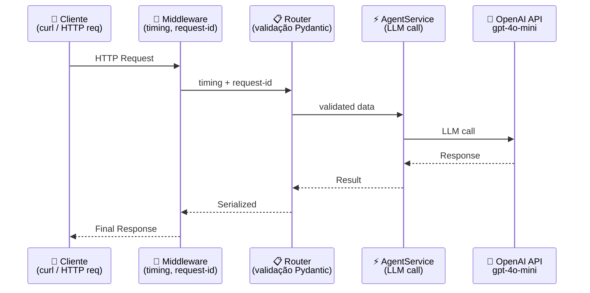
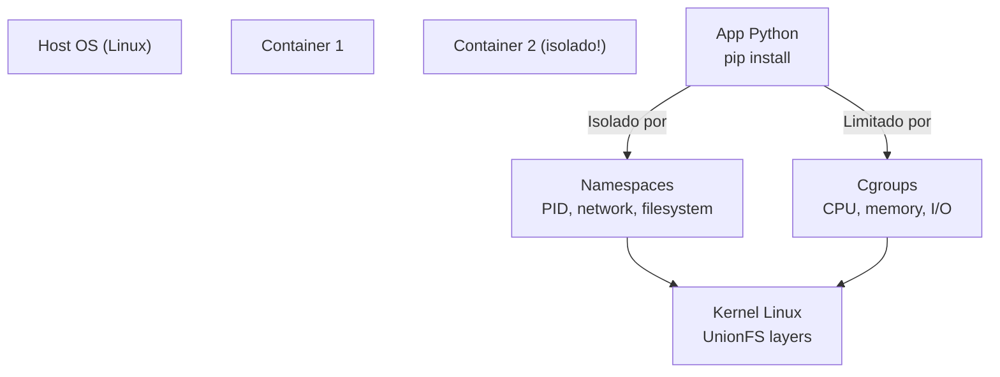

# Material Didático — P4: Produção (API REST com FastAPI)

## ⚠️ Pré-requisito

Você precisa ter concluído o módulo [P3b: Multiagente](../p3b_multi_agent/MATERIAL.md). Especificamente, precisa saber:

- Como construir sistemas multiagente coordenados
- Quando usar arquitetura single-agent vs. multi-agent

---

## 🎯 Objetivos de Aprendizagem

Ao final deste módulo, você será capaz de:

- [ ] **Construir** uma API REST com FastAPI para expor seu agente como serviço
- [ ] **Validar** inputs do usuário com Pydantic models (contrato cliente-servidor)
- [ ] **Implementar** middleware de monitoramento (timing, request-id, logging estruturado)
- [ ] **Dockerizar** sua aplicação para deploy consistente em qualquer ambiente
- [ ] **Entender** como o Docker funciona internamente (namespaces, cgroups, layers)

> 💡 **Dica:** Este é o módulo que transforma seu script local em um produto real. Sem uma API, seu agente é um brinquedo pessoal. Com uma API, vira algo que 100 pessoas podem usar simultaneamente.

---

## Conceitos Fundamentais

### De Script a Produto

Até agora, executamos scripts Python isolados. Em produção, precisamos de:

| Script Local | API de Produção |
| ------------- | ----------------- |
| Executa e para | Fica rodando 24/7 |
| Um usuário por vez | Múltiplos usuários simultâneos |
| Sem autenticação | Com validação e segurança |
| Logs no terminal | Logs estruturados em arquivo |
| Sem versionamento | Com versionamento e docs |

### Por que isso existe?

Um script local funciona perfeitamente quando você está desenvolvendo. Mas imagine seu agente sendo usado por 100 pessoas ao mesmo tempo:

```
Script local:    Usuário A → [processa] → Resposta → Usuário B espera...
                ↑ TRAVA aqui!

API produção:   Usuário A → [processa] ↘
                Usuário B → [processa] →→ Respostas simultâneas
                Usuário C → [processa] ↗
```

Sem uma API, seu agente é um produto de uso individual. Com uma API, vira um **produto escalável**.

### Erros Comuns de Iniciantes

| Erro | Consequência | Correção |
| ------ | -------------- | ---------- |
| Não validar input do usuário | Modelo recebe texto malicioso ou corrompido | SEMPRE usar Pydantic models para validar |
| Expor chaves de API no código | Qualquer pessoa pode roubar e gastar sua chave | Variáveis de ambiente (.env), nunca hardcode |
| Ignorar timeouts | Requisição fica presa indefinidamente | Timeout de 30s como padrão |
| Logar dados sensíveis | Vaza tokens, emails, CPF nos logs | Sanitizar logs, nunca logar conteúdo completo |
| Não testar localmente antes de deploy | Bug só aparece em produção | Testar com `--serve` antes de dockerizar |

### FastAPI — Framework Moderno

FastAPI é um framework web para Python que oferece:

1. **Autodocumentação**: Swagger UI automática em `/docs`
2. **Validação automática**: Pydantic valida requests automaticamente
3. **Type hints**: Tipagem forte com inferência de schemas
4. **Async/await**: Suporte nativo a operações assíncronas
5. **Performance**: Uma das frameworks Python mais rápidas (comparável a Go/Node.js)

### Fluxo de uma Requisição na API



Cada requisição passa por 4 camadas antes de chegar ao LLM.

```python
@app.post("/chat", response_model=AgentResponse)
async def chat(request: AgentRequest) -> AgentResponse:
    # request já é validado e tipado aqui
    result = await agent_service.process_request(...)
    return result  # FastAPI serializa automaticamente
```

### Modelos Pydantic como Contrato

Os modelos definem o contrato entre cliente e servidor:

```python
class AgentRequest(BaseModel):
    message: str                    # Obrigatório
    model: str = "gpt-4o-mini"      # Opcional com default
    use_tools: bool = False         # Booleano
    max_iterations: int = Field(ge=1, le=10, default=3)  # Validado

class AgentResponse(BaseModel):
    answer: str
    tokens_input: int
    tokens_output: int
    cost_usd: float
    conversation_id: str
```

Isso garante que:

- Requests inválidos são rejeitados antes de chegar à lógica
- Clients sabem exatamente o formato esperado
- Docs Swagger são gerados automaticamente

### Middleware de Monitoramento

Middleware intercepta todas as requisições para adicionar observabilidade:

```python
class MonitoringMiddleware:
    async def __call__(self, request, call_next):
        start = time.time()
        request_id = str(uuid.uuid4())[:8]
        
        # Adiciona headers de tracking
        response = await call_next(request)
        
        elapsed = time.time() - start
        response.headers["X-Request-ID"] = request_id
        response.headers["X-Response-Time"] = f"{elapsed*1000:.0f}ms"
        
        return response
```

Headers customizados permitem:

- Rastrear cada request individualmente nos logs
- Medir latência por endpoint
- Debugar problemas em produção

### Docker — Empacotamento Consistente

Docker garante que o código roda igual em qualquer ambiente:

```dockerfile
FROM python:3.11-slim
WORKDIR /app
COPY . .
RUN pip install -e ".[dev]"
EXPOSE 8000
CMD ["uvicorn", "app.main:app", "--host", "0.0.0.0", "--port", "8000"]
```

Vantagens:

- Mesma imagem local e produção
- Dependências congeladas
- Isolamento de ambientes

### Como o Docker Realmente Funciona

Docker **não é uma VM**. Ele não virtualiza hardware — usa recursos do kernel Linux:



**Namespaces**: cada container acha que tem seu próprio sistema de arquivos, rede e processos. É ilusão — o kernel separa tudo.

**Cgroups**: controlam quanto CPU/memória um container pode usar. Sem eles, um container poderia consumir todo o host.

**Layers**: cada `RUN`/`COPY` no Dockerfile cria uma layer read-only. Se você muda só o código (`COPY . .`), as camadas de dependência (`pip install`) são reutilizadas → build mais rápido.

Por isso `docker build` é lento na primeira vez (baixa todas as layers) mas rápido depois (cache de layers).

### docker-compose — Infraestrutura Completa

```yaml
services:
  api:
    build: .
    ports: ["8000:8000"]
    depends_on: [chromadb]
  
  chromadb:
    image: chromadb/chroma:latest
    volumes: [chroma_data:/chroma/chroma]
```

Orquestra múltiplos serviços com dependências e volumes persistentes.

---

## Exercício Prático

Execute `python modules/p4_production/run.py --serve` e observe:

1. A API iniciando no port 8000
2. Docs Swagger em <http://localhost:8000/docs>
3. Teste endpoints via curl ou interface interativa do Swagger
4. Métricas acumuladas em `/metrics`

Ou use Docker:

```bash
docker-compose up --build
```

## Perguntas para Reflexão

1. Por que usar async/await na API? Quando isso faz diferença vs quando não faz?
2. Se você tivesse 1000 requisições por segundo, que mudanças seriam necessárias?
3. Como você implementaria autenticação (API keys, JWT) nesta API?

---

---

## 📌 Resumo do Módulo

Deploy em produção é onde protótipos viram produtos:

1. **FastAPI = padrão para APIs de IA** — validação automática com Pydantic, async nativo, documentação Swagger/OpenAPI gerada automaticamente.

2. **Pydantic models = contrato** — cada endpoint tem input/output definido. Se o cliente enviar formato errado, FastAPI rejeita antes de chamar seu código.

3. **Middleware = observabilidade** — logging estruturado (JSON) permite monitorar latência, tokens usados e erros em tempo real. Sem logging, você está cego.

4. **Docker = portabilidade** — containeriza sua API para rodar em qualquer lugar (local, cloud, edge). Docker Compose orquestra múltiplos containers.

5. **Internals do Docker** — imagens são imutáveis, containers são efêmeros. Volume mount para dados, network para comunicação entre containers.

> ✅ **Você está pronto para:** Agora que sua API está em produção, precisa saber como avaliar a qualidade das respostas.

---

## 🔗 Próximos Passos

Com sua API em produção, seus agentes estão respondendo perguntas. Mas como saber se as respostas estão boas? Precisamos de avaliação sistemática.

→ Leia o módulo [P5: Avaliação de Qualidade](../p5_evaluation/MATERIAL.md) para aprender golden datasets e testes A/B.

---

## Referências

### Livros

- **"FastAPI in Action"** by Juan J. Borreguero — Guia completo do framework
- **"Docker Deep Dive"** by Nigel Poulton — Fundamentos de containers

### Documentação Oficial

- [FastAPI Documentation](https://fastapi.tiangolo.com/) — Docs oficiais
- [Pydantic v2 Models](https://docs.pydantic.dev/latest/concepts/models/) — Validação de dados
- [Uvicorn ASGI Server](https://www.uvicorn.org/) — Servidor assíncrono

### Tutoriais

- [Building Production APIs with FastAPI](https://testdriven.io/blog/fastapi-docker/) — TestDriven.io
- [Docker Compose Networking](https://docs.docker.com/compose/networking/) — Docker Docs
