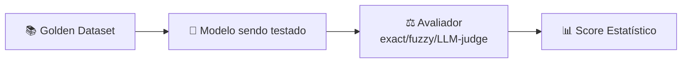
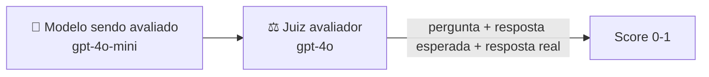
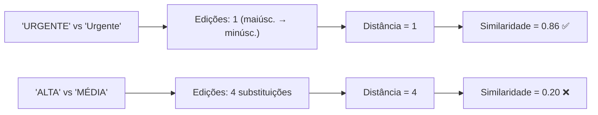

# Material Didático — P5: Avaliação e Testes

## ⚠️ Pré-requisito

Leia antes:

- [p0_fundamentals/MATERIAL.md](../p0_fundamentals/MATERIAL.md) — Fundamentos de IA e LLM
- [p3a1_self_eval/MATERIAL.md](../p3a1_self_eval/MATERIAL.md) — Autoavaliação

---

## 🎯 Objetivos de Aprendizagem

Ao final deste módulo, você será capaz de:

- [ ] **Construir** um golden dataset confiável com exemplos de input + resposta esperada
- [ ] **Implementar** diferentes métricas de avaliação (exact match, fuzzy, LLM-as-a-Judge)
- [ ] **Realizar** testes A/B para comparar duas versões do mesmo agente
- [ ] **Calcular** significância estatística (teste Z) para saber quando uma diferença é real
- [ ] **Aplicar** benchmarking regressivo para detectar degradação antes de deploy

> 💡 **Dica:** Este é o módulo que separa desenvolvimento amador de produção profissional. Sem avaliação automatizada, qualquer mudança no seu agente é uma roleta russa — pode melhorar, pode piorar silenciosamente.

---

## Conceitos Fundamentais

### O Problema da Qualidade Invisível

Sem avaliação, você está cego. Mudou o prompt? Trocou de modelo? Adicionou uma feature? Sem métricas, não sabe se melhorou ou piorou.

**Avaliação é o que separa desenvolvimento amador de produção profissional.**

### Por que isso existe?

Imagine que você gastou 3 horas ajustando o prompt do seu agente. Como saber se valeu a pena? Sem um dataset de teste (golden dataset), você só tem uma sensação subjetiva — "acho que ficou melhor".

Em produção, decisões precisam de dados:

```
Sem avaliação: "O prompt novo parece bom" → Deploy arriscado
Com avaliação: "O prompt v2 subiu de 78% para 92% no golden dataset" → Deploy seguro
```

Além disso, sem testes automatizados, qualquer mudança pode quebrar algo silenciosamente — o agente continua respondendo, mas com qualidade pior.

### Erros Comuns de Iniciantes

| Erro | Consequência | Correção |
| ------ | -------------- | ---------- |
| Golden dataset pequeno (< 20 exemplos) | Score não é representativo | Mínimo 30 exemplos, ideal 100+ |
| Usar só exact match para texto livre | Penaliza paráfrases válidas | Combinar fuzzy + embedding similarity |
| Não testar com modelo diferente | Prompt otimizado só para um modelo | Testar em gpt-4o-mini E gpt-4o |
| Avaliar só acurácia | Ignora latência, custo, segurança | Métrica composta: accuracy + latency + cost |
| Dataset vaza para treino | Modelo memoriza respostas → score inflado | Manter dataset de teste separado do ajuste |

### Pipeline de Avaliação



Cada exemplo do dataset passa por este pipeline, gerando scores comparáveis entre versões.

### Golden Dataset — Respostas Esperadas

Um golden dataset é um conjunto de exemplos com input + resposta esperada (ground truth):

```python
GoldenExample(
    id="ticket_001",
    question="Não consigo acessar minha conta, erro 403",
    expected_answer="URGENTE",
)
```

Funciona como um "banco de questões" para testar o agente. Cada execução gera scores comparáveis.

### Métricas de Avaliação

| Métrica | O que mede | Quando usar |
| --------- | ------------ | ------------- |
| **Exact Match** | Correspondência exata | Classificações discretas |
| **Fuzzy Match** | Sobreposição de palavras | Textos livres parciais |
| **LLM-as-a-Judge** | Julgamento por outro LLM | Respostas complexas/abertas |
| **Embedding Similarity** | Similaridade semântica vetorial | Paraphrase detection |

### LLM-as-a-Judge

Usa um LLM mais poderoso (ex: gpt-4o) para julgar a qualidade de respostas de um modelo menor (ex: gpt-4o-mini):



O juiz recebe: pergunta + resposta esperada + resposta real → retorna score 0-1.

### Como Fuzzy Match Calcula Similaridade

Fuzzy match usa **Distância de Levenshtein**: número mínimo de edições para transformar uma string na outra.



**Por que score 0.85 ≠ 0.90 é significativo?**

Em avaliação de agentes, cada ponto de percentual representa dezenas de exemplos no dataset. Um salto de 0.85 para 0.90 pode ser a diferença entre "pronto para produção" e "precisa melhorar mais".

### Significância Estatística: Quando um Score é Real?

Um score de 0.85 vs 0.90 só importa se o dataset é grande o suficiente para descartar ruído:

```
Dataset pequeno (10 exemplos):
  Prompt A → 7/10 corretos = 0.70
  Prompt B → 8/10 corretos = 0.80
  Diferença: 1 exemplo → provavelmente ruído
  Conclusão: não podemos dizer que B é melhor

Dataset médio (100 exemplos):
  Prompt A → 70/100 corretos = 0.70
  Prompt B → 80/100 corretos = 0.80
  Diferença: 10 exemplos → possivelmente real
  Conclusão: B parece melhor, mas precisamos teste estatístico

Dataset grande (1000 exemplos):
  Prompt A → 700/1000 corretos = 0.70
  Prompt B → 800/1000 corretos = 0.80
  Diferença: 100 exemplos → quase certamente real
  Conclusão: B é significativamente melhor (p < 0.001)
```

#### Regra prática: Tamanho mínimo do dataset

| Tamanho do Dataset | Confiabilidade | Uso recomendado |
| ------------------- | ---------------- | ------------------ |
| < 20 exemplos | Muito baixa | Só prototipagem, nunca deploy |
| 20-100 exemplos | Média | Decisões preliminares |
| 100-500 exemplos | Boa | Deploy com confiança |
| 500+ exemplos | Alta | Qualquer decisão de produção |

#### Teste Z para proporções (simplificado)

Para comparar dois scores p (proporção de acertos):

```
p1 = 0.70, n1 = 100
p2 = 0.80, n2 = 100

Z = (p2 - p1) / sqrt(p*(1-p) * (1/n1 + 1/n2))
onde p = (x1 + x2) / (n1 + n2) = (70+80)/(100+100) = 0.75

Z = 0.10 / sqrt(0.75*0.25 * 0.02) = 0.10 / 0.061 = 1.64

Se Z > 1.96 → diferença significativa (95% confiança)
Se Z < 1.96 → diferença pode ser ruído
```

Na prática: **nunha faça deploy baseado em menos de 50 exemplos**. Se seu golden dataset tem 10 exemplos, o resultado é uma dica, não uma decisão.

**Limitações do fuzzy match:**

- Não entende sinônimos: "urgente" vs "crítico" → similaridade baixa
- Sensível a ordem: "resposta longa" vs "longa resposta" → penaliza
- Por isso LLM-as-a-Judge existe: entende significado, não só texto

### Testes A/B

Compara duas variantes lado a lado no mesmo dataset:

```
Variante A (heurística): Score 0.62
Variante B (agente IA):  Score 0.89
Vencedor: B (+43.5%)
```

Essencial para decidir entre abordagens antes de deploy.

### Benchmarking Regressivo

Salva resultados de cada execução. Antes de qualquer mudança:

1. Roda baseline atual → salva report.json
2. Faz mudança (prompt, modelo, etc.)
3. Roda novamente → compara com baseline
4. Se score caiu → rollback automático

---

## Exercício Prático

Execute `python modules/p5_evaluation/run.py` e observe:

1. Como o golden dataset define ground truth
2. Scores individuais por exemplo (exact, fuzzy, LLM judge)
3. Relatório estatístico completo (média, mediana, min, max)
4. Resultado do teste A/B entre heurística vs agente

## Perguntas para Reflexão

1. Como construir um golden dataset confiável? Quem valida as respostas esperadas?
2. Se o LLM-as-a-judge também pode errar, como garantir que ele é justo?
3. Qual tamanho mínimo de dataset para resultados estatisticamente significativos?

---

---

## 📌 Resumo do Módulo

Avaliação sistemática é o que separa produção de experimentação:

1. **Golden dataset = verdade fundamental** — conjunto curado de entradas/saídas esperadas. Sem ele, você não sabe se melhorou ou piorou.

2. **Métricas importam** — precisão/recall para classificação, BLEU/ROUGE para geração, LLM-as-Judge para qualidade subjetiva. Cada métrica responde uma pergunta diferente.

3. **Testes A/B com significância estatística** — diferença de 2% pode ser ruído. Teste t e intervalo de confiança dizem se a mudança real ou sorteio.

4. **Benchmarking regressivo** — cada nova versão deve superar a anterior. Se regression test falha, deploy bloqueado. CI/CD com gates de qualidade.

5. **LLM-as-Judge vs Humanos** — LLM judge escala mas tem viés. Humanos são precisos mas caros. Use AMBAS: LLM para triagem, humanos para amostragem.

> ✅ **Você está pronto para:** Agora que sabe avaliar qualidade, precisa garantir segurança das respostas.

---

## 🔗 Próximos Passos

Com avaliação em produção, seus agentes entregam respostas consistentes. Mas como garantir que essas respostas são seguras contra ataques?

→ Leia o módulo [P6: Segurança e Guardrails](../p6_safety/MATERIAL.md) para aprender defesa contra prompt injection.

---

## Referências

### Livros

- **"Machine Learning Engineering"** by Andrey Burtenshaw — Capítulos sobre testing e evaluation
- **"Designing Machine Learning Systems"** by Chip Huyen — Capítulos sobre model evaluation

### Documentação Oficial

- [OpenAI Evals](https://platform.openai.com/docs/guides/evals) — OpenAI Docs
- [LangSmith Evaluation](https://smith.langchain.com/docs/concepts/evaluation/) — LangSmith Docs

### Tutoriais

- [Creating Golden Datasets](https://medium.com/@langchain/create-golden-datasets-for-llm-evaluation) — LangChain Blog
- [Evaluation Best Practices](https://docs.arize.com/phoenix) — Arize Phoenix Docs
