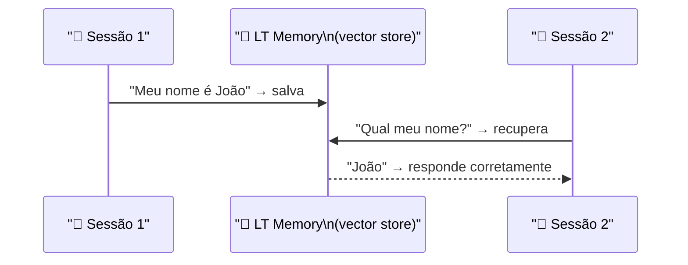
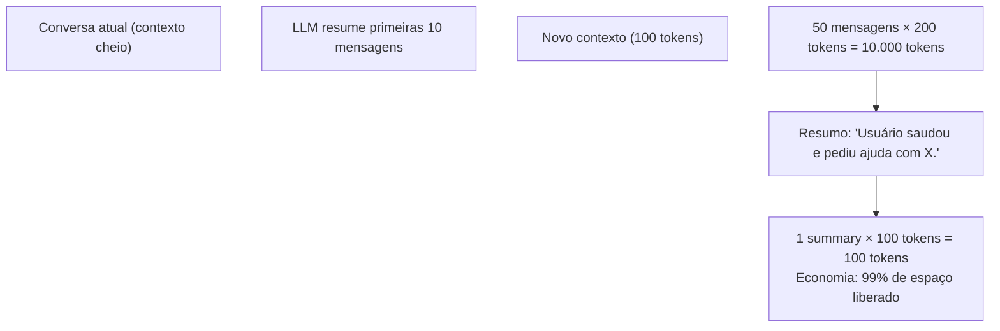

# Material Didático — P7: Memória e Contexto

## ⚠️ Pré-requisito

Você precisa ter concluído o módulo [P6: Segurança e Guardrails](../p6_safety/MATERIAL.md). Especificamente, precisa saber:

- Como implementar validação de inputs e outputs
- Patterns de guardrails para prevenir comportamentos indesejados

---

## 🎯 Objetivos de Aprendizagem

Ao final deste módulo, você será capaz de:

- [ ] **Explicar** a diferença entre memória de curto prazo (conversa atual) e longo prazo (persistente entre sessões)
- [ ] **Implementar** estratégias de gestão de contexto (sliding window, token budget, summarization)
- [ ] **Compreender** como sumarização automática funciona na prática (custo vs economia)
- [ ] **Projetar** sistema de memória hierárquica (resumo global + últimas mensagens)
- [ ] **Identificar** o que preservar vs resumir (dados do usuário vs conversa trivial)

> 💡 **Dica:** Memória é o que transforma um chatbot sem graça em um agente que "lembra" de você. Mas memória custa tokens — cada mensagem adicional ocupa espaço no contexto e custa dinheiro. Este módulo ensina o equilíbrio.

---

## Conceitos Fundamentais

### O Problema do Contexto Limitado

LLMs têm um limite de tokens que podem processar por vez (gpt-4o-mini: 128K tokens). Mas em conversas longas, esse limite é rapidamente excedido. Como gerenciar?

### Short-Term Memory = Conversation History

### Por que isso existe?

Sem memória, cada conversa com o agente começa do zero:

```
Usuário: "Meu nome é João"
Agente: "Olá! Como posso ajudar?"

Usuário: "Qual meu nome?"
Agente: "Não sei quem você é 😅"
```

Isso é frustrante para o usuário e impraticável para qualquer aplicação real. A memória permite que o agente **lembre** do que foi dito antes.

Mas há um problema: memória custa tokens. Cada mensagem da conversa ocupa espaço no contexto, e cada token custa dinheiro. Precisamos equilibrar:

- **Muito pouca memória**: agente esquece tudo → experiência ruim
- **Toda a memória**: custo explode → conta alta

As estratégias deste módulo (sliding window, token budget, summarization) são trade-offs entre esses dois extremos.

### Erros Comuns de Iniciantes

| Erro | Consequência | Correção |
| ------ | -------------- | ---------- |
| Enviar TODA a conversa ao modelo | Custo explode, ultrapassa limite de tokens | Usar sliding window ou token budget |
| Sumarizar sem preservar dados importantes | Agente esquece nome, preferências do usuário | Separar dados persistentes (nome) de histórico (conversa) |
| Não testar com conversa longa | Bug só aparece após 50+ mensagens | Testar com simulação de 100+ mensagens |
| Guardar senhas/tokens na memória | Vazamento em logs ou respostas | Sanitizar memória, nunca guardar dados sensíveis |

Memória de curto prazo é o histórico da conversa atual:

```
[system]: Você é um assistente...
[user]: Olá, meu nome é João
[assistant]: Olá João! Como posso ajudar?
[user]: Qual meu nome?
[assistant]: Você se chamou João...
```

Estratégias de gestão quando o contexto enche:

| Estratégia | Como funciona | Vantagem | Desvantagem |
| ------------ | -------------- | ---------- | ------------- |
| **Sliding Window** | Remove mensagens mais antigas | Simples | Perde contexto importante |
| **Token Budget** | Para de adicionar ao atingir limite | Previsível | Ignora novas mensagens |
| **Summarization** | Resume segmentos antigos | Preserva informação | Custo de sumarização |

### Long-Term Memory = Persistent Knowledge

Memória de longo prazo persiste entre sessões:



Funciona como um vector store simplificado:

1. Embedding do conteúdo
2. Busca por similaridade com a query
3. Retorna memórias mais relevantes

### Summarization Automática

Quando o contexto está cheio, resume segmentos anteriores:

```
Original: 50 mensagens × 200 tokens = 10.000 tokens
Resumido: 1 summary × 100 tokens = 100 tokens
Economia: 99% de espaço liberado
```

#### Como Sumarização Funciona na Prática

A sumarização não é mágica — é outra chamada ao LLM, mas com um objetivo específico:



**O que se resume vs o que se mantém:**

| O que RESUMIR | O que MANTER |
| --------------- | ------------- |
| Saudações e pequenas conversas | Dados do usuário (nome, preferências) |
| Perguntas já respondidas | Tarefas em andamento |
| Mensagens > 30 min atrás | Últimas 5-10 mensagens diretas |
| Informações genéricas | Detalhes específicos do problema |

**Trade-off inevitável: informação perdida**

```
Sumarização perde ~15-30% da informação original.

Exemplo real:
Original: "Meu nome é João, tenho 30 anos,
          trabalho em São Paulo, gosto de café."
Resumido: "Usuário se apresentou." → PERDEU TUDO
Resumido: "Nome: João, 30 anos, SP" → PRESERVOU DADOS
Resumido: "João, 30, SP, gosta de café" → IDEAL

A qualidade do resumo depende do prompt de sumarização.

### 🏗️ Arquitetura do Sistema de Memória

> Referência completa: [architecture.md](architecture.md)

O sistema de memória é composto por 3 camadas independentes:

```

[Conversa Atual] → [Short-Term Manager] → [Summarizer]
                        ↓                        ↓
              [Token Budget]            [Long-Term Store]
                        ↓                        ↓
              [Contexto Montado] ←── [Retriever] ← [Vector DB]

```

| Camada | Responsabilidade | O que armazena |
|--------|------------------|----------------|
| **Short-Term** | Histórico da conversa atual | Últimas N mensagens |
| **Summarizer** | Resume segmentos antigos | 1 summary por segmento |
| **Long-Term Store** | Persiste entre sessões | Memórias com embedding |
| **Token Budget** | Controla limite de tokens | Orçamento por chamada |
| **Retriever** | Busca memórias relevantes | top_k memórias por query |

**Fluxo completo:**
1. Nova mensagem chega → Short-Term Manager adiciona ao histórico
2. Token Budget verifica se contexto está cheio
3. Se cheio → Summarizer resume primeiros segmentos
4. Simultaneamente → Retriever busca memórias relevantes no Vector DB
5. Contexto montado = [system] + [summary_global] + [short-term] + [memórias recuperadas]
6. Enviado ao LLM

**Trade-off chave:** mais memórias longas = melhor personalização mas mais custo; menos summaries = mais contexto curto prazo mas risco de exceder token limit.

Custo da sumarização: cada resumo custa tokens. Se sumarizar a cada 30 mensagens e cada resumo tem 100 tokens input + 50 output, o custo extra é ~$0.00002 por sumarização — insignificante comparado à economia de 9.900 tokens.

### Importância e Forgetting

Nem tudo na memória é igualmente importante. Um sistema sofisticado precisa decidir **o que manter, o que resumir e o que deletar**:

| Critério | Alta Prioridade (manter) | Baixa Prioridade (esquecer) |
| ---------- | ------------------------ | ---------------------------- |
| **Conteúdo** | Dados pessoais, preferências, decisões | Saudações, conversas triviais |
| **Tempo** | Últimas 5-10 mensagens | Mensagens > 30 min atrás |
| **Frequência** | Tópicos mencionados repetidamente | Tópicos únicos sem relevância |
| **Emoção** | Frustração, urgência, satisfação | Conversa neutra e factual |

#### Como o Forgetting Funciona na Prática

O forgetting não é aleatório — usa **score decay** (decaimento por tempo) + **frequência de acesso**:

```python
class MemoryScore:
    def calculate(self, memory_entry):
        # Score baseia-se em:
        time_decay = 1.0 / (1 + memory_entry.age_hours)  # diminui com tempo
        access_freq = min(memory_entry.access_count / 10, 1.0)  # normaliza
        importance = self._assess_importance(memory_entry.content)  # heurística
        
        return (time_decay * 0.4 + 
                access_freq * 0.3 + 
                importance * 0.3)
    
    def should_forget(self, score):
        return score < 0.1  # limiar mínimo
```

**Estratégias combinadas:**

1. **Time-based decay**: cada memória perde 5% do score por hora sem acesso
2. **Frequency boost**: memórias acessadas frequentemente ganham +20% no score
3. **Priority override**: dados críticos (nome, preferências) têm score mínimo garantido
4. **Summarization fallback**: quando score está baixo mas não zero, sumarizar em vez de deletar

**Trade-off inevitável:**

```
Esquecer cedo → perde contexto importante
Esquecer tarde → custo alto, contexto poluído

Solução: summarização hierárquica
- Nível 1 (frequent): resumir últimas 10 msgs → 1 summary
- Nível 2 (menos freq): resumir summaries antigos → 1 global
- Nível 3 (raro): salvar estado persistente no banco
```

## 🎬 O que você vai ver

Antes de rodar o código, aqui está uma prévia do que o programa vai fazer:

```
$ python modules/p7_memory/run.py

💾 Armazenando memória...
   "Experiência: Python backend" → salva (curto prazo)

🔍 Consultando memória...
   Q: "O que eu disse sobre minha experiência?"
   A: "Você mencionou Python backend"

🔄 Contexto enchendo...
   Summarização automática: 10 msgs → 1 resumo

📊 Status da memória:
   Curto prazo: 8/10 mensagens
   Longo prazo: 3 memórias salvas
```

## Exercício Prático

Execute `python modules/p7_memory/run.py` e observe:

1. Como as memórias são armazenadas e recuperadas
2. A consulta de memória funcionando ("O que eu disse sobre minha experiência?")
3. A summarização automática quando o contexto enche
4. O status completo de ambos os tipos de memória

## Perguntas para Reflexão

1. Quando resumir vs quando deletar? Que critérios definiriam isso?
2. Se você tivesse 1000 interações, quantas memórias de longo prazo seriam razoáveis?
3. Como evitar que memórias incorretas ou enviesadas persistam?

## 📌 Resumo do Módulo

Memória é o que diferencia agentes conversacionais de ferramentas stateless:

1. **Memória de curto prazo = contexto atual** — tudo que está no context window agora. Limitado (4K-128K tokens), mas essencial para manter fluidez da conversa.

2. **Memória de longo prazo = persistência** — dados salvos entre sessões. Vector store (embeddings) para busca semântica, ou database relacional para dados estruturados.

3. **Sumarização automática = gestão inteligente** — quando contexto enche, sumarizar conversas antigas em vez de deletar. Preserva informação importante sem ocupar espaço.

4. **Hierarquia de memória** — curto prazo (contexto atual) → médio prazo (sessão atual) → longo prazo (entre sessões). Cada nível tem estratégia diferente de gestão.

5. **Preservar vs Resumir** — nem tudo deve ser resumido. Dados críticos (nomes, datas, decisões) devem ser preservados intactos. Contexto conversacional pode ser resumido.

> ✅ **Você está pronto para:** Agora que seu agente lembra de conversas, vamos melhorar a experiência do usuário com streaming.

## ✅ Checklist: Como Saber Se Você Atingiu o Objetivo

Marque cada item **só se conseguir fazer sem olhar o material**:

- [ ] Explico a diferença entre memória curto prazo e longo prazo
- [ ] Descrevo quando sumarização deve ser acionada
- [ ] Explico por que preservar dados críticos vs resumir contexto
- [ ] Rodo `run.py` e explico o status de ambos os tipos de memória
- [ ] Digo 2 estratégias de gestão de memória (summarização hierárquica, etc.)

> ⚠️ Se marcou menos de 3 itens, releia as seções correspondentes antes de prosseguir.

---

## 🔗 Próximos Passos

Com memória implementada, seus agentes mantêm contexto entre conversas. Mas respostas longas podem parecer lentas para o usuário — streaming resolve isso.

→ Leia o módulo [P8: Streaming](../p8_streaming/MATERIAL.md) para aprender SSE e latência percebida.

---

## Referências

(empty)
- [Conversation Memory Patterns](https://langchain-ai.github.io/langgraph/concepts/memory/) — LangGraph Docs
- [Vector Store for Memory](https://docs.trychroma.com/) — ChromaDB Docs
