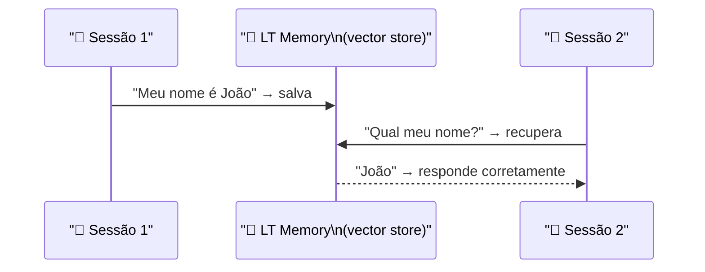
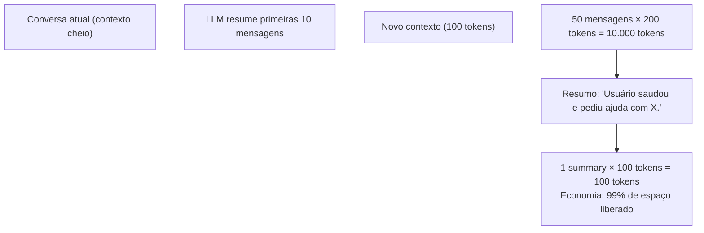

# Material Didático — P7: Memória e Contexto

## ⚠️ Pré-requisito

Leia antes:

- [p0_fundamentals/MATERIAL.md](../p0_fundamentals/MATERIAL.md) — Fundamentos de IA e LLM
- [p2_rag/MATERIAL.md](../p2_rag/MATERIAL.md) — RAG (embeddings)

---

## Conceitos Fundamentais

### O Problema do Contexto Limitado

LLMs têm um limite de tokens que podem processar por vez (gpt-4o-mini: 128K tokens). Mas em conversas longas, esse limite é rapidamente excedido. Como gerenciar?

### Short-Term Memory = Conversation History

### Por que isso existe?

Sem memória, cada conversa com o agente começa do zero:

```
Usuário: "Meu nome é João"
Agente: "Olá! Como posso ajudar?"

Usuário: "Qual meu nome?"
Agente: "Não sei quem você é 😅"
```

Isso é frustrante para o usuário e impraticável para qualquer aplicação real. A memória permite que o agente **lembre** do que foi dito antes.

Mas há um problema: memória custa tokens. Cada mensagem da conversa ocupa espaço no contexto, e cada token custa dinheiro. Precisamos equilibrar:

- **Muito pouca memória**: agente esquece tudo → experiência ruim
- **Toda a memória**: custo explode → conta alta

As estratégias deste módulo (sliding window, token budget, summarization) são trade-offs entre esses dois extremos.

### Erros Comuns de Iniciantes

| Erro | Consequência | Correção |
| ------ | -------------- | ---------- |
| Enviar TODA a conversa ao modelo | Custo explode, ultrapassa limite de tokens | Usar sliding window ou token budget |
| Sumarizar sem preservar dados importantes | Agente esquece nome, preferências do usuário | Separar dados persistentes (nome) de histórico (conversa) |
| Não testar com conversa longa | Bug só aparece após 50+ mensagens | Testar com simulação de 100+ mensagens |
| Guardar senhas/tokens na memória | Vazamento em logs ou respostas | Sanitizar memória, nunca guardar dados sensíveis |

Memória de curto prazo é o histórico da conversa atual:

```
[system]: Você é um assistente...
[user]: Olá, meu nome é João
[assistant]: Olá João! Como posso ajudar?
[user]: Qual meu nome?
[assistant]: Você se chamou João...
```

Estratégias de gestão quando o contexto enche:

| Estratégia | Como funciona | Vantagem | Desvantagem |
| ------------ | -------------- | ---------- | ------------- |
| **Sliding Window** | Remove mensagens mais antigas | Simples | Perde contexto importante |
| **Token Budget** | Para de adicionar ao atingir limite | Previsível | Ignora novas mensagens |
| **Summarization** | Resume segmentos antigos | Preserva informação | Custo de sumarização |

### Long-Term Memory = Persistent Knowledge

Memória de longo prazo persiste entre sessões:



Funciona como um vector store simplificado:

1. Embedding do conteúdo
2. Busca por similaridade com a query
3. Retorna memórias mais relevantes

### Summarization Automática

Quando o contexto está cheio, resume segmentos anteriores:

```
Original: 50 mensagens × 200 tokens = 10.000 tokens
Resumido: 1 summary × 100 tokens = 100 tokens
Economia: 99% de espaço liberado
```

#### Como Sumarização Funciona na Prática

A sumarização não é mágica — é outra chamada ao LLM, mas com um objetivo específico:



**O que se resume vs o que se mantém:**

| O que RESUMIR | O que MANTER |
| --------------- | ------------- |
| Saudações e pequenas conversas | Dados do usuário (nome, preferências) |
| Perguntas já respondidas | Tarefas em andamento |
| Mensagens > 30 min atrás | Últimas 5-10 mensagens diretas |
| Informações genéricas | Detalhes específicos do problema |

**Trade-off inevitável: informação perdida**

```
Sumarização perde ~15-30% da informação original.

Exemplo real:
Original: "Meu nome é João, tenho 30 anos,
          trabalho em São Paulo, gosto de café."
Resumido: "Usuário se apresentou." → PERDEU TUDO
Resumido: "Nome: João, 30 anos, SP" → PRESERVOU DADOS
Resumido: "João, 30, SP, gosta de café" → IDEAL

A qualidade do resumo depende do prompt de sumarização.
```

**Estratégia recomendada: sumarização hierárquica**

```
Nível 1 (frequente): resumir últimas 10 mensagens → 1 summary
Nível 2 (menos frequente): resumir summaries antigos → 1 summary global
Nível 3 (raro): salvar estado persistente no banco

Exemplo após 100 mensagens:
[system] + [summary_global] + [últimas 10 msgs]
≈ 200 tokens total (vs 20.000 originais)
```

Custo da sumarização: cada resumo custa tokens. Se sumarizar a cada 30 mensagens e cada resumo tem 100 tokens input + 50 output, o custo extra é ~$0.00002 por sumarização — insignificante comparado à economia de 9.900 tokens.

### Importância e Forgetting

Nem tudo na memória é igualmente importante:

- **Alta importância**: Preferências do usuário, dados pessoais
- **Baixa importância**: Conversas triviais, saudações

Sistema de forgetting remove memórias de baixa importância automaticamente.

---

## Exercício Prático

Execute `python modules/p7_memory/run.py` e observe:

1. Como as memórias são armazenadas e recuperadas
2. A consulta de memória funcionando ("O que eu disse sobre minha experiência?")
3. A summarização automática quando o contexto enche
4. O status completo de ambos os tipos de memória

## Perguntas para Reflexão

1. Quando resumir vs quando deletar? Que critérios definiriam isso?
2. Se você tivesse 1000 interações, quantas memórias de longo prazo seriam razoáveis?
3. Como evitar que memórias incorretas ou enviesadas persistam?

---

## Referências

### Livros

- **"Language Models are Few-Shot Learners"** by Brown et al. (OpenAI) — Paper foundational sobre context management

### Documentação Oficial

- [LangChain ConversationBufferWindowMemory](https://python.langchain.com/docs/modules/memory/) — LangChain Docs
- [Context Window Management](https://platform.openai.com/docs/guides/context-window) — OpenAI Docs

### Tutoriais

- [LangChain Memory Types](https://python.langchain.com/docs/concepts/memory/) — LangChain Docs
- [Vector Databases for LLMs](https://www.pinecone.io/learn/vector-databases/) — Pinecone Docs
- [Conversation Memory Patterns](https://langchain-ai.github.io/langgraph/concepts/memory/) — LangGraph Docs
- [Vector Store for Memory](https://docs.trychroma.com/) — ChromaDB Docs
