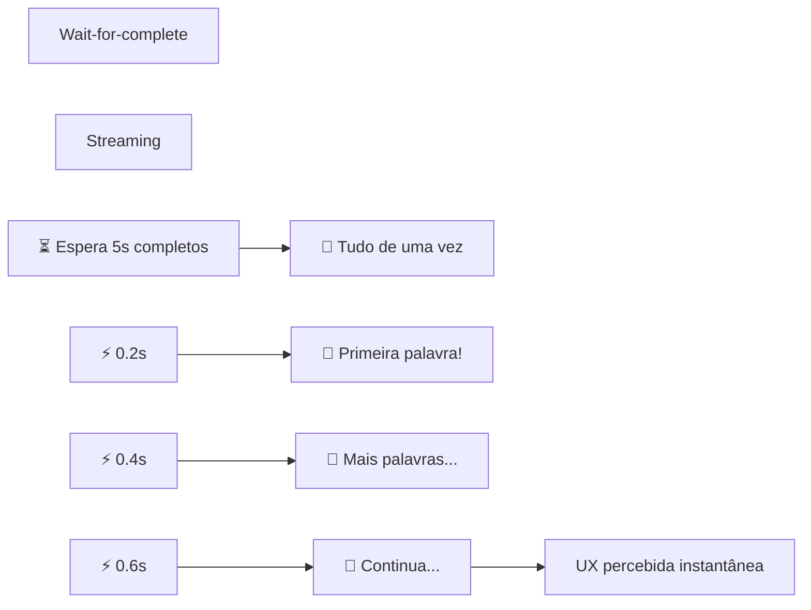

# Material Didático — P8: Streaming e Tempo Real

## ⚠️ Pré-requisito

Você precisa ter concluído o módulo [P7: Memória e Contexto](../p7_memory/MATERIAL.md). Especificamente, precisa saber:

- Como gerenciar contexto em agentes de longo prazo
- Patterns de memória de curto e longo prazo

---

## 🎯 Objetivos de Aprendizagem

Ao final deste módulo, você será capaz de:

- [ ] **Explicar** a diferença entre latência percebida vs real (por que streaming muda UX)
- [ ] **Implementar** Server-Sent Events (SSE) para enviar respostas progressivamente
- [ ] **Entender** o formato SSE no wire (text/event-stream, \n\n separator)
- [ ] **Implementar** abort/cancel para permitir que usuário cancele geração
- [ ] **Aplicar** buffering inteligente (2-4 tokens por envio) para evitar jitter aparente

> 💡 **Dica:** Streaming é pura psicologia do usuário. O tempo total pode ser o mesmo, mas ver progresso imediato muda completamente a percepção. É uma das melhorias de UX com maior ROI em qualquer aplicação de IA.

---

## Conceitos Fundamentais

### Por que Streaming?

Imagine esperar 5 segundos por uma resposta vs ver cada palavra aparecer em tempo real. A diferença na experiência do usuário é enorme.

```
Sem streaming:          Com streaming:
[....................] [Generating...]
                       [Generatin...g AI...]
                       [Generating AI Assistant]
Espera 5s              Usuário vê progresso
```

### Por que isso existe?

LLMs são lentos para gerar texto completo. Um modelo pode levar 3-10 segundos para escrever uma resposta razoável. Sem streaming, o usuário fica olhando para uma tela em branco sem saber se:

- O sistema travou
- Está processando
- Vai demorar mais

Com streaming, o usuário **vê progresso imediato** — a primeira palavra aparece em ~200ms. Isso muda completamente a percepção de velocidade, mesmo que o tempo total seja o mesmo.

Além da UX, streaming permite:

- **Abort/cancel**: usuário cancela geração se perceber que o agente está errado
- **Feedback visual**: indicador de carregamento natural
- **Responsividade**: interface não bloqueia enquanto gera

### Erros Comuns de Iniciantes

| Erro | Consequência | Correção |
| ------ | -------------- | ---------- |
| Gerar tudo antes de enviar | UX ruim, timeout em respostas longas | Usar SSE para enviar chunks progressivos |
| Não implementar abort | Usuário precisa recarregar página inteira | Implementar sinal de abort + verificar no loop |
| Enviar chunk por chunk sem buffer | Rede sobrecarregada, jitter aparente | Buffer de 2-4 tokens por envio |
| Esquecer de fechar conexão SSE | Vazamento de recursos no servidor | Sempre fechar após `done` ou erro |
| Não testar com rede lenta | Streaming parece travado em mobile | Testar com throttling (3G simulation) |

### Server-Sent Events (SSE)

Protocolo simples para enviar dados do servidor ao cliente em tempo real:

```
data: {"type": "chunk", "content": "Hello"}

data: {"type": "chunk", "content": ", I'm an AI"}

data: {"type": "done", "tokens": 15, "cost": 0.001}
```

Vantagens sobre WebSocket:

- **Unidirecional**: só servidor → cliente (suficiente para LLM responses)
- **HTTP nativo**: funciona com qualquer proxy/load balancer
- **Reconexão automática**: browser reconecta se cair
- **Mais simples**: menos código no servidor

### Abort/Cancel

Usuários podem querer cancelar geração:

```python
# Cliente envia sinal de abort
agent.abort()

# Servidor para de gerar
if agent._abort_event.is_set():
    yield "[ABORTADO PELO USUÁRIO]"
    return
```

### Latência Percebida vs Real

| Métrica | Sem Streaming | Com Streaming |
| --------- | -------------- | --------------- |
| Tempo até primeira palavra | 3s | 0.2s |
| Tempo total | 5s | 5s |
| UX | "Está travado?" | "Já está respondendo!" |

O tempo total é o mesmo, mas a percepção é completamente diferente.

### Como SSE Funciona no Wire

SSE não é mágica — é **HTTP com conexão mantida aberta** e um formato de texto simples:

```
HTTP/1.1 200 OK
Content-Type: text/event-stream
Cache-Control: no-cache
Connection: keep-alive
```

A conexão TCP permanece aberta e o servidor envia chunks periodicamente:

```
event: message
data: {"chunk": "Hello", "index": 0}

event: message
data: {"chunk": ", World", "index": 1}

event: done
data: {"total_tokens": 15, "cost": 0.001}
```

### 🏗️ Arquitetura do Pipeline Streaming

> Referência completa: [architecture.md](architecture.md)

O pipeline streaming é composto por 5 componentes:

```
[Cliente] ←── [SSE Server] ←── [LLM API]
    ↑              ↓              ↓
[Abort Signal] [Buffer Manager] [Token Counter]
```

| Componente | Responsabilidade | Parâmetro crítico |
| ------------ | ------------------ | ------------------- |
| **SSE Server** | Mantém conexão HTTP aberta + formata eventos | keep-alive timeout |
| **Buffer Manager** | Agrupa tokens em chunks (2-4 tokens) | buffer_size, flush_interval |
| **Token Counter** | Conta tokens acumulados + custo | max_tokens |
| **Abort Handler** | Verifica sinal de cancelamento | abort_event.is_set() |
| **LLM Generator** | Gera tokens um-a-um (async generator) | yield token |

**Fluxo completo:**

1. Cliente envia request → SSE Server abre conexão HTTP
2. LLM gera token 1 → Token Counter incrementa → Buffer Manager acumula
3. Buffer cheio (2-4 tokens) → SSE Server envia chunk formatado
4. Repete passos 2-3 até LLM terminar
5. SSE Server envia evento `done` com métricas finais
6. Se cliente envia abort → Abort Handler para geração

**Trade-off chave:** buffer maior = menos chunks mas mais delay inicial; buffer menor = mais responsivo mas mais overhead de rede.

## 🎬 O que você vai ver

**Regra crítica**: cada evento deve terminar com **duas quebras de linha** (`\n\n`). O cliente lê até encontrar `\n\n` e então processa o evento.

**Por que streaming é mais rápido que wait-for-complete?**



**Tempo até UX:** 0.2s (streaming) vs 5.0s (wait-for-complete)

O servidor usa `yield` (generator) para enviar cada chunk sem esperar o resto. No Python com FastAPI, isso é `StreamingResponse` + async generator.

## 🎬 O que você vai ver

Antes de rodar o código, aqui está uma prévia do que o programa vai fazer:

```
$ python modules/p8_streaming/run.py

📡 Iniciando streaming...

⏱️ 0.2s → "Olá! Aqui é seu assistente..."
⏱️ 0.4s → " Vou ajudar você com sua pergunta sobre IA."
⏱️ 0.6s → " Primeiramente, é importante entender que..."
⏱️ 0.8s → "...agentes de IA usam ferramentas externas..."
   ⚠️ Abort após 3 chunks — cancelado pelo usuário

📊 Formato SSE enviado:
   data: {"text": "Olá!", "done": false}
   data: {"text": " Vou ajudar", "done": false}
   data: {"text": "", "done": true}
```

## Exercício Prático

Execute `python modules/p8_streaming/run.py` e observe:

1. Como os chunks aparecem progressivamente no terminal
2. O indicador de tempo mostrando evolução
3. A demonstração de abort/cancel após 3 chunks
4. O formato SSE que seria enviado via HTTP

## Perguntas para Reflexão

1. Se você fosse implementar FastAPI + SSE, como seria o endpoint?
2. Quando abortar automaticamente? Que critérios seriam razoáveis?
3. Como calcular custo estimado antes de começar a gerar?

---

## 📌 Resumo do Módulo

Streaming é sobre percepção do usuário, não velocidade real:

1. **Latência percebida vs real** — usuário espera <2s para ver primeira palavra. Se esperar 10s sem nada, acha que travou. Streaming resolve percepção, não latência.

2. **SSE = protocolo simples** — servidor envia chunks `data: {"token": "..."}` via HTTP keep-alive. Cliente lê incrementalmente. Formato padrão da indústria.

3. **Buffering inteligente** — mostrar palavras completas (não caracteres) evita flickering. Buffer de 3-5 tokens = fluidez sem delay.

4. **Abort/cancel = controle do usuário** — se usuário percebe erro, pode cancelar geração. Implementar com asyncio.CancelledError e cleanup adequado.

5. **Custo estimado antes de gerar** — contar tokens do input, estimativa do output, custo por token. Alertar usuário ANTES de gastar $0.50 em resposta.

> ✅ **Você está pronto para:** Agora que respostas são responsivas, vamos otimizar custos com cache.

## ✅ Checklist: Como Saber Se Você Atingiu o Objetivo

Marque cada item **só se conseguir fazer sem olhar o material**:

- [ ] Explico por que streaming melhora a experiência do usuário (tempo percebido)
- [ ] Descrevo como SSE funciona (data: ... \n\n)
- [ ] Explico a diferença entre streaming e wait-for-complete
- [ ] Rodo `run.py` e observo os chunks aparecendo progressivamente
- [ ] Digo 2 casos onde streaming NÃO é necessário

> ⚠️ Se marcou menos de 3 itens, releia as seções correspondentes antes de prosseguir.

---

## 🔗 Próximos Passos

Com streaming, seus agentes respondem rapidamente. Mas respostas repetidas gastam tokens desnecessariamente — cache resolve isso.

→ Leia o módulo [P9: Caching](../p9_caching/MATERIAL.md) para aprender estratégias de cache e políticas de evicção.

---

## Referências

(empty)
