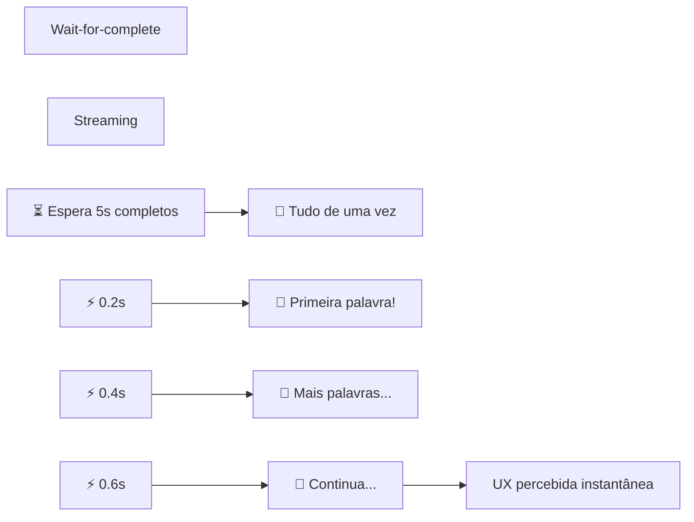

# Material Didático — P8: Streaming e Tempo Real

## ⚠️ Pré-requisito

Leia antes:

- [p0_fundamentals/MATERIAL.md](../p0_fundamentals/MATERIAL.md) — Fundamentos de IA e LLM
- [p4_production/MATERIAL.md](../p4_production/MATERIAL.md) — Produção com API

---

## Conceitos Fundamentais

### Por que Streaming?

Imagine esperar 5 segundos por uma resposta vs ver cada palavra aparecer em tempo real. A diferença na experiência do usuário é enorme.

```
Sem streaming:          Com streaming:
[....................] [Generating...]
                       [Generatin...g AI...]
                       [Generating AI Assistant]
Espera 5s              Usuário vê progresso
```

### Por que isso existe?

LLMs são lentos para gerar texto completo. Um modelo pode levar 3-10 segundos para escrever uma resposta razoável. Sem streaming, o usuário fica olhando para uma tela em branco sem saber se:

- O sistema travou
- Está processando
- Vai demorar mais

Com streaming, o usuário **vê progresso imediato** — a primeira palavra aparece em ~200ms. Isso muda completamente a percepção de velocidade, mesmo que o tempo total seja o mesmo.

Além da UX, streaming permite:

- **Abort/cancel**: usuário cancela geração se perceber que o agente está errado
- **Feedback visual**: indicador de carregamento natural
- **Responsividade**: interface não bloqueia enquanto gera

### Erros Comuns de Iniciantes

| Erro | Consequência | Correção |
| ------ | -------------- | ---------- |
| Gerar tudo antes de enviar | UX ruim, timeout em respostas longas | Usar SSE para enviar chunks progressivos |
| Não implementar abort | Usuário precisa recarregar página inteira | Implementar sinal de abort + verificar no loop |
| Enviar chunk por chunk sem buffer | Rede sobrecarregada, jitter aparente | Buffer de 2-4 tokens por envio |
| Esquecer de fechar conexão SSE | Vazamento de recursos no servidor | Sempre fechar após `done` ou erro |
| Não testar com rede lenta | Streaming parece travado em mobile | Testar com throttling (3G simulation) |

### Server-Sent Events (SSE)

Protocolo simples para enviar dados do servidor ao cliente em tempo real:

```
data: {"type": "chunk", "content": "Hello"}

data: {"type": "chunk", "content": ", I'm an AI"}

data: {"type": "done", "tokens": 15, "cost": 0.001}
```

Vantagens sobre WebSocket:

- **Unidirecional**: só servidor → cliente (suficiente para LLM responses)
- **HTTP nativo**: funciona com qualquer proxy/load balancer
- **Reconexão automática**: browser reconecta se cair
- **Mais simples**: menos código no servidor

### Abort/Cancel

Usuários podem querer cancelar geração:

```python
# Cliente envia sinal de abort
agent.abort()

# Servidor para de gerar
if agent._abort_event.is_set():
    yield "[ABORTADO PELO USUÁRIO]"
    return
```

### Latência Percebida vs Real

| Métrica | Sem Streaming | Com Streaming |
| --------- | -------------- | --------------- |
| Tempo até primeira palavra | 3s | 0.2s |
| Tempo total | 5s | 5s |
| UX | "Está travado?" | "Já está respondendo!" |

O tempo total é o mesmo, mas a percepção é completamente diferente.

### Como SSE Funciona no Wire

SSE não é mágica — é **HTTP com conexão mantida aberta** e um formato de texto simples:

```
HTTP/1.1 200 OK
Content-Type: text/event-stream
Cache-Control: no-cache
Connection: keep-alive
         ↓
[Conexão TCP permanece aberta]
         ↓
Servidor envia chunks periodicamente:

event: message
data: {"chunk": "Hello", "index": 0}

event: message
data: {"chunk": ", World", "index": 1}

event: done
data: {"total_tokens": 15, "cost": 0.001}
```

**Regra crítica**: cada evento deve terminar com **duas quebras de linha** (`\n\n`). O cliente lê até encontrar `\n\n` e então processa o evento.

**Por que streaming é mais rápido que wait-for-complete?**



**Tempo até UX:** 0.2s (streaming) vs 5.0s (wait-for-complete)

O servidor usa `yield` (generator) para enviar cada chunk sem esperar o resto. No Python com FastAPI, isso é `StreamingResponse` + async generator.

---

## Exercício Prático

Execute `python modules/p8_streaming/run.py` e observe:

1. Como os chunks aparecem progressivamente no terminal
2. O indicador de tempo mostrando evolução
3. A demonstração de abort/cancel após 3 chunks
4. O formato SSE que seria enviado via HTTP

## Perguntas para Reflexão

1. Se você fosse implementar FastAPI + SSE, como seria o endpoint?
2. Quando abortar automaticamente? Que critérios seriam razoáveis?
3. Como calcular custo estimado antes de começar a gerar?

---

## Referências

### Livros

- **"High Performance Python"** by Guido van Rossum & Jeff Bezanson — Capítulos sobre async programming

### Documentação Oficial

- [OpenAI Streaming API](https://platform.openai.com/docs/api-reference/streaming) — OpenAI Docs
- [Server-Sent Events Spec](https://html.spec.whatwg.org/multipage/server-sent-events.html) — W3C

### Tutoriais

- [Real-time Responses with FastAPI](https://fastapi.tiangolo.com/) — FastAPI Docs
- [Async Generators in Python](https://docs.python.org/3/library/asyncio-task.html) — Python Docs
